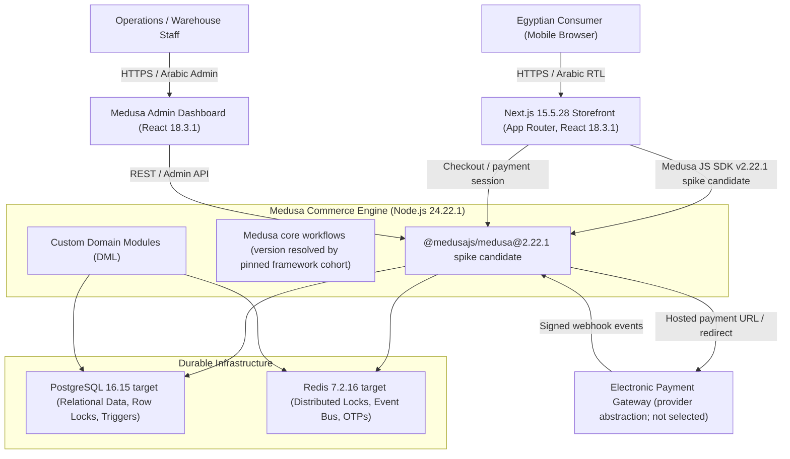

# Architecture & System Design
## Project: Arabic-First E-Commerce Store for Imported Food Products (Egypt)
**Document Status:** Revision 19 — Electronic Payment + COD and Phase 0 Design Closure (Design Revision; Runtime Unverified)  
**Date:** 2026-10-25  
**Current Review Decision:** **`PHASE 0 DESIGN ACCEPTED BY OWNER; RUNTIME EVIDENCE DEFERRED TO PHASE 1 SPIKE`**
*(Phase 0 closes on design/documentation consistency and recorded owner decisions and default assumptions (owner may change) only. A restricted Phase 1 Technical Compatibility Spike may run before Phase 0 sign-off for compatibility/evidence work only; store feature development remains blocked pending Spike evidence review and launch gates.)*

---

## 1. System Topology & Context

The platform delivers an Arabic-first direct-to-consumer e-commerce experience tailored specifically for the Egyptian market, featuring high-trust imported food products: packaged Zamzam water and packaged dates.



---

## 2. Canonical Module Ownership & Boundary Isolation

In Medusa v2, independent commerce modules maintain distinct business logic boundaries. Direct cross-module relational foreign keys are prohibited; cross-module references are stored as validated string IDs linked via Medusa Remote Links (`defineLink`):

| Module Name | Schema / Boundary | Owned Entities (Relational FKs Permitted Internally) | Cross-Module References (String IDs / Remote Links Only) |
|---|---|---|---|
| **Medusa Core Order** | Core Framework | `Order`, `OrderItem`, `OrderLineItem`, `OrderAddress` | Native core tables. |
| **`batch_inventory`** | Custom Module | `supplier`, `inventory_location`, `inventory_batch`, `inventory_movement`, `cost_adjustment`, `cart_batch_reservation`, `order_batch_allocation`, `cart_checkout_session`, `cart_checkout_attempt` | `variant_id` (Product Module), `cart_id` (Cart Module), `order_id` / `line_item_id` (Order Module). |
| **`order_operations`** | Custom Module | `order_operational_state`, `shipment_record`, `delivery_attempt`, `cod_collection_record`, `electronic_payment_attempt`, `payment_webhook_event`, `return_request`, `return_item`, `refund_record` | `order_id` (Order Module), `line_item_id` (Order Module), `batch_id` (batch_inventory Module); native payment-provider sessions remain behind the Medusa Payment Module/provider abstraction. |
| **`shipping_zones`** | Custom Module | `shipping_delivery_zone` | `shipping_option_id` (Fulfillment Module). |
| **`system_security`** | Custom Module | `idempotency_key`, `audit_log`, `private_document` | Generic entity references (`actor_id`, `entity_id`). |

### 2.1 Two-Tier Enforcement Architecture (Application vs Database)
In Medusa v2 default configuration, all modules share a single PostgreSQL database instance and schema (`public`). This creates an architectural distinction that must be managed cleanly:
- **Tier 1 (Application / Workflow Layer):** Every workflow (`createReturnRequestWorkflow`, `completeCheckoutWorkflow`, etc.) respects strict module encapsulation, accessing entities across modules exclusively through public module service methods and Medusa Remote Queries (`query.graph`). Direct SQL joins across module tables are never used in application services.
- **Tier 2 (Database Defense-in-Depth Layer):** Critical PostgreSQL triggers (`trg_check_return_quantity`, `trg_check_return_request_reactivation`) execute directly inside PostgreSQL across `order_item`, `order_batch_allocation`, and `return_item`. Because they execute within the shared PostgreSQL instance, they provide physical data integrity guarantees against concurrent race conditions, while remaining classified as database-level defense-in-depth rather than domain application logic.

---

## 3. Pinned Technology Version Matrix

**Phase 1 spike candidate-cohort update (2026-10-26):** Phase 0 originally selected 2.21.2. Phase 1 uses exact Medusa 2.22.1 pins. Code commit 4ad59a6 passed strict install, metadata/tree checks, lint, migrations, both builds, TP-02a/02b/02c/03 and rollback in disposable CI services. These are compatibility and narrow component/workflow results, not independent acceptance. TP-02c/TP-03 lack HTTP 409 coverage; TP-03 inventory evidence is table-wide on an empty cart. See docs/phase1-tp-case-matrix.md. Store feature development remains blocked.

| Component | Candidate pin / support stream | Rationale and evidence status |
|---|---|---|
| Backend runtime | Node.js `24.22.1` LTS | CI selects the exact version from `.nvmrc`. The current local environment is Node `24.15.0`, which does not satisfy the root `24.22.x` engine; local clean install is therefore blocked. `[VERIFIED-DOCS]`; application compatibility evidenced only by CI baseline. |
| Medusa framework | `@medusajs/framework@2.22.1` | Exact version listed on npm on 2026-10-25. Chosen as common stable cohort pending lockfile/peer-resolution and build checks. `[SOURCE-VERIFIED: package exists]`; integration `[PROPOSED]`. |
| Medusa server | `@medusajs/medusa@2.22.1` | Exact version listed on npm on 2026-10-25. Must be resolved with framework as a compatible pair. `[SOURCE-VERIFIED: package exists]`; integration `[PROPOSED]`. |
| Medusa CLI | `@medusajs/cli@2.22.1` | Exact version listed on npm on 2026-10-25; retain only if compatible with the selected framework/server peer requirements. `[SOURCE-VERIFIED: package exists]`; integration `[PROPOSED]`. |
| Medusa Store SDK | `@medusajs/js-sdk@2.22.1` | Exact version listed on npm on 2026-10-25, selected to match the candidate server cohort. `[SOURCE-VERIFIED: package exists]`; storefront integration `[PROPOSED]`. |
| Medusa internal workflow/locking modules | Resolved through the selected Medusa packages and lockfile; do not independently pin undocumented internal packages unless directly imported and published as standalone dependencies | Use the exact `2.22.1` direct pins present in the current spike branch; validate transitive resolution, import paths, and runtime behavior from the generated lockfile and CI artifacts. `[PROPOSED]`. |
| Storefront framework | Next.js `15.5.28` | Exact patched 15.5-line candidate. Verify compatibility with the React versions resolved in the lockfile and execute the production build. `[SOURCE-VERIFIED: package exists]`; build `[PROPOSED]`. |
| UI runtime | `react@18.3.1` and `react-dom@18.3.1` | Exact pins are shared across backend and storefront in the current manifests and lockfile to satisfy the tested Medusa/Next.js cohort. CI and local storefront production builds pass; application integration remains a prototype candidate. |
| Database | PostgreSQL `16.15` target | Current PostgreSQL 16 minor release listed in official version policy on 2026-10-25. Pin image/package digest in deployment configuration before acceptance. `[VERIFIED-DOCS]`; migrations/tests `[PROPOSED]`. |
| Cache and distributed locks | Redis `7.2.16` target | Patch-level target for reproducibility; resolve to an immutable image digest in deployment config. Lock renewal and concurrency remain `[PROPOSED]` until tested. |
| Tailwind CSS | `3.4.17` candidate | Existing design pin; verify lockfile installation and production build. `[PROPOSED]`. |
| Zod | `3.23.8` candidate | Existing design pin; no claim that this is the latest version. Verify against current security review and lockfile before release. `[PROPOSED]`. |
| Medusa UI package | No direct pin unless a custom admin extension imports it | Its versioning is independent of the Medusa server packages. If used directly, choose a compatible version from peer metadata and pin it in the lockfile; do not reuse an old guessed version. `[PROPOSED]`. |

**Mandatory compatibility evidence before Phase 1 spike acceptance:** capture `npm view <package>@<version> version peerDependencies engines`, commit the generated package lockfile, run `npm ci`, `npm ls --all` (or the package-manager equivalent), `medusa build`, and the storefront production build. Any peer conflict, duplicate incompatible Medusa core package, missing package, or build failure blocks compatibility sign-off. No such commands are claimed to have been run by this documentation revision.

**Source pages consulted (2026-10-25):** [Node.js release index](https://nodejs.org/en/blog/release), [PostgreSQL versioning policy](https://www.postgresql.org/support/versioning/), [@medusajs/framework on npm](https://www.npmjs.com/package/%40medusajs/framework), [@medusajs/medusa on npm](https://www.npmjs.com/package/%40medusajs/medusa), [@medusajs/cli on npm](https://www.npmjs.com/package/%40medusajs/cli), [@medusajs/js-sdk on npm](https://www.npmjs.com/package/%40medusajs/js-sdk), [React on npm](https://www.npmjs.com/package/react), [React DOM on npm](https://www.npmjs.com/package/react-dom).

---

## 4. Checkout Locking, Idempotency Lease & Epoch-Fencing Protocol

### 4.1 Locking Step Types & Nested Sub-Workflow Behavior

In Medusa v2, distributed locking is provided through the configured locking provider and exported core workflow steps. The current Revision 19 candidate cohort uses `@medusajs/framework@2.22.1`, `@medusajs/medusa@2.22.1`, and `@medusajs/cli@2.22.1`; the exact resolved lock-step implementation must be re-inspected in those installed packages before relying on implementation-specific behavior.

**API shape reference (must be revalidated against the candidate `2.22.1` installed source before implementation):**

```typescript
// @medusajs/core-flows/dist/locking/steps/acquire-lock.d.ts:
export interface AcquireLockStepInput {
  key: string | string[];         // Resource key(s) to lock (e.g. "cart:" + cart.id)
  timeout?: number;               // Max seconds to wait to acquire (default: 0)
  retryInterval?: number;         // Seconds between retry attempts (default: 0.3)
  ttl?: number;                   // Lock expiration in seconds; extends if owner matches
  ownerId?: string;               // Owner ID; only owner can release or extend
  provider?: string;              // Locking provider (configured in medusa-config.ts)
  executeOnSubWorkflow?: boolean; // If true, executes even when parentStepIdempotencyKey exists
}

// @medusajs/locking-redis/dist/services/redis-lock.d.ts:
type LockCommands = {
  acquireLock: (key: string, ownerId: string, ttl: number, awaitQueue?: boolean) => Promise<number>;
  releaseLock: (key: string, ownerId: string) => Promise<number>;
  extendLock: (key: string, ownerId: string, ttl: number) => Promise<number>;
};
```

> **Sub-Workflow Lock Skip Semantics:**  
> The `2.22.1` source and real-Redis regression have both been inspected. The implementation's parallel multi-key acquisition without rollback, `awaitQueue` branch that bypasses same-owner renewal, and non-atomic owner-read/`UNLINK` sequence align with the failures in partial-acquire cleanup, same-owner re-entry, reverse-order acquisition, and owner-safe `releaseAll`. These behaviors are not accepted until resolved with reproducible evidence:
> ```javascript
> const isSubWorkflow = !!parentStepIdempotencyKey;
> if (isSubWorkflow && !data.executeOnSubWorkflow) {
>     return workflows_sdk_1.StepResponse.skip();
> }
> ```
> When `completeCartWorkflow` executes inside `completeCheckoutWorkflow` via `.runAsStep()`, `parentStepIdempotencyKey` is present and `executeOnSubWorkflow` is false. Therefore, **`completeCartWorkflow` skips its internal lock acquisition**. The parent checkout workflow `completeCheckoutWorkflow` **must acquire the lock on `cart.id`**; otherwise, checkout executes with zero locking protection. `[SOURCE-VERIFIED]`

---

### 4.2 Explicit Separation of Redis Lock from PostgreSQL Lease

A distributed Redis lock and a PostgreSQL execution lease serve distinct purposes and must not be conflated:
1. **Redis Cart Lock:** Fast distributed mutual exclusion across application instances to serialize concurrent requests on the same cart (`key = "cart:" + cart_id`, `ttl = 120s`, `timeout = 5s`).
2. **PostgreSQL Idempotency Lease:** Durable execution authority tied to an idempotency key and attempt identity in `idempotency_key` (`lease_owner_id = "worker:" + checkout_attempt_id + ":" + worker_pid_uuid`, `last_heartbeat_at = NOW()`).

#### Renewal, Heartbeat, and Lock-Loss Protocol:
- **Lock Renewal API:** `@medusajs/locking-redis` defines the custom Redis Lua command `extendLock(key, ownerId, ttl)`. It validates that `redis.call('GET', key) == ownerId` before executing `EXPIRE key ttl`. It returns `1` if extended, and `0` if the lock expired or is owned by someone else.
- **Worker Heartbeat Execution Loop:** The checkout worker maintains a background timer every 30 seconds (`HEARTBEAT_INTERVAL = 30s`):
  1. **Step 1 (Redis Extension):** The worker calls `redisClient.extendLock("cart:" + cart_id, worker_owner_id, 120)`.
  2. **Step 2 (Lock-Loss Detection):** If Redis returns `0` (lock lost, key evicted, or stolen) or Redis connection fails:
     - The worker immediately trips an internal `AbortController` (`signal.abort("LOCK_LOST")`).
     - The worker marks its in-memory status as `ABORTED_LOCK_LOST`.
     - **The worker REFUSES to update PostgreSQL heartbeat.** A worker that lost its Redis lock is prohibited from extending its PostgreSQL lease.
  3. **Step 3 (PostgreSQL Lease Heartbeat):** Only if Redis returned `1` does the worker execute:
     ```sql
     UPDATE idempotency_key
     SET locked_at = NOW(),
         last_heartbeat_at = NOW()
     WHERE key = :idempotency_key
       AND lease_owner_id = :worker_owner_id
       AND status = 'pending';
     ```
- **120-Second Timeout is a Recovery Threshold:** A lease older than 120 seconds is not treated as proof that a worker is dead. It is a threshold authorizing a recovery controller or newer attempt to safely fence off the previous worker.
- **CAS Abort on Redis Lock Acquisition Failure:** If Stage 1 (PostgreSQL lease acquisition) succeeds but Stage 2 (Redis lock acquisition) times out (>5s), the worker executes a compare-and-set deletion of its pending lease before returning 409 Conflict:
  ```sql
  DELETE FROM idempotency_key
  WHERE key = :idempotency_key
    AND lease_owner_id = :worker_owner_id
    AND status = 'pending';
  ```
  This prevents orphaned pending leases from blocking immediate retries.
- **Cross-Key Cart Collision Guard:** If a request arrives with a *different* idempotency key while an execution is active:
  - The worker checks `cart_checkout_session` and `cart_checkout_attempt`.
  - If `cart_checkout_session.status = 'in_progress'` and the current attempt's lease heartbeat is newer than 120 seconds (`last_heartbeat_at > NOW() - INTERVAL '120 seconds'`), the request is rejected immediately with `409 Conflict ("Cart checkout currently in progress by another request")`.
  - A new request cannot preempt a live attempt.

---

### 4.3 Safe Cart Mutation Protection

To prevent cart item alterations while checkout is underway:
- **Cart Mutation Policy:** All cart modification endpoints (`POST /store/carts/:id/line-items`, `POST /store/carts/:id/shipping-methods`, etc.) must acquire the Redis cart lock (`timeout = 2s, ttl = 15s`) and check `cart_checkout_session`:
  - **If `status = 'in_progress'`:** Mutation is **strictly rejected** with `409 Conflict ("Cart checkout currently in progress; mutations are locked")`.
  - **A timestamp becoming old NEVER authorizes mutation directly.** A client cannot modify a cart simply because 120 seconds have elapsed.
  - **Stuck Session Recovery:** A stuck session can only be recovered through an explicit administrative or client recovery action (`POST /store/carts/:id/abort-checkout`). The recovery controller:
    1. Verifies that the previous attempt's lease heartbeat is dead (`last_heartbeat_at < NOW() - INTERVAL '120 seconds'`).
    2. Acquires the Redis cart lock.
    3. Fences off the stale attempt by incrementing the epoch:
       ```sql
       UPDATE cart_checkout_session
       SET status = 'aborted',
           epoch = epoch + 1,
           updated_at = NOW()
       WHERE cart_id = :cart_id
         AND status = 'in_progress'
         AND epoch = :expected_epoch;
       ```
    4. Marks `cart_checkout_attempt.attempt_status = 'aborted'`.
    5. Releases cart batch reservations with the canonical hashed `reservation_release`/`saga_cancel` movement key.
    Only after the session is durably transitioned to `aborted` are cart mutations permitted.
  - **If `status = 'completed'`:** Mutation is **permanently blocked** (`409 Conflict: Cart has already been converted to an order`).

---

### 4.4 Initial Checkout Response vs. Idempotent Replay Response

The initial HTTP `201` response and the durable idempotency response are deliberately different. The initial response may include the one-time plaintext claim code exactly once; that transient value is never written to PostgreSQL, logs, audit payloads, or a replayable response cache. Before completing the idempotency row, build a sanitized `response_body`, for example `{ "order_ref": "...", "claim_available": false, "next_action": "phone_otp_lookup" }`, with the safe order reference and other non-secret fields only. Store the original `response_code` (normally `201`) separately. The retry returns the same order identity and status semantics using the sanitized body, does not generate a new claim code, and performs no inventory, checkout, or order mutations. This is **semantic replay**, not byte-for-byte equality with the first transient response.

### 4.5 Immutable Per-Attempt Entity (`cart_checkout_attempt`)

Revision 11 stored a mutable `order_id` directly on `cart_checkout_session`. Because order creation and database binding are separated by distributed boundaries, retries and stale workers could race to overwrite or cancel orders.

Revision 12 separates session tracking from attempt execution:
1. **`cart_checkout_session` (Cart-Level Pointer):** Holds `cart_id`, `epoch`, `current_attempt_id`, and `status`.
2. **`cart_checkout_attempt` (Immutable Attempt History):** Records every individual execution attempt:
   - `checkout_attempt_id UUID PRIMARY KEY`
   - `cart_id VARCHAR(255) NOT NULL REFERENCES cart_checkout_session(cart_id)`
   - `epoch INT NOT NULL`
   - `idempotency_key VARCHAR(255) NOT NULL`
   - `lease_owner_id VARCHAR(255) NOT NULL`
   - `attempt_status VARCHAR(50) NOT NULL` (`initiated`, `reserved`, `order_creation_started`, `order_created`, `allocated`, `completed`, `needs_reconciliation`, `aborted`, `failed`)
   - `order_id VARCHAR(255) NULL UNIQUE`
   - `order_correlation_status VARCHAR(50) NOT NULL DEFAULT 'none'` (`none`, `pending_correlation`, `correlated`, `needs_reconciliation`, `cancelled`)
   - `failure_reason TEXT NULL`
   - `created_at TIMESTAMPTZ NOT NULL DEFAULT NOW()`
   - `updated_at TIMESTAMPTZ NOT NULL DEFAULT NOW()`
   - `completed_at TIMESTAMPTZ NULL`
   - `CONSTRAINT uq_attempt_cart_epoch UNIQUE (cart_id, epoch)`

#### Order Binding, Correlation, and Cancellation Safety (Revision 18 contract carried forward in Revision 19; runtime unverified)

Medusa's `completeCartWorkflow.runAsStep` input is the workflow input object, not an arbitrary sibling-level `metadata` field. Use the documented call shape:

```typescript
const result = await completeCartWorkflow.runAsStep({ input: { id: cart.id } })
```

Do **not** assume this call accepts or atomically persists `checkout_attempt_id` in order metadata. The durable recovery anchor is the native order's `cart_id`, queried through Medusa's public Remote Query/API, plus the durable pre-call state in `cart_checkout_attempt`. Order metadata may be written later only through a separately supported API and is secondary diagnostic information; it is not required for correlation.

**Before calling native order completion**, persist and commit:

```sql
UPDATE cart_checkout_attempt
SET attempt_status = 'order_creation_started',
    order_correlation_status = 'pending_correlation',
    updated_at = NOW()
WHERE checkout_attempt_id = :attempt_id
  AND attempt_status = 'reserved'
  AND order_id IS NULL;
-- Require exactly one affected row. Persist a workflow execution ID if the
-- installed Medusa version exposes one through a supported public contract.
```

Invoke `completeCartWorkflow.runAsStep({ input: { id: cart.id } })`. If it returns a valid order ID, first verify through the supported Medusa public query that the native order belongs to this cart, then correlate it in a new guarded transaction. If the workflow times out, throws after an uncertain side effect, or returns no usable order ID, do not assume that no order exists.

**Successful result binding (application transaction outline):**

```sql
BEGIN;
-- The native order already exists. The supported public query has identified
-- :order_id, so serialize existing-order custom workflows before any row lock.
SELECT pg_advisory_xact_lock(
  hashtextextended('phase0:order:' || :order_id::text, 0)
);

SELECT epoch, current_attempt_id, status
FROM cart_checkout_session
WHERE cart_id = :cart_id
FOR UPDATE;
-- Require status='in_progress', epoch=:expected_epoch,
-- current_attempt_id=:attempt_id.

SELECT cart_id, epoch, attempt_status, order_id, order_correlation_status
FROM cart_checkout_attempt
WHERE checkout_attempt_id = :attempt_id
FOR UPDATE;
-- Require cart_id=:cart_id, epoch=:expected_epoch,
-- attempt_status='order_creation_started',
-- order_correlation_status='pending_correlation', and order_id IS NULL.
-- Before entering this transaction, a supported Medusa public query must have
-- confirmed exactly one native Order whose cart_id=:cart_id and id=:order_id.

UPDATE cart_checkout_attempt
SET order_id = :order_id,
    attempt_status = 'order_created',
    order_correlation_status = 'correlated',
    updated_at = NOW()
WHERE checkout_attempt_id = :attempt_id
  AND cart_id = :cart_id
  AND epoch = :expected_epoch
  AND attempt_status = 'order_creation_started'
  AND order_correlation_status = 'pending_correlation'
  AND order_id IS NULL;
-- Require exactly one affected row. The unique order_id constraint and the
-- session/attempt row locks protect the binding. Otherwise ROLLBACK and re-read.
COMMIT;
```

If an exact binding already exists for the same order/attempt/epoch, treat it as a read-only replay only after verifying the native order/cart relationship and the full current binding. If the attempt is already bound to a different order, the order belongs to another cart, or any compare-and-set affects zero or multiple rows, roll back and enter the defined divergence/reconciliation path; do not overwrite the existing binding.

**Recovery rules:**

1. Query native orders for the cart by `cart_id` using a supported Medusa public query. Do not require `order.metadata.checkout_attempt_id`.
2. If exactly one order exists and exactly one current unresolved attempt has `attempt_status='order_creation_started'`, `order_correlation_status='pending_correlation'`, the same cart/epoch, and no existing `order_id`, bind that order using the guarded transaction above. If the candidate attempt or session is already in a reconciliation-only state, do not silently auto-bind; follow the reconciliation decision table.
3. If zero orders exist but the native workflow invocation is still in-flight, has unknown outcome, or cannot be proven failed/compensated, keep the attempt in `pending_correlation`/`needs_reconciliation`. Retry only the read/reconciliation check after a bounded delay. **Do not start a second native order, advance the epoch, release the old reservation set, or cancel anything while the order outcome remains unknown.**
4. If the native workflow is authoritatively failed/compensated and no order exists, record the failed attempt, release reservations idempotently through the inventory protocol, and only then allow the recovery controller to decide whether a fresh epoch is permitted.
5. If multiple orders exist, multiple unresolved attempts can claim the same order, or an order exists without a unique compatible attempt, set `order_correlation_status='needs_reconciliation'`, stop automatic mutation, and raise `CRITICAL_ORDER_AMBIGUITY` for manual reconciliation. Never create another order blindly.
6. A stale worker may not cancel an order based only on its local workflow result. Cancellation requires an authoritative correlated `order_id`, the matching attempt/epoch, and an explicit recovery policy showing that the order is safe to cancel. Unknown correlation is a hard stop, not permission to cancel.

The workflow return shape, `cart_id` query behavior, invocation status observation, and binding mutation must be demonstrated in the current Revision 19 candidate cohort during TP-08a/TP-08b/TP-13c. The actual package cohort is provisional until metadata, installation, and build evidence is captured. Until then this entire mechanism remains `[PROPOSED]`.

---

### 4.6 Complete Reservation-to-Allocation Conversion

`convertCartReservationsToAllocationsStep` uses one managed PostgreSQL transaction. The SQL below is an executable-contract outline: named assertions/variables are application transaction code, not PostgreSQL built-ins. It must be implemented with the same transaction handle for every SQL statement.

**Critical atomicity rule:** allocation rows, informational `allocation_conversion` ledger rows, reservation transitions to `converted`, and attempt/session finalization are one transaction. A committed conversion is recovered by validating the complete committed state; the workflow never treats an existing movement row by itself as proof that conversion completed.

```text
BEGIN;

-- The order is already created/correlated. The caller obtained :order_id by a
-- supported non-locking Medusa query before this transaction. Revalidate that
-- association through the supported API after acquiring the shared custom-flow
-- serialization root; do not issue direct cross-module order joins here.
SELECT pg_advisory_xact_lock(
  hashtextextended('phase0:order:' || :order_id::text, 0)
);

-- A. Acquire workflow-level authority locks before inventory locks, after the
-- order advisory root required for every existing-order workflow.
SELECT epoch, current_attempt_id, status
FROM cart_checkout_session
WHERE cart_id = :cart_id
FOR UPDATE;

SELECT attempt_status, order_id
FROM cart_checkout_attempt
WHERE checkout_attempt_id = :attempt_id
FOR UPDATE;

-- If session.status='completed' AND attempt_status='allocated':
--   Validate that all expected reservation rows are converted, every expected
--   allocation exists exactly once, and every expected conversion movement exists
--   with matching semantic attributes. If all pass, return ALREADY_COMMITTED
--   without inventory/allocation writes; downstream recovery may continue.
--   If any component is missing, extra, or contradictory, ROLLBACK and raise
--   INVENTORY_CONVERSION_STATE_DIVERGENCE. Never rerun conversion inserts.

-- B. For a new conversion, require the authoritative attempt to be current.
-- session.status must be 'in_progress'; attempt_status must be 'order_created';
-- order_id must equal :order_id; epoch/current_attempt_id must match request.
-- Otherwise ROLLBACK with STALE_CHECKOUT_ATTEMPT or INVALID_ATTEMPT_STATUS.

-- C. Determine all batch IDs referenced by ANY reservation for this attempt,
-- without locking reservation rows. All reservation creation for this attempt
-- must serialize through the session lock; no new rows may be added after
-- attempt_status becomes 'order_created'.
SELECT DISTINCT batch_id
FROM cart_batch_reservation
WHERE checkout_attempt_id = :attempt_id
ORDER BY batch_id ASC;
-- Capture as :attempt_batch_ids. An empty set is an error.

-- D. Lock all affected batches first, in deterministic ascending ID order.
SELECT id, quantity_on_hand, quantity_reserved, quantity_quarantined
FROM inventory_batch
WHERE id = ANY(:attempt_batch_ids)
ORDER BY id ASC
FOR UPDATE;
-- Assert every requested batch ID was found exactly once. The transaction keeps
-- the FOR UPDATE locks held until commit; subsequent reads of these batch rows
-- are the source for movement snapshots.

-- E. Lock every reservation belonging to the attempt, including non-active rows,
-- after batch locks. Revalidate the entire set rather than silently filtering rows.
SELECT id, checkout_line_key, batch_id, variant_id, quantity,
       expires_at, status
FROM cart_batch_reservation
WHERE checkout_attempt_id = :attempt_id
ORDER BY id ASC
FOR UPDATE;
-- Assert every reservation batch_id belongs to :attempt_batch_ids.
-- For a NEW conversion, every row required for the order must be active and
-- expires_at > transaction_timestamp; otherwise abort and recover/release via
-- the separately specified recovery path. Capture exactly the validated IDs in
-- :validated_cbr_ids. Validate required line keys and summed quantities.

-- F. A partially persisted conversion is not a safe replay. Because conversion
-- writes are atomic, on the new-conversion path any pre-existing allocation for
-- this order/attempt or any pre-existing expected allocation_conversion movement
-- is an integrity divergence unless the complete committed-state branch above
-- has already validated it. Compare the semantic fields before raising a
-- collision; never rely on NOT EXISTS to hide existing rows.
-- For every expected key built by the shared movement-key helper:
--   no row -> continue new conversion
--   matching row in a non-committed state -> ROLLBACK with
--      INVENTORY_CONVERSION_STATE_DIVERGENCE
--   mismatching row -> ROLLBACK with 409 DEDUPLICATION_KEY_COLLISION_ATTRIBUTE_MISMATCH

-- G. Verify deterministic line mapping. Build expected rows from only
-- :validated_cbr_ids; require exactly one matching active order line by
-- checkout_line_key for every validated reservation. Obtain :active_order_version
-- from the authoritative order record and validate it before this query. Require the expected
-- allocation key (order_id, line_item_id, batch_id) to be absent on this path.
-- If any line is missing/ambiguous, ROLLBACK with UNMAPPED_OR_AMBIGUOUS_LINE_ITEM.

-- H. Insert allocations using only the validated reservation set.
INSERT INTO order_batch_allocation (
    id, order_id, order_version, line_item_id, batch_id, checkout_line_key,
    quantity_allocated, allocation_status, allocated_at
)
SELECT
    'alloc_' || gen_random_uuid(), :order_id, :active_order_version, oli.id, cbr.batch_id,
    cbr.checkout_line_key, cbr.quantity, 'allocated', NOW()
FROM cart_batch_reservation cbr
JOIN order_line_item oli
  ON (oli.metadata->>'checkout_line_key')::uuid = cbr.checkout_line_key
JOIN order_item oi
  ON oi.order_id = :order_id
 AND oi.version = :active_order_version
 AND oi.item_id = oli.id
WHERE cbr.id = ANY(:validated_cbr_ids);
-- Assert inserted allocation count equals COUNT(:validated_cbr_ids), and that
-- grouped quantities per (line_item_id, batch_id) exactly equal the expected
-- reservation aggregates. Persist order_version on each allocation. Any mismatch
-- rolls back the whole transaction.

-- I. Insert one informational 0-delta movement per validated reservation using
-- the locked batch row. The movement key is supplied by the shared helper:
-- movementDedupKey({ movementType: 'allocation_conversion',
--   batchId: :batch_id, referenceType: 'order_allocation',
--   referenceId: :order_id, operationSubkey: :checkout_line_key }).
-- Since delta is zero, before and after snapshots are identical and are read
-- from the retained locked row. Do not use NOT EXISTS as replay control.
INSERT INTO inventory_movement (
    id, deduplication_key, batch_id, variant_id, movement_type,
    quantity_on_hand_delta, quantity_reserved_delta, quantity_quarantined_delta,
    quantity_on_hand_before, quantity_on_hand_after,
    quantity_reserved_before, quantity_reserved_after,
    quantity_quarantined_before, quantity_quarantined_after,
    reference_type, reference_id, reason, actor_id, created_at
)
SELECT
    'mov_' || gen_random_uuid(),
    :dedup_key_by_reservation_id[cbr.id],
    cbr.batch_id, cbr.variant_id, 'allocation_conversion',
    0, 0, 0,
    ib.quantity_on_hand, ib.quantity_on_hand,
    ib.quantity_reserved, ib.quantity_reserved,
    ib.quantity_quarantined, ib.quantity_quarantined,
    'order_allocation', :order_id, NULL, 'SYSTEM', NOW()
FROM cart_batch_reservation cbr
JOIN inventory_batch ib ON ib.id = cbr.batch_id
WHERE cbr.id = ANY(:validated_cbr_ids);
-- Step D already acquired FOR UPDATE locks on every affected batch and those
-- locks remain held by this transaction. This join reads rows locked earlier;
-- the JOIN itself does not acquire the locks. Do not commit between D and I.
-- Assert movement count equals COUNT(:validated_cbr_ids).

-- J. Transition exactly the validated reservation set. No unrelated row may move.
UPDATE cart_batch_reservation
SET status = 'converted', converted_at = NOW(), updated_at = NOW()
WHERE id = ANY(:validated_cbr_ids)
  AND status = 'active'
  AND expires_at > NOW();
-- Assert affected rows equals COUNT(:validated_cbr_ids); otherwise roll back.

UPDATE cart_checkout_attempt
SET attempt_status = 'allocated', updated_at = NOW()
WHERE checkout_attempt_id = :attempt_id AND attempt_status = 'order_created'
  AND order_id = :order_id;
-- Assert exactly one row updated.

UPDATE cart_checkout_session
SET status = 'completed', updated_at = NOW()
WHERE cart_id = :cart_id AND epoch = :epoch
  AND current_attempt_id = :attempt_id AND status = 'in_progress';
-- Assert exactly one row updated.

COMMIT;
```

**Recovery semantics:**

- **No conversion committed:** the transaction rollback leaves no conversion allocations, conversion movements, or converted reservation statuses. Retry starts from validation and locking again.
- **Conversion committed, downstream not initialized:** validate the complete committed state (`attempt_status='allocated'`, session state, converted reservations, exact allocations, exact movement set and semantic fields), perform no conversion writes, then resume downstream initialization.
- **Movement exists while reservation is active, or movement/allocation/reservation state is incomplete:** treat as `INVENTORY_CONVERSION_STATE_DIVERGENCE`; do not silently skip an insert or re-run allocation creation.
- **Exact completed state:** return/recover without additional balance mutations, allocation rows, or ledger rows.

Any SQL relation or helper variable shown with a colon prefix is an application-supplied value/result. The implementation must use the canonical schema and one transaction manager; this outline is not evidence of runtime execution.


---

## 5. Deterministic Cart-to-Order Line Item Mapping

### 5.1 Real Order Module Schema & Ordered Quantity

In Medusa v2 Order Module:
- `Order` links to `OrderItem` records via `order_id` and `version`.
- `OrderItem` holds the **authoritative ordered quantity** (`quantity: BigNumber`), version, and references `item_id` (foreign key to `OrderLineItem`).
- `OrderLineItem` stores catalog details (title, variant_id, unit_price, metadata). It does **NOT** store the ordered quantity column.

### 5.2 Server-Generated `checkout_line_key` Mapping

To ensure deterministic, tamper-proof mapping between cart lines and order lines:
1. When a line item is added to the cart, the backend generates a trusted UUID `checkout_line_key` stored in `line_item.metadata`.
2. Every `cart_batch_reservation` persists this exact `checkout_line_key UUID NOT NULL`.
3. A source inspection recorded in an earlier revision is not treated as evidence that the current Revision 19 candidate dependency graph preserves `item.metadata` or exposes a particular order-creation behavior. Re-inspect the exact installed candidate cohort and retain reproducible source references during the compatibility spike. Until then, do not rely on metadata copying to correlate orders; the documented recovery protocol is based on durable pre-call attempt state, supported queries by native `cart_id`, and fail-closed handling of ambiguous outcomes.
4. `convertCartReservationsToAllocationsStep` maps order line items to batch reservations by joining `oli.metadata->>'checkout_line_key' = cbr.checkout_line_key::text`.
5. **Split-Batch Allocation Support:** Multiple reservation rows can share the same `checkout_line_key` with different `batch_id` values. The conversion step verifies that:
   $$\sum \text{quantity\_allocated} = \text{order\_item.quantity}$$
   Any quantity discrepancy rolls back the conversion transaction, aborts the saga, and cancels the order.
6. **Safe Failure Rule:** If `checkout_line_key` is missing or duplicate, the workflow refuses to guess based on line sequence and raises `AMBIGUOUS_LINE_MAPPING`. Compensation may cancel the order only after the order is authoritatively bound to this attempt and the recovery controller confirms cancellation is permitted. Release reservations only after cancellation/compensation is definitively confirmed. If cancellation or correlation has an unknown outcome, set `needs_reconciliation`, retain the inventory/epoch fence, and return a pending/retryable response (503/202); never release stock or create a second order blindly.

---

## 6. Shipping Zone Integration and Currency Precision

### 6.1 Currency Units & Precision (Medusa v2 Major Currency Units)

> **Currency Precision Rule:** Medusa v2 prices and calculated shipping amounts are represented in **major currency units** (`number`, supporting decimals), not minor units (cents/piasters). For Egyptian Pounds (EGP), a flat delivery rate of `50.00 EGP` must be returned as `50` or `50.00`. It must **NOT** be multiplied by 100 (`5000`). `[VERIFIED-DOCS]`

### 6.2 Custom Fulfillment Provider Contract (`egypt-zone-fulfillment`)

Implemented by extending `AbstractFulfillmentProviderService` from `@medusajs/framework/utils` with strict TypeScript typing:

```typescript
import { AbstractFulfillmentProviderService } from "@medusajs/framework/utils"
import { 
  CalculateShippingOptionPriceDTO, 
  CalculatedShippingOptionPrice 
} from "@medusajs/framework/types"

export class EgyptZoneFulfillmentService extends AbstractFulfillmentProviderService {
  static identifier = "egypt-zone-fulfillment"

  async canCalculate(data: CalculateShippingOptionPriceDTO["optionData"]): Promise<boolean> {
    return true
  }

  async calculatePrice(
    optionData: CalculateShippingOptionPriceDTO["optionData"],
    data: CalculateShippingOptionPriceDTO["data"],
    context: CalculateShippingOptionPriceDTO["context"]
  ): Promise<CalculatedShippingOptionPrice> {
    const currencyCode = context.currency_code?.toLowerCase()
    if (currencyCode && currencyCode !== "egp") {
      throw new Error(`UNSUPPORTED_CURRENCY: ${currencyCode}. Only EGP is supported.`)
    }

    const governorateCode = context.shipping_address?.province
    if (!governorateCode) {
      throw new Error("MISSING_GOVERNORATE_CODE")
    }

    const zone = await this.queryZone(governorateCode)
    if (!zone || !zone.is_active) {
      throw new Error(`UNSUPPORTED_SHIPPING_ZONE: ${governorateCode}`)
    }

    // Return exact flat rate in EGP major units (e.g. 50.00)
    return {
      calculated_amount: Number(zone.shipping_fee),
      is_calculated_price_tax_inclusive: false,
    }
  }

  async validateOption(data: Record<string, unknown>): Promise<boolean> { return true }
  async validateFulfillmentData(optionData, data, context): Promise<Record<string, unknown>> { return data }
  async createFulfillment(): Promise<Record<string, unknown>> { return {} }
  async cancelFulfillment(): Promise<Record<string, unknown>> { return {} }
}
```

---

## 7. Authoritative Inventory Movement Vocabulary & Invariants

To eliminate terminological confusion, the system defines an authoritative, closed vocabulary of **ten (10) movement types** in `inventory_movement` with explicit balance deltas and operational preconditions:

| Movement Type | `quantity_on_hand_delta` | `quantity_reserved_delta` | `quantity_quarantined_delta` | `reference_type` | `reference_id` Format | Deduplication Key Pattern | Operational Preconditions & Balance Effect |
|---|:---:|:---:|:---:|---|---|---|---|
| **`receipt`** | **$+N$** | $0$ | $0$ | `receipt` | `receipt_operation_id` UUID | `inv:v1:receipt:{SHA-256(identity tuple)}` | **Precondition:** Batch created at 0; intake applies $+N$ in same transaction; initial snapshots $0 \to N$. Increases on-hand stock. |
| **`reservation`** | $0$ | **$+N$** | $0$ | `cart_reservation` | `cbr.id` | `inv:v1:reservation:{SHA-256(identity tuple)}` | **Precondition:** Batch has sellable stock ($\text{quantity\_available} \ge N$). Increments reserved balance without changing on-hand. |
| **`reservation_release`** | $0$ | **$-N$** | $0$ | `cleanup` / `saga_cancel` | `cbr.id` | `inv:v1:reservation_release:{SHA-256(identity tuple)}` (cleanup/saga context encoded in identity) | **Precondition:** Reservation row currently active. Decrements reserved stock by canonical `cbr.quantity` at most once back to available pool. |
| **`allocation_conversion`**| $0$ | $0$ | $0$ | `order_allocation` | `order_id` | `inv:v1:allocation_conversion:{SHA-256(identity tuple)}` | **Precondition:** Active unexpired reservations validated under locked batch rows. Informational audit event; 0 balance delta. |
| **`fulfillment`** | **$-N$** | **$-N$** | $0$ | `fulfillment` | `ful.id` | `inv:v1:fulfillment:{SHA-256(identity tuple)}` | **Precondition:** Order allocated; batch has on-hand and reserved $\ge N$. Courier dispatch decrements physical on-hand and reserved simultaneously. |
| **`return_quarantine`** | **$+N$** | $0$ | **$+N$** | `return_quarantine` | `return_id` | `inv:v1:return_quarantine:{SHA-256(identity tuple)}` | **Precondition:** Returned parcel physically received at depot. Increments on-hand and quarantine by $+N$; sellable available change is 0. |
| **`return_restock`** | $0$ | $0$ | **$-N$** | `return_restock` | `return_id` | `inv:v1:return_restock:{SHA-256(identity tuple)}` | **Precondition:** Food safety supervisor inspects and approves parcel; batch has quarantined $\ge N$. Decrements quarantine, restoring sellable stock. |
| **`damage_writeoff`** | **$-N$** | $0$ | **$-N$** | `damage_writeoff` | `writeoff_id` | `inv:v1:damage_writeoff:{SHA-256(identity tuple)}` | **Precondition:** Damaged food currently in quarantine (`quantity_quarantined \ge N`). Decrements physical on-hand and quarantine simultaneously. Nonempty reason required. |
| **`expiry_quarantine`** | $0$ | $0$ | **$+N$** | `expiry_quarantine` | `quarantine_id` | `inv:v1:expiry_quarantine:{SHA-256(identity tuple)}` | **Precondition:** Reclassifies unreserved sellable stock only ($\text{quantity\_available} \ge N$). Increments quarantine; available decrements. Active orders never quarantined. |
| **`manual_correction`** | **$\pm N$** | **$\pm M$** | **$\pm K$** | `manual_correction` | `adjustment_id` | `inv:v1:manual_correction:{SHA-256(identity tuple)}` | **Precondition:** Authorized supervisor adjustment; resulting balances satisfy $on\_hand \ge reserved + quarantined \ge 0$. Mandatory nonempty reason. |

### 7.1 Canonical Movement Deduplication Key Contract

All movement producers MUST use the same helper contract; legacy readable keys such as `rcpt:...`, `res:...`, `rel:cleanup:...`, and `alloc:...` are descriptive aliases only and are **not** persisted keys in Revision 15.

The persisted key is:

`inv:v1:{movement_type}:{lowercase_sha256_hex}`

Generate the digest as SHA-256 over the UTF-8 bytes of a compact JSON array with a fixed positional schema:

`["inv-v1", movement_type, batch_id, reference_type, reference_id, operation_subkey]`

All elements are strings; when no operation subkey is required, use the empty string. Do not reorder fields, omit null-like slots, or use locale-dependent encoding. SHA-256 output is 64 lowercase hexadecimal characters. Since `movement_type` is bounded by `VARCHAR(50)`, the persisted key is at most 122 characters (`7 + 50 + 1 + 64`) and fits the canonical `VARCHAR(128)` column. Key generation must be implemented once in a shared helper and reused by every producer.

The `operation_subkey` is empty unless needed to distinguish multiple legitimate events sharing the same type, batch, reference type, and reference ID. Use `checkout_line_key` for `allocation_conversion`, `line_item_id` for `fulfillment`, and `return_item_id` for return movements. Initial per-lot receipt uses an empty subkey because its stable `receipt_operation_id` uniquely identifies one batch-intake operation. For reservation keys, use the reservation ID as `reference_id`; do not duplicate the entire raw cart/attempt tuple in the stored key.

The hash identifies an operation identity, not the requested delta. Whenever a key already exists, compare the stored semantic attributes (including the three deltas and applicable `reason` and `actor_id`). Exact match means replay; any mismatch is an explicit `409 Conflict`. A cryptographic hash is collision-resistant, not a replacement for semantic comparison.

Canonical operation identities:

| Movement type | `reference_type` | `reference_id` | `operation_subkey` |
|---|---|---|---|
| `receipt` | `receipt` | stable per-lot `receipt_operation_id` | empty for initial per-lot receipt |
| `reservation` | `cart_reservation` | `cart_batch_reservation.id` | empty |
| `reservation_release` | `cleanup` or `saga_cancel` | reservation ID | empty |
| `allocation_conversion` | `order_allocation` | order ID | `checkout_line_key` |
| `fulfillment` | `fulfillment` | fulfillment ID | line item ID |
| `return_quarantine` | `return_quarantine` | return ID | return-item ID |
| `return_restock` | `return_restock` | return ID | return-item ID |
| `damage_writeoff` | `damage_writeoff` | write-off ID | empty |
| `expiry_quarantine` | `expiry_quarantine` | quarantine operation ID | empty |
| `manual_correction` | `manual_correction` | adjustment ID | empty |

`receipt_operation_id` uniquely identifies one batch-intake operation. If one supplier invoice contains multiple physical lots, each lot has its own stable `receipt_operation_id`; an invoice-line subkey is used only if one operation legitimately emits multiple receipt events for the same batch. On retry, the workflow reads the existing batch by `receipt_operation_id`, compares all immutable intake metadata, verifies ledger/balance invariants, and derives the key from the persisted batch ID. It must not create a second batch for the same operation. The unique column and transaction-scoped advisory lock serialize retries.

### 7.2 Cross-Domain Lock Hierarchy (Revision 18)

The former inventory-only rule was incomplete: it covered `inventory_batch` versus reservation/allocation rows, but it did not explain how an existing order's return/fulfillment locks interact with checkout session/attempt locks. The following is the canonical **application-workflow lock protocol** for Revision 18. It is a design contract, not evidence that a deployed implementation follows it.

#### A. Root serialization before row locks

1. **Existing-order workflows:** Before taking any row-level lock or mutating custom order/return/inventory data for an existing order, acquire the same transaction-scoped order advisory lock in every participating custom workflow:
   ```sql
   SELECT pg_advisory_xact_lock(
     hashtextextended('phase0:order:' || :order_id::text, 0)
   );
   ```
   Obtain `order_id` from a non-locking supported query first, acquire the advisory lock, then re-read/revalidate the association and `order_version` before mutation. For transactions involving multiple orders, acquire all order advisory locks in ascending lexical `order_id` order. The hash is a lock key only; a hash collision may cause harmless extra serialization and must not be treated as entity identity.
2. **Existing order plus checkout attempt:** Acquire the order advisory lock **before** locking `cart_checkout_session`, then lock `cart_checkout_attempt`. This includes order correlation/recovery, conversion, and any cleanup of an attempt already associated with an order.
3. **Pre-order cart-only flows:** When no native order exists, acquire/renew the external Redis cart lock as specified, then lock `cart_checkout_session` followed by `cart_checkout_attempt`. Such a transaction must commit before calling native order creation. It must never attempt to acquire an order advisory lock later in the same transaction.
4. **Return/refund roots:** Existing-order workflows acquire the order advisory lock first. Then lock the domain roots required for that operation in this order: `cart_checkout_session` (if used), `cart_checkout_attempt` (if used), `return_request`, the selected payment settlement row (`cod_collection_record` for COD or `electronic_payment_attempt` for electronic payment), `refund_record`, and `refund_disbursement_attempt` (ascending attempt number), omitting entities not used by that transaction. Refund disbursement/reconciliation must not be combined into a transaction that mutates inventory balances; these are separate transactions.

The advisory lock is a shared application-level serialization mechanism. It does not replace Medusa public module APIs, does not create cross-module foreign keys, and does not itself lock the native Order row. Database triggers may still take native row locks as defense-in-depth. Application workflows must use the shared helper before mutation; ordinary application roles must not be allowed to bypass the workflow boundary. Do not claim protection from unrelated native/framework or privileged SQL writes unless those writers participate in the same protocol or are prevented from mutating the relevant custom state.

#### B. Inventory row locks after domain roots

After acquiring the appropriate root locks above:

5. Determine the complete set of affected `batch_id` values using non-locking reads. Do not lock reservation, allocation, `order_item`, or `return_item` rows before batch locks in a transaction that will also mutate a batch balance.
6. Lock every affected `inventory_batch` row in ascending `id` order (`ORDER BY id ASC FOR UPDATE`) and retain its actual balances for snapshots. Validate that every requested batch was found.
7. Only after all affected batches are locked, lock/revalidate the relevant child rows (reservations, allocations, and any return/order-item child rows that the workflow must mutate or whose trigger will lock). Use ascending primary-key order within each child table and the same documented order in each workflow. Update only the exact validated IDs captured by the transaction.
8. Check the movement `deduplication_key` and compare immutable semantic attributes before any balance mutation. Exact replay is allowed only when the associated domain state also proves that operation already committed. Conflicting attributes or a movement/domain-state mismatch abort with the specified error; they are not silently repaired.
9. Apply guarded balance updates, state transitions, and ledger insertion with the same transaction handle. Commit all or roll back all.

#### C. Required transaction separation for returns

- A **return-request/quantity-validation transaction** may acquire the order advisory key, create/update `return_request`, and insert `return_item` rows while running order/item/quantity guard triggers, but it must not mutate an inventory batch in that same transaction.
- A **physical return receipt/quarantine/restock transaction** must acquire the order advisory key and read/lock the required return root before inventory mutation, determine affected batches without locking child rows, and lock batches in ascending order. It may then update pre-existing `return_item` inspection/receipt fields and allocation state. It MUST NOT insert `return_item` rows or update `return_request` status in this transaction because those trigger paths acquire native order/order-item locks and invert the batch-first stock order. The `return_item` UPDATE trigger must not acquire native order/order-item locks. If a new return item or request-state change is required, commit that validation/state transaction separately before starting physical stock mutation.
- A **refund/disbursement/reconciliation transaction** uses order advisory lock -> `return_request` -> selected settlement row (`cod_collection_record` for COD or `electronic_payment_attempt` for electronic payment) -> refund -> disbursement attempt, and never takes inventory batch locks. Do not combine the financial payout transaction with a physical inventory transaction.

This transaction separation is mandatory: do not place an item/return trigger that locks order-item/allocation rows before a later batch lock in the same transaction.

#### D. Checkout, cleanup, and conversion specifics

| Operation | Required lock sequence |
|---|---|
| Pre-order reservation creation | Redis cart lock -> `cart_checkout_session` -> `cart_checkout_attempt` -> determine batch IDs -> `inventory_batch` rows ascending -> reservation rows ascending -> dedup check -> balance/movement write -> commit |
| Order correlation after native workflow | Non-locking supported order lookup -> order advisory lock -> `cart_checkout_session` -> `cart_checkout_attempt` -> revalidate binding -> commit; no inventory mutation |
| Reservation-to-allocation conversion | Non-locking lookup of the correlated order ID -> order advisory lock -> session -> attempt -> determine all batch IDs without child locks -> batch rows ascending -> all attempt reservations ascending -> validate order-line mapping and exact `validated_cbr_ids` -> allocations/movements/status changes -> commit |
| Expired-reservation cleanup for a pre-order/aborted attempt | Establish that no native order exists and the workflow outcome is not unknown -> session -> attempt -> determine batches -> batch rows ascending -> reservation rows ascending -> replay check -> atomic release/movement/status transition |
| Cleanup or recovery for an attempt with an associated order | Non-locking association lookup -> order advisory lock -> session -> attempt -> determine batches -> batch rows ascending -> reservation rows ascending -> revalidate eligibility -> atomic mutation, or stop for reconciliation |
| Fulfillment or stock mutation for an existing order | Non-locking order ID lookup -> order advisory lock -> required operational root rows -> determine batches -> batch rows ascending -> allocation/child rows ascending -> guarded balance and movement writes |
| Return request creation/quantity validation only | Order advisory lock -> return-request root -> trigger-protected order-item/allocation checks -> commit; **no later batch lock in this transaction** |
| Physical return receipt/restock | Order advisory lock -> read/lock required return root -> determine batch IDs -> batch rows ascending -> update pre-existing return-item/allocation child rows -> movement/balance mutation -> commit; **no return-item INSERT or `return_request` UPDATE in this transaction** |
| Refund/disbursement/reconciliation | Order advisory lock -> return request -> selected settlement row (`cod_collection_record` or `electronic_payment_attempt`) -> refund -> disbursement attempts ascending; **no inventory batch lock** |
| Batch-only receipt, expiry quarantine, or manual correction | Stable operation advisory key where specified -> batch rows ascending (when multiple) -> movement dedup check -> guarded balance/movement write -> commit |

#### E. Trigger limitation and failure handling

PostgreSQL takes a target row's tuple lock for an `UPDATE` before a row-level `BEFORE UPDATE` trigger can execute. Therefore a trigger that later locks the native `order` row cannot reorder a non-compliant caller's earlier tuple lock. The approved application workflow must acquire the order advisory lock before any such statement. Direct writes should be denied to ordinary application roles; privileged/direct-SQL negative tests may deadlock and be aborted by PostgreSQL. A deadlock outcome must roll back the entire transaction and may be retried only through the same idempotent workflow. **No zero-deadlock claim is made until real PostgreSQL concurrency tests pass.**


### 7.3 Strict Ledger Deduplication & Atomic Balance Mutation Semantics

Transactions must not use `ON CONFLICT DO NOTHING` to silently swallow a movement-key collision after updating a batch balance. Every balance mutation and its movement insert occur in the same PostgreSQL transaction.

For every inventory operation:
1. Acquire required session/attempt locks before batch locks, if applicable.
2. Determine affected batches, then lock every `inventory_batch` row in ascending `id` order and retain the actual locked row values.
3. Lock relevant reservation/allocation rows in ascending `id` order and revalidate status and quantity.
4. Look up `inventory_movement` by the canonical `deduplication_key` before changing a balance.
5. Compare immutable semantic intent attributes: `batch_id`, `variant_id`, `movement_type`, all three deltas, `reference_type`, `reference_id`, normalized `reason`, and `actor_id`. Normalize `reason` before first insertion and on retry; `NULL` remains distinct from a non-null string.
6. If an existing movement matches the semantic intent, treat it as a replay only when the associated domain state is also consistent with a committed operation. Apply zero additional balance changes and insert no duplicate movement.
7. If the key exists with different semantic attributes, roll back with `409 Conflict` (`DEDUPLICATION_KEY_COLLISION_ATTRIBUTE_MISMATCH`). If the movement matches but reservation/allocation state contradicts the operation, roll back with a specific `*_STATE_DIVERGENCE` integrity error; do not repair the state silently.
8. If no movement exists, validate operation preconditions, perform a guarded balance mutation, and insert the movement row with before/after snapshots derived from the batch row locked in this transaction. Any failed assertion, constraint, or insertion rolls back the complete transaction.

Generated `id`, `created_at`, and before/after snapshots are not caller-supplied semantic intent attributes. Snapshot arithmetic and tri-balance constraints check internal consistency; they do not independently prove that snapshots represent the actual batch row at mutation time. That property depends on the lock and transaction protocol.

### 7.4 Batch Inception & Receipt Policy
Every `inventory_batch` is initialized with zero balances (`quantity_on_hand = 0`, `quantity_reserved = 0`, `quantity_quarantined = 0`). The initial stock intake is applied via a `receipt` movement within the exact same database transaction as the batch creation:
- `quantity_on_hand_delta = +N`, `quantity_reserved_delta = 0`, `quantity_quarantined_delta = 0`
- `quantity_on_hand_before = 0`, `quantity_on_hand_after = N`
- `quantity_reserved_before = 0`, `quantity_reserved_after = 0`
- `quantity_quarantined_before = 0`, `quantity_quarantined_after = 0`
- `deduplication_key = :receipt_dedup_key` (computed from movement type, persisted `batch_id`, `reference_type`, `receipt_operation_id`, and empty initial-receipt subkey)
- `reference_type = 'receipt'`, `reference_id = receipt_operation_id`
This ensures the physical on-hand invariant $\text{quantity\_on\_hand} = \sum \text{quantity\_on\_hand\_delta}$ holds strictly from batch inception.

### 7.5 Append-Only Immutability Enforcement
Historical movement records in `inventory_movement` are strictly protected from tampering or deletion via database trigger and role privilege separation:
- Trigger `trg_inventory_movement_immutable` raises an exception (`INVENTORY_MOVEMENT_IMMUTABLE`) on any attempted `UPDATE` or `DELETE`.
- Application database role `medusa_app` has only `SELECT` and `INSERT` permissions granted; `UPDATE`, `DELETE`, and `TRUNCATE` privileges are revoked.

---

## 8. Canonical Product Eligibility Predicate

One canonical predicate governs all expiration evaluations across checkout, pre-dispatch, alert jobs, and test suites:

```text
inventory_batch.status = 'available'
AND inventory_batch.expiration_date > (
    (CURRENT_TIMESTAMP AT TIME ZONE 'Africa/Cairo')::date 
    + (variant_min_shelf_life_days || ' days')::INTERVAL
)
```

Where:
- `variant_min_shelf_life_days` is read from `product_variant.metadata->'packaging'->>'min_shelf_life_days'`.
- Calendar dates use Cairo-local date arithmetic: `CURRENT_DATE_CAIRO = (CURRENT_TIMESTAMP AT TIME ZONE 'Africa/Cairo')::date`.
- Absolute reservation TTLs use UTC instant comparisons: `expires_at < NOW()`.

---

## 9. Payment Provider Abstraction (Electronic Payment + COD)

- **MVP decision:** Electronic payment and Cash on Delivery (COD) are offered side by side. This is a recorded owner decision (Gate 6), not a pending choice.
- **Provider boundary:** No electronic payment gateway is selected. Treat the gateway as a provider abstraction behind the Medusa Payment Module; do not couple domain workflows to a vendor-specific API or status vocabulary. Gateway selection follows [DEFAULT-ASSUMPTION] D-1: Phase 0 remains provider-agnostic, and no vendor is selected. The Phase 1 Spike uses a provider simulator; the owner may change this default; see the Default Assumptions Register.
- **Customer payment UI:** Electronic payment must use the selected provider's hosted payment page or redirect. Card PAN, CVV, and cardholder authentication data must never pass through or be stored by the storefront/backend.
- **State separation:** Electronic payment state is held in `electronic_payment_attempt` and provider events in `payment_webhook_event`; COD collection/remittance remains in `cod_collection_record`. Payment status does not replace order, fulfillment, or inventory state.
- **Historical note:** `pp_system_default` and the earlier TP-05 placeholder-provider discussion were prior implementation candidates, not a selected gateway or a reason to treat COD as the only MVP payment method. No provider integration is claimed tested.