# Data Model & Schema Specifications
## Project: Arabic-First E-Commerce Store for Imported Food Products (Egypt)
**Document Status:** Revision 19 — Electronic Payments and Phase 0 Design Closure (Design Revision; Runtime Unverified)  
**Date:** 2026-10-25  
**Current Review Decision:** `Phase 0 design is accepted by owner; cross-document review/sign-off completed. Runtime evidence is deferred to the Phase 1 Technical Compatibility Spike.`
*(Phase 0 closes on design/documentation and recorded owner decisions and default assumptions (owner may change) only; a restricted Phase 1 Technical Compatibility Spike may run before Phase 0 sign-off, but store feature development remains blocked until the spike evidence and launch gates are reviewed)*

---

## 1. Entity-Relationship Overview

```mermaid
erDiagram
    %% Core Medusa native entities (Reference only)
    MEDUSA_PRODUCT ||--o{ MEDUSA_VARIANT : "has"
    MEDUSA_CART ||--o{ MEDUSA_LINE_ITEM : "contains"
    MEDUSA_ORDER ||--o{ MEDUSA_ORDER_ITEM : "contains active version"
    MEDUSA_ORDER_ITEM ||--|| MEDUSA_ORDER_LINE_ITEM : "joins to catalog line"

    %% Custom Module: batch_inventory
    SUPPLIER ||--o{ INVENTORY_BATCH : "supplies"
    INVENTORY_LOCATION ||--o{ INVENTORY_BATCH : "stores"
    INVENTORY_BATCH ||--o{ INVENTORY_MOVEMENT : "logs"
    INVENTORY_BATCH ||--o{ CART_BATCH_RESERVATION : "reserves"
    INVENTORY_BATCH ||--o{ ORDER_BATCH_ALLOCATION : "allocates"
    INVENTORY_BATCH ||--o{ COST_ADJUSTMENT : "adjusts"
    MEDUSA_CART ||--|| CART_CHECKOUT_SESSION : "fences"
    CART_CHECKOUT_SESSION ||--o{ CART_CHECKOUT_ATTEMPT : "tracks attempts"

    %% Custom Module: order_operations
    MEDUSA_ORDER ||--|| ORDER_OPERATIONAL_STATE : "tracks"
    MEDUSA_ORDER ||--|| COD_COLLECTION_RECORD : "settles when COD"
    MEDUSA_ORDER ||--o{ ELECTRONIC_PAYMENT_ATTEMPT : "payment attempts"
    ELECTRONIC_PAYMENT_ATTEMPT ||--o{ PAYMENT_WEBHOOK_EVENT : "receives events"
    MEDUSA_ORDER ||--o{ SHIPMENT_RECORD : "fulfills"
    SHIPMENT_RECORD ||--o{ DELIVERY_ATTEMPT : "tracks"
    MEDUSA_ORDER ||--o{ RETURN_REQUEST : "initiates"
    RETURN_REQUEST ||--o{ RETURN_ITEM : "contains"
    RETURN_REQUEST ||--o{ REFUND_RECORD : "authorizes"
    REFUND_RECORD ||--o{ REFUND_DISBURSEMENT_ATTEMPT : "tracks payout attempts"

    %% Custom Module: shipping_zones
    SHIPPING_DELIVERY_ZONE {
        string governorate_code PK
        numeric shipping_fee
        boolean is_active
    }

    %% Custom Module: system_security
    IDEMPOTENCY_KEY {
        string key PK
        string status
        string lease_owner_id
        timestamptz locked_at
        timestamptz expires_at
    }
    AUDIT_LOG {
        string id PK
        string action
        string entity_id
    }
```



---

## 2. Medusa Core Entity Extensions (Metadata Schemas)

Medusa core tables are never altered directly. Custom domain attributes extending core entities are stored within native JSONB `metadata` fields or linked via Medusa Remote Links.

> [!WARNING]
> **Non-Production Catalog Placeholder Notice:**  
> The metadata sample below contains placeholder copy for technical integration testing. In accordance with Launch Gate 1, **no product authenticity, Saudi origin, mineral properties, or regulatory compliance claims may be published in seed data or on the live storefront** until documented import manifests and regulatory filings are formally verified by the Business Owner.

#### Product Metadata Placeholder (`product.metadata`)
```json
{
  "locale_ar": {
    "title": "مياه معبأة - 5 لتر (نموذج اختباري)",
    "description": "بيانات وصفية تجريبية لأغراض الاختبار الفني والتحقق من بنية النظام فقط.",
    "origin_statement": null
  },
  "compliance": {
    "food_safety_category": "packaged_water",
    "requires_expiration": true,
    "default_min_shelf_life_days": 30,
    "country_of_origin": null,
    "regulatory_status": "pending_owner_verification"
  }
}
```

#### Variant Metadata (`product_variant.metadata`)
```json
{
  "locale_en": {
    "title": "5 Liter Bottle (Test Fixture)"
  },
  "packaging": {
    "package_quantity": 5.0,
    "unit_of_measure": "liter",
    "min_shelf_life_days": 30,
    "gross_weight_kg": 5.2
  }
}
```

#### Cart & Order Line Item Metadata (`line_item.metadata`)
```json
{
  "checkout_line_key": "d3b07384-d113-494b-9c8e-0b046a782298",
  "min_shelf_life_days": 30
}
```

---

## 3. Custom Module Table Schemas

### 3.1 Custom Module: `batch_inventory`

#### `supplier`
Tracks import entities supplying packaged Zamzam water or packaged dates.
| Column Name | Type | Constraints | Description |
|---|---|---|---|
| `id` | VARCHAR(255) | PK | Unique ID (`sup_...`) |
| `name` | VARCHAR(255) | NOT NULL | Supplier business name |
| `contact_email` | VARCHAR(255) | NULL | Primary contact |
| `contact_phone` | VARCHAR(50) | NULL | E.164 phone format |
| `country_code` | VARCHAR(2) | NOT NULL | ISO 3166-1 alpha-2 (e.g. `SA`, `EG`) |
| `is_active` | BOOLEAN | NOT NULL, DEFAULT true | Operational status |
| `created_at` | TIMESTAMPTZ | NOT NULL, DEFAULT NOW() | UTC timestamp |
| `updated_at` | TIMESTAMPTZ | NOT NULL, DEFAULT NOW() | UTC timestamp |

#### `inventory_location`
Depots and fulfillment facilities located in Egypt.
| Column Name | Type | Constraints | Description |
|---|---|---|---|
| `id` | VARCHAR(255) | PK | Unique ID (`loc_...`) |
| `name` | VARCHAR(255) | NOT NULL | Depot name (e.g. Cairo Main Hub) |
| `address_line1` | VARCHAR(255) | NOT NULL | Physical address |
| `governorate_code`| VARCHAR(50) | NOT NULL | Governorate code (e.g. `EG-C`) |
| `is_active` | BOOLEAN | NOT NULL, DEFAULT true | Operational status |
| `created_at` | TIMESTAMPTZ | NOT NULL, DEFAULT NOW() | UTC timestamp |
| `updated_at` | TIMESTAMPTZ | NOT NULL, DEFAULT NOW() | UTC timestamp |

#### `inventory_batch`
The authoritative physical lot tracking entity for FEFO dispatch, landed costing, and expiry management.
| Column Name | Type | Constraints | Description |
|---|---|---|---|
| `id` | VARCHAR(255) | PK | Unique ID (`bat_...`) |
| `variant_id` | VARCHAR(255) | NOT NULL | String ID referencing Medusa `product_variant` (Module Link) |
| `location_id` | VARCHAR(255) | NOT NULL, FK -> `inventory_location(id)` | Warehouse depot |
| `supplier_id` | VARCHAR(255) | NOT NULL, FK -> `supplier(id)` | Sourcing entity |
| `batch_number` | VARCHAR(100) | NOT NULL | Physical lot/batch string printed on package |
| `supplier_invoice_reference`| VARCHAR(255) | NOT NULL | Mandatory invoice/receipt reference linking to landed cost document |
| `receipt_operation_id` | UUID | NOT NULL | Stable server-generated intake operation ID; uniquely constrained below so receipt retries resolve to the same batch |
| `production_date` | DATE | NULL | Date bottled or packaged |
| `expiration_date` | DATE | NOT NULL | Authoritative expiration date |
| `status` | VARCHAR(50) | NOT NULL, DEFAULT 'available' | `available`, `quarantined`, `expired`, `exhausted` |
| `quantity_on_hand` | INTEGER | NOT NULL, DEFAULT 0, CHECK (quantity_on_hand >= 0) | Physical units in warehouse depot |
| `quantity_reserved`| INTEGER | NOT NULL, DEFAULT 0, CHECK (quantity_reserved >= 0) | Units reserved for active customer orders |
| `quantity_quarantined`| INTEGER | NOT NULL, DEFAULT 0, CHECK (quantity_quarantined >= 0) | Units physically present but non-sellable |
| `purchase_currency`| VARCHAR(3) | NOT NULL, DEFAULT 'EGP' | Source currency code from invoice (e.g. SAR, USD, EGP) |
| `purchase_price_raw`| NUMERIC(12, 4)| NOT NULL, CHECK (purchase_price_raw > 0) | Unit price in original invoice currency |
| `exchange_rate_to_egp`| NUMERIC(12, 4)| NOT NULL | Applied exchange rate to EGP (No default! Strictly verified) |
| `rate_determination_policy`| VARCHAR(64)| NOT NULL, DEFAULT 'customs_clearance_date' | Policy for foreign exchange rate determination ([DEFAULT-ASSUMPTION] D-7; owner may change) |
| `unit_cost_purchase` | NUMERIC(12, 4) | NOT NULL, CHECK (unit_cost_purchase > 0) | Base cost in EGP (`purchase_price_raw * exchange_rate_to_egp`) |
| `unit_cost_allocated`| NUMERIC(12, 4) | NOT NULL, DEFAULT 0.0000 | Landed cost (freight/customs) per unit in EGP |
| `unit_cost_final` | NUMERIC(12, 4) | NOT NULL | Total landed unit cost = purchase + allocated (EGP) |
| `created_at` | TIMESTAMPTZ | NOT NULL, DEFAULT NOW() | UTC timestamp |
| `updated_at` | TIMESTAMPTZ | NOT NULL, DEFAULT NOW() | UTC timestamp |

**Integrity Constraints & Indexes on `inventory_batch`:**
- `CONSTRAINT chk_batch_tri_balance CHECK (quantity_on_hand >= (quantity_reserved + quantity_quarantined))`
- `CONSTRAINT uq_batch_receipt_operation UNIQUE (receipt_operation_id)`
- `CONSTRAINT chk_batch_exchange_rate CHECK ((purchase_currency = 'EGP' AND exchange_rate_to_egp = 1.0000) OR (purchase_currency != 'EGP' AND exchange_rate_to_egp > 0))`
- `CONSTRAINT chk_batch_unit_cost_final CHECK (unit_cost_final = unit_cost_purchase + unit_cost_allocated)`
- `INDEX idx_batch_fefo ON inventory_batch(variant_id, status, expiration_date ASC)`: Optimizes FEFO candidate selection.
- `INDEX idx_batch_exp_mon ON inventory_batch(status, expiration_date)`: Used for background expiration monitors.

#### `cart_checkout_session`
Authoritative cart-level pointer for active epoch and current execution attempt.
| Column Name | Type | Constraints | Description |
|---|---|---|---|
| `cart_id` | VARCHAR(255) | PK | String ID referencing Medusa `cart` (Module Link) |
| `current_attempt_id` | TEXT | NOT NULL | Canonical UUID v4 of active checkout attempt [Physical-schema clarification: Medusa v2 DML model.text() generates PostgreSQL TEXT column, reinforced with regex check constraint chk_ccs_current_attempt_id_uuid to strictly enforce valid UUID format without altering identifier semantics] |
| `epoch` | INTEGER | NOT NULL, DEFAULT 1 | Monotonically incremented checkout epoch [DEFAULT-ASSUMPTION, owner may change: Medusa v2 DML maps model.number() to PostgreSQL INTEGER without injecting precision metadata columns like raw_epoch, providing clean integer semantics for cart checkout attempt epochs; owner may revert to BIGINT if 2B attempt limit is insufficient] |
| `status` | VARCHAR(32) | NOT NULL, DEFAULT 'in_progress' | `in_progress`, `completed`, `aborted`, `failed` |
| `created_at` | TIMESTAMPTZ | NOT NULL, DEFAULT NOW() | UTC timestamp |
| `updated_at` | TIMESTAMPTZ | NOT NULL, DEFAULT NOW() | UTC timestamp |

**Constraints on `cart_checkout_session`:**
- `CONSTRAINT chk_ccs_status CHECK (status IN ('in_progress', 'completed', 'aborted', 'failed'))`
- `CONSTRAINT chk_ccs_current_attempt_id_uuid CHECK (current_attempt_id ~* '^[0-9a-f]{8}-[0-9a-f]{4}-[1-5][0-9a-f]{3}-[89ab][0-9a-f]{3}-[0-9a-f]{12}$')`
- `CONSTRAINT chk_ccs_cart_id_len CHECK (char_length(cart_id) <= 255)`
- `CONSTRAINT chk_ccs_epoch_positive CHECK (epoch >= 1)`

#### `cart_checkout_attempt`
Immutable per-attempt execution history, order correlation, and fencing record.
| Column Name | Type | Constraints | Description |
|---|---|---|---|
| `checkout_attempt_id` | UUID | PK | Canonical attempt UUID v4 |
| `cart_id` | VARCHAR(255) | NOT NULL, FK -> `cart_checkout_session(cart_id)` | Referenced cart |
| `epoch` | BIGINT | NOT NULL | Epoch assigned to this specific attempt |
| `idempotency_key` | VARCHAR(255) | NOT NULL | Client idempotency key governing attempt |
| `payment_method` | VARCHAR(32) | NOT NULL | Immutable selection: `electronic` or `cod`; recorded before external payment/order creation begins |
| `lease_owner_id` | VARCHAR(255) | NOT NULL | Unique worker lease token (`worker:${attempt_id}:${pid_uuid}`) |
| `attempt_status` | VARCHAR(50) | NOT NULL, DEFAULT 'initiated' | `initiated`, `reserved`, `order_creation_started`, `order_created`, `allocated`, `completed`, `needs_reconciliation`, `aborted`, `failed` |
| `order_id` | VARCHAR(255) | UNIQUE, NULL | Native Medusa Order ID created under this attempt |
| `order_correlation_status`| VARCHAR(50) | NOT NULL, DEFAULT 'none' | `none`, `pending_correlation`, `correlated`, `needs_reconciliation`, `cancelled` |
| `failure_reason` | TEXT | NULL | Explicit failure diagnostic if aborted/failed |
| `created_at` | TIMESTAMPTZ | NOT NULL, DEFAULT NOW() | UTC timestamp |
| `updated_at` | TIMESTAMPTZ | NOT NULL, DEFAULT NOW() | UTC timestamp |
| `completed_at` | TIMESTAMPTZ | NULL | Timestamp attempt reached terminal completion |

**Constraints & Indexes on `cart_checkout_attempt`:**
- `CONSTRAINT uq_attempt_cart_epoch UNIQUE (cart_id, epoch)`
- `CONSTRAINT chk_attempt_status CHECK (attempt_status IN ('initiated','reserved','order_creation_started','order_created','allocated','completed','needs_reconciliation','aborted','failed'))`
- `CONSTRAINT chk_order_correlation_status CHECK (order_correlation_status IN ('none','pending_correlation','correlated','needs_reconciliation','cancelled'))`
- `INDEX idx_cca_order ON cart_checkout_attempt(order_id)`
- `INDEX idx_cca_status ON cart_checkout_attempt(cart_id, attempt_status)`

#### `cart_batch_reservation`
Pre-order reservation entity resolving the timing gap between checkout initiation and order completion.
| Column Name | Type | Constraints | Description |
|---|---|---|---|
| `id` | VARCHAR(255) | PK | Unique ID (`cbr_...`) |
| `checkout_attempt_id` | UUID | NOT NULL | Canonical UUID matching `cart_checkout_attempt.checkout_attempt_id` |
| `cart_id` | VARCHAR(255) | NOT NULL | Medusa Cart ID |
| `checkout_line_key` | UUID | NOT NULL | Server-generated UUID uniquely identifying the cart line item |
| `checkout_epoch` | BIGINT | NOT NULL, DEFAULT 1 | Fenced epoch number inherited from `cart_checkout_attempt` |
| `cart_line_item_id` | VARCHAR(255) | NOT NULL | Medusa Cart Line Item ID |
| `variant_id` | VARCHAR(255) | NOT NULL | Medusa Variant ID |
| `batch_id` | VARCHAR(255) | NOT NULL, FK -> `inventory_batch(id)` | Reserved batch |
| `quantity` | INTEGER | NOT NULL, CHECK (quantity > 0) | Quantity reserved from batch |
| `unit_cost_snapshot` | NUMERIC(12, 4) | NOT NULL | Batch unit cost at reservation time |
| `status` | VARCHAR(32) | NOT NULL, DEFAULT 'active' | `active`, `converted`, `released`, `expired` |
| `expires_at` | TIMESTAMPTZ | NOT NULL | Reservation expiration TTL (15 minutes from creation) |
| `converted_at` | TIMESTAMPTZ | NULL | Timestamp converted to permanent allocation |
| `created_at` | TIMESTAMPTZ | NOT NULL, DEFAULT NOW() | UTC timestamp |
| `updated_at` | TIMESTAMPTZ | NOT NULL, DEFAULT NOW() | UTC timestamp |

**Indexes & Constraints on `cart_batch_reservation`:**
- `CONSTRAINT uq_cbr_attempt_line_batch UNIQUE (checkout_attempt_id, checkout_line_key, batch_id)`
- `INDEX idx_cbr_cart_epoch ON cart_batch_reservation(cart_id, checkout_epoch, status)`
- `INDEX idx_cbr_cleanup ON cart_batch_reservation(status, expires_at)`

#### `inventory_movement`
Append-only inventory movement ledger tracking all physical, reserved, and quarantined balance mutations.

| Column Name | Type | Constraints | Description |
|---|---|---|---|
| `id` | VARCHAR(40) | PK | `mov_` prefix plus canonical UUID string; exactly 40 characters |
| `deduplication_key` | VARCHAR(128) | NOT NULL | `inv:v1:{movement_type}:{64-char SHA-256 hex}`; maximum 122 characters |
| `batch_id` | VARCHAR(255) | NOT NULL, FK -> `inventory_batch(id)` | Target batch |
| `variant_id` | VARCHAR(255) | NOT NULL | String ID referencing Medusa `product_variant` (Module Link) |
| `movement_type` | VARCHAR(50) | NOT NULL | Authoritative list: `receipt`, `reservation`, `reservation_release`, `allocation_conversion`, `fulfillment`, `return_quarantine`, `return_restock`, `damage_writeoff`, `expiry_quarantine`, `manual_correction` |
| `quantity_on_hand_delta` | INTEGER | NOT NULL, DEFAULT 0 | Signed change in physical on-hand warehouse stock |
| `quantity_reserved_delta` | INTEGER | NOT NULL, DEFAULT 0 | Signed change in reserved customer stock |
| `quantity_quarantined_delta` | INTEGER | NOT NULL, DEFAULT 0 | Signed change in non-sellable quarantined stock |
| `quantity_on_hand_before` | INTEGER | NOT NULL | Snapshot of `inventory_batch.quantity_on_hand` before mutation |
| `quantity_on_hand_after` | INTEGER | NOT NULL | Snapshot of `inventory_batch.quantity_on_hand` after mutation |
| `quantity_reserved_before` | INTEGER | NOT NULL | Snapshot of `inventory_batch.quantity_reserved` before mutation |
| `quantity_reserved_after` | INTEGER | NOT NULL | Snapshot of `inventory_batch.quantity_reserved` after mutation |
| `quantity_quarantined_before`| INTEGER | NOT NULL | Snapshot of `inventory_batch.quantity_quarantined` before mutation |
| `quantity_quarantined_after` | INTEGER | NOT NULL | Snapshot of `inventory_batch.quantity_quarantined` after mutation |
| `reference_type` | VARCHAR(50) | NOT NULL | Triggering context: `receipt`, `cart_reservation`, `cleanup`, `saga_cancel`, `order_allocation`, `fulfillment`, `return_quarantine`, `return_restock`, `damage_writeoff`, `expiry_quarantine`, `manual_correction` |
| `reference_id` | VARCHAR(255) | NOT NULL | Canonical textual identifier of the triggering entity (receipt operation ID, reservation ID, order ID, fulfillment ID, return ID, write-off ID, quarantine ID, or adjustment ID) |
| `reason` | TEXT | NULL | Explanatory note (Mandatory for `manual_correction` and `damage_writeoff`) |
| `actor_id` | VARCHAR(255) | NOT NULL | User ID of administrator or `'SYSTEM'` for automated jobs |
| `created_at` | TIMESTAMPTZ | NOT NULL, DEFAULT NOW() | Immutable UTC timestamp |

**Indexes & Constraints on `inventory_movement`:**
- `CONSTRAINT uq_inv_movement_dedup UNIQUE (deduplication_key)`
- `CONSTRAINT chk_movement_type CHECK (movement_type IN ('receipt', 'reservation', 'reservation_release', 'allocation_conversion', 'fulfillment', 'return_quarantine', 'return_restock', 'damage_writeoff', 'expiry_quarantine', 'manual_correction'))`
- `CONSTRAINT chk_movement_reference_type CHECK (reference_type IN ('receipt', 'cart_reservation', 'cleanup', 'saga_cancel', 'order_allocation', 'fulfillment', 'return_quarantine', 'return_restock', 'damage_writeoff', 'expiry_quarantine', 'manual_correction'))`
- `CONSTRAINT chk_movement_delta_nonzero CHECK (movement_type = 'allocation_conversion' OR quantity_on_hand_delta != 0 OR quantity_reserved_delta != 0 OR quantity_quarantined_delta != 0)`
- `CONSTRAINT chk_movement_snapshots_arithmetic CHECK (quantity_on_hand_after = quantity_on_hand_before + quantity_on_hand_delta AND quantity_reserved_after = quantity_reserved_before + quantity_reserved_delta AND quantity_quarantined_after = quantity_quarantined_before + quantity_quarantined_delta)`
- `CONSTRAINT chk_movement_snapshots_nonnegative CHECK (quantity_on_hand_before >= 0 AND quantity_on_hand_after >= 0 AND quantity_reserved_before >= 0 AND quantity_reserved_after >= 0 AND quantity_quarantined_before >= 0 AND quantity_quarantined_after >= 0)`
- `CONSTRAINT chk_movement_snapshots_tri_balance CHECK (quantity_on_hand_before >= (quantity_reserved_before + quantity_quarantined_before) AND quantity_on_hand_after >= (quantity_reserved_after + quantity_quarantined_after))`
- `CONSTRAINT chk_movement_delta_semantics CHECK (`
  `  (movement_type = 'receipt' AND quantity_on_hand_delta > 0 AND quantity_reserved_delta = 0 AND quantity_quarantined_delta = 0) OR`
  `  (movement_type = 'reservation' AND quantity_on_hand_delta = 0 AND quantity_reserved_delta > 0 AND quantity_quarantined_delta = 0) OR`
  `  (movement_type = 'reservation_release' AND quantity_on_hand_delta = 0 AND quantity_reserved_delta < 0 AND quantity_quarantined_delta = 0) OR`
  `  (movement_type = 'allocation_conversion' AND quantity_on_hand_delta = 0 AND quantity_reserved_delta = 0 AND quantity_quarantined_delta = 0) OR`
  `  (movement_type = 'fulfillment' AND quantity_on_hand_delta < 0 AND quantity_reserved_delta < 0 AND quantity_on_hand_delta = quantity_reserved_delta AND quantity_quarantined_delta = 0) OR`
  `  (movement_type = 'return_quarantine' AND quantity_on_hand_delta > 0 AND quantity_reserved_delta = 0 AND quantity_quarantined_delta > 0 AND quantity_on_hand_delta = quantity_quarantined_delta) OR`
  `  (movement_type = 'return_restock' AND quantity_on_hand_delta = 0 AND quantity_reserved_delta = 0 AND quantity_quarantined_delta < 0) OR`
  `  (movement_type = 'damage_writeoff' AND quantity_on_hand_delta < 0 AND quantity_reserved_delta = 0 AND quantity_quarantined_delta < 0 AND quantity_on_hand_delta = quantity_quarantined_delta) OR`
  `  (movement_type = 'expiry_quarantine' AND quantity_on_hand_delta = 0 AND quantity_reserved_delta = 0 AND quantity_quarantined_delta > 0) OR`
  `  (movement_type = 'manual_correction')`
  `)`
- `CONSTRAINT chk_movement_reason CHECK ((movement_type NOT IN ('manual_correction', 'damage_writeoff')) OR (reason IS NOT NULL AND LENGTH(TRIM(reason)) > 0))`
- `INDEX idx_movement_batch ON inventory_movement(batch_id, created_at ASC)`
- `INDEX idx_movement_ref ON inventory_movement(reference_type, reference_id)`

**Append-Only Ledger Immutability Enforcement Mechanism:**
To guarantee that `inventory_movement` remains strictly append-only, PostgreSQL trigger and database role privileges are enforced:
```sql
CREATE OR REPLACE FUNCTION trg_enforce_inventory_movement_immutable()
RETURNS TRIGGER AS $$
BEGIN
    RAISE EXCEPTION USING
        MESSAGE = format('INVENTORY_MOVEMENT_IMMUTABLE: UPDATE and DELETE are prohibited on inventory_movement (id: %s)', OLD.id),
        ERRCODE = 'P0001';
END;
$$ LANGUAGE plpgsql;

CREATE TRIGGER trg_inventory_movement_immutable
BEFORE UPDATE OR DELETE ON inventory_movement
FOR EACH ROW
EXECUTE FUNCTION trg_enforce_inventory_movement_immutable();

-- Database Role Permissions:
-- Application role is strictly restricted to append (INSERT) and read (SELECT) operations.
-- Run as the migration/owner role; verify effective privileges after deployment:
-- REVOKE UPDATE, DELETE, TRUNCATE ON inventory_movement FROM medusa_app;
-- GRANT SELECT, INSERT ON inventory_movement TO medusa_app;
-- The row trigger blocks UPDATE/DELETE when a role has those permissions;
-- TRUNCATE is not row-triggered and is blocked by privilege separation.
```

#### `order_batch_allocation`
Permanent post-completion entity connecting Medusa native order line items to specific physical batches.
| Column Name | Type | Constraints | Description |
|---|---|---|---|
| `id` | VARCHAR(255) | PK | Unique ID (`alloc_...`) |
| `order_id` | VARCHAR(255) | NOT NULL | String ID referencing Medusa `order` (Module Link) |
| `order_version` | BIGINT | NOT NULL | Native order version used when the allocation was created; captured in the conversion transaction |
| `line_item_id` | VARCHAR(255) | NOT NULL | String ID referencing Medusa `order_line_item` (Module Link) |
| `checkout_line_key` | UUID | NOT NULL | Server-generated line identifier matching cart reservation |
| `batch_id` | VARCHAR(255) | NOT NULL, FK -> `inventory_batch(id)` | Physical batch allocated |
| `quantity_allocated` | INTEGER | NOT NULL, CHECK (quantity_allocated > 0) | Quantity allocated from this batch |
| `paid_unit_amount_after_discounts_snapshot` | NUMERIC(12, 2) | NOT NULL, CHECK (paid_unit_amount_after_discounts_snapshot >= 0) | Immutable per-unit amount actually paid for this order line after discounts, captured from the authoritative order price at order creation/conversion; repeated consistently across all batch-allocation rows for the same `order_id + order_version + line_item_id`. Tax-inclusive pricing and this tax-inclusive paid-amount basis are [DEFAULT-ASSUMPTION] D-2; owner may change it; see the Default Assumptions Register. |
| `allocation_status` | VARCHAR(50) | NOT NULL, DEFAULT 'allocated' | `allocated`, `fulfilled`, `released` |
| `allocated_at` | TIMESTAMPTZ | NOT NULL, DEFAULT NOW() | Timestamp allocation occurred |

**Indexes & Constraints on `order_batch_allocation`:**
- `CONSTRAINT uq_oba_order_version_line_batch UNIQUE (order_id, order_version, line_item_id, batch_id)`
- Snapshot invariant: `paid_unit_amount_after_discounts_snapshot` is captured at order creation/conversion, is immutable thereafter, and must match across every allocation row sharing `order_id + order_version + line_item_id`; it preserves the original paid price for later return/refund computation.
- `INDEX idx_oba_order_line ON order_batch_allocation(order_id, line_item_id)`
- `INDEX idx_oba_batch ON order_batch_allocation(batch_id, allocation_status)`

#### `cost_adjustment`
Audit log of landed cost adjustments.
| Column Name | Type | Constraints | Description |
|---|---|---|---|
| `id` | VARCHAR(255) | PK | Unique ID (`adj_...`) |
| `batch_id` | VARCHAR(255) | NOT NULL, FK -> `inventory_batch(id)` | Target batch |
| `previous_unit_cost_allocated` | NUMERIC(12, 4) | NOT NULL | Allocated cost before adjustment |
| `new_unit_cost_allocated` | NUMERIC(12, 4) | NOT NULL | Allocated cost after adjustment |
| `delta_per_unit` | NUMERIC(12, 4) | NOT NULL | Change applied per unit |
| `units_remaining_adjusted` | INTEGER | NOT NULL | On-hand units revalued |
| `retroactive_sold_units_variance` | NUMERIC(12, 4) | NOT NULL, DEFAULT 0.0000 | Cost variance tracked for period COGS reports |
| `reason` | TEXT | NOT NULL | Mandatory explanation (e.g. customs invoice) |
| `document_reference` | VARCHAR(255) | NULL | Internal document/receipt reference |
| `created_by` | VARCHAR(255) | NOT NULL | Admin user ID |
| `created_at` | TIMESTAMPTZ | NOT NULL, DEFAULT NOW() | UTC timestamp |

---

### 3.2 Custom Module: `order_operations`

#### `order_operational_state`
Tracks logistics and operational states without modifying Medusa core tables.
| Column Name | Type | Constraints | Description |
|---|---|---|---|
| `id` | VARCHAR(255) | PK | Unique ID (`oop_...`) |
| `order_id` | VARCHAR(255) | UNIQUE, NOT NULL | String ID referencing Medusa `order` (Module Link) |
| `payment_method` | VARCHAR(32) | NOT NULL | Immutable method selected at checkout: `electronic` or `cod` |
| `claim_code_hash` | VARCHAR(64) | NOT NULL | SHA-256 hash of single-use 5-minute claim code (for forensic audit only; active token exchange is handled exclusively via Redis `GETDEL`) |
| `operational_status` | VARCHAR(50) | NOT NULL, DEFAULT 'new' | `new`, `confirmed`, `in_preparation`, `shipped`, `delivered`, `completed`, `cancelled`, `undelivered_returned`, `return_in_progress`, `partially_returned`, `fully_returned` |
| `fulfillment_status` | VARCHAR(50) | NOT NULL, DEFAULT 'unfulfilled' | `unfulfilled`, `preparing`, `shipped`, `delivered`, `failed_attempt`, `returned_to_warehouse` |
| `last_status_change_at`| TIMESTAMPTZ | NOT NULL, DEFAULT NOW() | Timestamp of most recent transition |
| `notes` | TEXT | NULL | Staff notes |
| `created_at` | TIMESTAMPTZ | NOT NULL, DEFAULT NOW() | UTC timestamp |
| `updated_at` | TIMESTAMPTZ | NOT NULL, DEFAULT NOW() | UTC timestamp |

#### `cod_collection_record`
Authoritative record for Cash on Delivery collection, courier remittance, and refunds.
| Column Name | Type | Constraints | Description |
|---|---|---|---|
| `id` | VARCHAR(255) | PK | Unique ID (`cod_...`) |
| `order_id` | VARCHAR(255) | UNIQUE, NOT NULL | String ID referencing Medusa `order` (Module Link) |
| `expected_amount` | NUMERIC(12, 2) | NOT NULL | Total amount due from customer (in EGP) |
| `collected_amount` | NUMERIC(12, 2) | NOT NULL, DEFAULT 0.00 | Actual cash collected by carrier |
| `collection_status`| VARCHAR(50) | NOT NULL, DEFAULT 'unpaid' | `unpaid`, `collected_by_carrier`, `remitted_to_bank`, `partially_refunded`, `fully_refunded`, `collection_failed`, `cancelled` |
| `collected_at` | TIMESTAMPTZ | NULL | Date cash collected from customer |
| `remitted_at` | TIMESTAMPTZ | NULL | Date cash deposited into merchant bank account |
| `courier_settlement_reference` | VARCHAR(100) | NULL | Bank statement / courier deposit slip # |
| `notes` | TEXT | NULL | Financial reconciliation notes |
| `created_at` | TIMESTAMPTZ | NOT NULL, DEFAULT NOW() | UTC timestamp |
| `updated_at` | TIMESTAMPTZ | NOT NULL, DEFAULT NOW() | UTC timestamp |

**Constraints on `cod_collection_record`:**
- `CONSTRAINT chk_cod_collection_status CHECK (collection_status IN ('unpaid', 'collected_by_carrier', 'remitted_to_bank', 'partially_refunded', 'fully_refunded', 'collection_failed', 'cancelled'))`
- *Note:* **Actual refunded cash** is dynamically derived from `SUM(amount) WHERE status = 'completed'`; there is no stored `cumulative_refunded` column. **Reserved capacity** is a separate sum over `pending_approval`, `approved`, `disbursement_initiated`, `disbursement_unknown`, `disbursement_submitted`, and `completed`. Unknown external outcomes reserve capacity but do not count as confirmed cash refunded.

#### `electronic_payment_attempt`
Provider-neutral record of an electronic payment session/attempt. [DEFAULT-ASSUMPTION] D-1: no gateway is selected, Phase 0 remains provider-agnostic, and the Phase 1 Spike uses a provider simulator. Vendor and status mapping are selected before launch using the criteria in the Default Assumptions Register; the owner may change this default. The system must not store card PAN/CVV or other cardholder authentication data.
| Column Name | Type | Constraints | Description |
|---|---|---|---|
| `id` | VARCHAR(255) | PK | Internal attempt ID (`epa_...`) |
| `order_id` | VARCHAR(255) | NULL until order correlation | Medusa Order ID via Module Link; must be bound once the order is authoritatively correlated |
| `cart_id` | VARCHAR(255) | NOT NULL | Cart associated with checkout attempt |
| `checkout_attempt_id` | VARCHAR(255) | UNIQUE, NOT NULL | Canonical checkout attempt identity |
| `provider_key` | VARCHAR(100) | NOT NULL | Configured gateway identifier; no provider selected in this revision |
| `provider_payment_id` | VARCHAR(255) | NULL, UNIQUE when present | Gateway payment/session identifier |
| `amount` | NUMERIC(12,2) | NOT NULL, CHECK (`amount` > 0) | Expected payment amount in EGP major units |
| `currency_code` | CHAR(3) | NOT NULL | Currency code, initially expected to be `EGP` |
| `status` | VARCHAR(40) | NOT NULL | `initiated`, `authorized`, `paid`, `failed`, `abandoned`, `partially_refunded`, `refunded`, `outcome_unknown`, `void_pending`, `voided` |
| `idempotency_key` | VARCHAR(255) | UNIQUE, NOT NULL | Stable internal/provider idempotency identity where supported |
| `provider_reference` | VARCHAR(255) | NULL | Provider transaction reference |
| `last_provider_event_at` | TIMESTAMPTZ | NULL | Latest accepted provider event timestamp, not sufficient alone for ordering decisions |
| `paid_at` | TIMESTAMPTZ | NULL | Authoritative paid timestamp |
| `created_at` | TIMESTAMPTZ | NOT NULL, DEFAULT NOW() | UTC timestamp |
| `updated_at` | TIMESTAMPTZ | NOT NULL, DEFAULT NOW() | UTC timestamp |

**Electronic payment invariants:** provider event transitions are idempotent and guarded; `paid` must be supported by authoritative provider evidence; stale events cannot regress a terminal/newer state; an uncertain provider result is not treated as failure. An order may advance into fulfillment only when electronic payment is authoritatively `paid`, or when COD is explicitly selected and its COD workflow is initialized. COD state is never inferred from electronic payment state.

#### `payment_webhook_event`
Durable webhook inbox for deduplication, audit, and recovery. Store only the minimum payload needed for processing/reconciliation; never store secrets or raw card data.
| Column Name | Type | Constraints | Description |
|---|---|---|---|
| `id` | VARCHAR(255) | PK | Internal event ID (`pwe_...`) |
| `provider_key` | VARCHAR(100) | NOT NULL | Gateway identifier |
| `provider_event_id` | VARCHAR(255) | NOT NULL | Provider-issued stable event ID |
| `event_type` | VARCHAR(120) | NOT NULL | Provider event type mapped to internal state transition |
| `provider_payment_id` | VARCHAR(255) | NULL | Associated provider payment/session |
| `payload_hash` | VARCHAR(64) | NOT NULL | Hash of canonical verified event payload for conflict detection |
| `signature_verified` | BOOLEAN | NOT NULL | Set true only after configured provider signature verification succeeds |
| `processing_status` | VARCHAR(30) | NOT NULL | `received`, `processed`, `duplicate`, `ignored_stale`, `failed_retryable`, `needs_reconciliation` |
| `provider_event_at` | TIMESTAMPTZ | NULL | Provider timestamp if supplied; not the sole ordering authority |
| `received_at` | TIMESTAMPTZ | NOT NULL, DEFAULT NOW() | Server receive time |
| `processed_at` | TIMESTAMPTZ | NULL | Successful processing time |

**Constraints:** unique (`provider_key`, `provider_event_id`). Invalid-signature events must not mutate payment/order state. Exact duplicate event IDs return an idempotent acknowledgement after signature validation. Same event ID with a conflicting payload hash is quarantined for investigation. Out-of-order events must be evaluated against the current payment state and authoritative provider lookup; they must not regress a newer accepted state.

#### `shipment_record`
Tracks courier dispatch and delivery events.
| Column Name | Type | Constraints | Description |
|---|---|---|---|
| `id` | VARCHAR(255) | PK | Unique ID (`ship_...`) |
| `order_id` | VARCHAR(255) | UNIQUE, NOT NULL | String ID referencing Medusa `order` (Module Link) |
| `carrier_name` | VARCHAR(100) | NOT NULL | Courier service name |
| `tracking_number` | VARCHAR(100) | NULL | Courier tracking / airway bill # |
| `dispatched_at` | TIMESTAMPTZ | NULL | Date parcel left warehouse |
| `delivered_at` | TIMESTAMPTZ | NULL | Date parcel delivered to customer |
| `total_attempts` | INTEGER | NOT NULL, DEFAULT 0 | Count of delivery attempts |
| `created_by` | VARCHAR(255) | NOT NULL | Admin user ID |
| `created_at` | TIMESTAMPTZ | NOT NULL, DEFAULT NOW() | UTC timestamp |
| `updated_at` | TIMESTAMPTZ | NOT NULL, DEFAULT NOW() | UTC timestamp |

#### `delivery_attempt`
Tracks individual delivery attempts for a shipment without overwriting history.
| Column Name | Type | Constraints | Description |
|---|---|---|---|
| `id` | VARCHAR(255) | PK | Unique ID (`att_...`) |
| `shipment_id` | VARCHAR(255) | NOT NULL, FK -> `shipment_record(id)` | Parent shipment |
| `attempt_number` | INTEGER | NOT NULL | Attempt index (1, 2, 3) |
| `attempt_date` | TIMESTAMPTZ | NOT NULL | Date and time of attempt |
| `status` | VARCHAR(50) | NOT NULL | `successful`, `failed`, `rescheduled` |
| `failure_reason` | VARCHAR(100) | NULL | `customer_unreachable`, `refused_payment`, `wrong_address`, `customer_postponed` |
| `notes` | TEXT | NULL | Driver feedback notes |
| `created_at` | TIMESTAMPTZ | NOT NULL, DEFAULT NOW() | UTC timestamp |

#### `return_request`
Header entity for customer returns and depot delivery failures.
| Column Name | Type | Constraints | Description |
|---|---|---|---|
| `id` | VARCHAR(255) | PK | Unique ID (`ret_...`) |
| `order_id` | VARCHAR(255) | NOT NULL | String ID referencing Medusa `order` (Module Link) |
| `order_version` | BIGINT | NOT NULL | Immutable order version captured when the request is created; must match the allocation version |
| `return_type` | VARCHAR(50) | NOT NULL, DEFAULT 'customer_return' | `customer_return` (post-delivery), `undelivered_depot_return` (delivery failed, returning to warehouse) |
| `return_status` | VARCHAR(50) | NOT NULL, DEFAULT 'pending_receipt' | `pending_receipt`, `pending_inspection`, `completed`, `rejected`, `cancelled` |
| `approved_refund_amount` | NUMERIC(12, 2) | NULL | System-computed total refund under the current default item-price/shipping-share/goods-condition rules in D-2, D-3, and D-4; the owner may change these defaults before launch. An authorized admin may override with a mandatory reason and approver; the amount is frozen with approval and is never customer-supplied |
| `refund_amount_approved_by` | VARCHAR(255) | NULL | Authorized supervisor who approved the amount |
| `refund_amount_approved_at` | TIMESTAMPTZ | NULL | Timestamp the approved amount was frozen |
| `computed_items_total` | NUMERIC(12, 2) | NULL | Sum of returned quantities multiplied by each line's snapshotted per-unit amount actually paid after discounts; tax-inclusive pricing and paid-amount basis are [DEFAULT-ASSUMPTION] D-2; owner may change; see the Default Assumptions Register |
| `shipping_refund_amount` | NUMERIC(12, 2) | NULL | Shipping component included in the computed proposal; must be zero when shipping is not refundable |
| `shipping_refund_reason` | VARCHAR(50) | NULL | Auditable rule applied: `merchant_fault`, `customer_change_of_mind`, `undelivered_electronic_order`, or `not_applicable` |
| `computed_refund_amount` | NUMERIC(12, 2) | NULL | System-computed proposal before approval/override; immutable after approval; equals `computed_items_total + shipping_refund_amount` under the recorded formula rules, with tax treatment still open |
| `refund_override_reason` | TEXT | NULL | Mandatory reason when approved amount differs from computed amount |
| `refund_override_by` | VARCHAR(255) | NULL | Admin who performed the override; must match the approval audit record |
| `prior_operational_status`| VARCHAR(50) | NULL | Recorded operational state (`completed`, `partially_returned`, `delivered`) to restore if return is rejected |
| `return_tracking_number` | VARCHAR(100) | NULL | Courier return shipment number |
| `received_at_warehouse` | TIMESTAMPTZ | NULL | Date arrived back at depot |
| `created_by` | VARCHAR(255) | NOT NULL | Admin user ID or Customer Request |
| `created_at` | TIMESTAMPTZ | NOT NULL, DEFAULT NOW() | UTC timestamp |
| `updated_at` | TIMESTAMPTZ | NOT NULL, DEFAULT NOW() | UTC timestamp |

**Constraints on `return_request`:**
- `CONSTRAINT chk_return_status CHECK (return_status IN ('pending_receipt', 'pending_inspection', 'completed', 'rejected', 'cancelled'))`
- `CONSTRAINT chk_return_refund_amount_approval CHECK ((approved_refund_amount IS NULL AND refund_amount_approved_by IS NULL AND refund_amount_approved_at IS NULL) OR (approved_refund_amount > 0 AND computed_refund_amount IS NOT NULL AND refund_amount_approved_by IS NOT NULL AND refund_amount_approved_at IS NOT NULL))`
- `CONSTRAINT chk_return_shipping_refund_amount CHECK (shipping_refund_amount IS NULL OR shipping_refund_amount >= 0)`
- `CONSTRAINT chk_return_shipping_refund_reason CHECK (shipping_refund_reason IS NULL OR shipping_refund_reason IN ('merchant_fault','customer_change_of_mind','undelivered_electronic_order','not_applicable'))`
- Formula-breakdown invariant: before approval, the system persists `computed_items_total`, `shipping_refund_amount`, `shipping_refund_reason`, and `computed_refund_amount` together; the computed total equals the item total plus the shipping component under the formula rules. The breakdown is frozen with the approved amount and its approval audit fields.
- Override audit invariant: if `approved_refund_amount` differs from `computed_refund_amount`, both `refund_override_reason` and `refund_override_by` must be nonempty/non-null; these fields and the approved amount/approver/timestamp become immutable once approval is recorded.
- `CONSTRAINT chk_completed_return_has_amount CHECK (return_status <> 'completed' OR (return_type = 'customer_return' AND approved_refund_amount IS NOT NULL AND refund_amount_approved_by IS NOT NULL AND refund_amount_approved_at IS NOT NULL) OR (return_type = 'undelivered_depot_return' AND ((approved_refund_amount IS NOT NULL AND refund_amount_approved_by IS NOT NULL AND refund_amount_approved_at IS NOT NULL) OR (approved_refund_amount IS NULL AND refund_amount_approved_by IS NULL AND refund_amount_approved_at IS NULL AND refund_override_reason IS NULL AND refund_override_by IS NULL))))`
- `order_id` and `order_version` are immutable after insert.
- Once set, `approved_refund_amount`, `refund_amount_approved_by`, and `refund_amount_approved_at` are immutable. Any amount correction requires a formally recorded cancellation/reopen path before refund intents exist; direct overwrite is prohibited.
- Creation must capture the order version used by the batch allocations; it must not blindly copy the latest version if the allocations belong to an earlier version.
- `completed` is immutable (all column changes, not only status changes) and may be entered only through the guarded completion protocol in Section 4.

#### `return_item`
Granular line item inspection for returned food products.
| Column Name | Type | Constraints | Description |
|---|---|---|---|
| `id` | VARCHAR(255) | PK | Unique ID (`reti_...`) |
| `return_request_id` | VARCHAR(255) | NOT NULL, FK -> `return_request(id)` | Parent return request |
| `line_item_id` | VARCHAR(255) | NOT NULL | String ID of Medusa `order_line_item` (Module Link) |
| `batch_id` | VARCHAR(255) | NOT NULL | String ID of `inventory_batch` (Module Link) |
| `quantity` | INTEGER | NOT NULL, CHECK (quantity > 0) | Quantity returned |
| `customer_reason` | VARCHAR(100) | NOT NULL | Free-text reason stated by the customer; retained independently of the structured cause |
| `return_cause` | VARCHAR(50) | NOT NULL | Structured cause: `merchant_fault`, `customer_change_of_mind`, `courier_undelivered` (for undelivered depot returns); set when the return is recorded and editable only before the parent request is approved |
| `goods_condition` | VARCHAR(50) | NULL | Structured inspection category: `sealed`, `opened`, `damaged_on_receipt`, `expired`; required before refund computation except for `return_cause = 'courier_undelivered'`, where it is not applicable and remains NULL |
| `inspection_status`| VARCHAR(50) | NOT NULL, DEFAULT 'pending_inspection' | `pending_inspection`, `approved_restock`, `rejected_damaged`, `rejected_expired` |
| `inspection_notes` | TEXT | NULL | Seal integrity, storage condition notes |
| `inspected_by` | VARCHAR(255) | NULL | Supervisor user ID |
| `inspected_at` | TIMESTAMPTZ | NULL | Date inspected |
| `created_at` | TIMESTAMPTZ | NOT NULL, DEFAULT NOW() | UTC timestamp |

**Constraints on `return_item`:**
- `CONSTRAINT chk_return_item_goods_condition CHECK ((return_cause = 'courier_undelivered' AND goods_condition IS NULL) OR (return_cause <> 'courier_undelivered' AND goods_condition IS NOT NULL AND goods_condition IN ('sealed','opened','damaged_on_receipt','expired')))`
- `CONSTRAINT chk_return_item_cause CHECK (return_cause IN ('merchant_fault','customer_change_of_mind','courier_undelivered'))`
- `return_cause` is set when the return item is recorded and may be edited only while the parent request has no frozen `approved_refund_amount`; it is immutable once the request is approved.
- `goods_condition` is set during inspection and may be changed only while inspection remains open and the parent request is not terminal. It must be populated before refund computation when `return_cause <> 'courier_undelivered'`; for `courier_undelivered`, it is not applicable and must remain NULL. This conditional requirement is enforced by `chk_return_item_goods_condition`.
- `return_request_id`, `line_item_id`, `batch_id`, and `quantity` are immutable after insertion. `customer_reason` remains free text. Inspection fields may change only while the parent request is not terminal; any attempt to rewrite the identity/quantity of a recorded return item is rejected.

#### `refund_record`
Dedicated ledger tracking customer refunds under a 4-stage preventive dual-control protocol with complete actor separation.
| Column Name | Type | Constraints | Description |
|---|---|---|---|
| `id` | VARCHAR(255) | PK | Unique ID (`ref_...`) |
| `idempotency_key` | VARCHAR(255) | UNIQUE, NOT NULL | Prevents duplicate refund intent execution on retries |
| `request_hash` | VARCHAR(64) | NOT NULL | SHA-256 hash of canonical request fields (order, return, amount, recipient fingerprint) |
| `recipient_fingerprint`| VARCHAR(64) | NOT NULL | Keyed HMAC-SHA256 of normalized recipient plaintext (for replay stability without ciphertext nondeterminism) |
| `order_id` | VARCHAR(255) | NOT NULL | Medusa Order ID (Module Link) |
| `return_request_id` | VARCHAR(255) | NOT NULL, FK -> `return_request(id)` | Associated return request |
| `amount` | NUMERIC(12, 2) | NOT NULL, CHECK (amount > 0) | Refund amount in EGP major units |
| `status` | VARCHAR(50) | NOT NULL, DEFAULT 'pending_approval' | `pending_approval`, `approved`, `disbursement_initiated`, `disbursement_unknown`, `disbursement_submitted`, `completed`, `rejected`, `failed` |
| `refund_method` | VARCHAR(50) | NOT NULL | `electronic_gateway`, `manual_bank_wire`, `vodafone_cash`, `cash_voucher` |
| `encrypted_recipient_details`| JSONB | NOT NULL | Application-level AES-256-GCM encrypted recipient banking info |
| `external_reference`| VARCHAR(255) | UNIQUE, NULL | Bank transfer reference or electronic receipt number |
| `requested_by` | VARCHAR(255) | NOT NULL | Admin/CS user who requested refund |
| `approved_by` | VARCHAR(255) | NULL | Supervisor user who authorized payout |
| `disbursed_by` | VARCHAR(255) | NULL | Finance operator who executed external transfer |
| `reconciled_by` | VARCHAR(255) | NULL | Supervisor user who reconciled bank statement |
| `approved_at` | TIMESTAMPTZ | NULL | Date supervisor approved payout |
| `disbursed_at` | TIMESTAMPTZ | NULL | Date finance operator submitted external transfer |
| `reconciled_at` | TIMESTAMPTZ | NULL | Date transfer was verified on bank statement and completed |
| `created_at` | TIMESTAMPTZ | NOT NULL, DEFAULT NOW() | UTC timestamp |
| `updated_at` | TIMESTAMPTZ | NOT NULL, DEFAULT NOW() | UTC timestamp |

**Constraints on `refund_record`:**
- `CONSTRAINT chk_refund_status CHECK (status IN ('pending_approval', 'approved', 'disbursement_initiated', 'disbursement_unknown', 'disbursement_submitted', 'completed', 'rejected', 'failed'))`
- `CONSTRAINT chk_refund_actors CHECK ((approved_by IS NULL OR approved_by <> requested_by) AND (disbursed_by IS NULL OR (disbursed_by <> requested_by AND (approved_by IS NULL OR disbursed_by <> approved_by))) AND (reconciled_by IS NULL OR (reconciled_by <> requested_by AND (approved_by IS NULL OR reconciled_by <> approved_by) AND (disbursed_by IS NULL OR reconciled_by <> disbursed_by))))`
- `CONSTRAINT chk_disbursement_reference CHECK ((status IN ('disbursement_submitted', 'completed') AND external_reference IS NOT NULL AND length(trim(external_reference)) > 0) OR (status NOT IN ('disbursement_submitted', 'completed')))`
- `CONSTRAINT chk_refund_disbursement_actor CHECK (status NOT IN ('disbursement_submitted', 'completed') OR (disbursed_by IS NOT NULL AND approved_by IS NOT NULL AND disbursed_at IS NOT NULL))`
- `CONSTRAINT chk_refund_completed_actors CHECK (status <> 'completed' OR (requested_by IS NOT NULL AND approved_by IS NOT NULL AND disbursed_by IS NOT NULL AND reconciled_by IS NOT NULL AND requested_by <> approved_by AND requested_by <> disbursed_by AND requested_by <> reconciled_by AND approved_by <> disbursed_by AND approved_by <> reconciled_by AND disbursed_by <> reconciled_by AND reconciled_at IS NOT NULL))`
- The four actor IDs, once assigned, must represent four distinct people. `chk_refund_completed_actors` makes all four actors and reconciliation timestamp mandatory for `completed`; `chk_refund_disbursement_actor` requires an approver and disburser before a submitted payout can be recorded. Database `CHECK` constraints cannot enforce role authorization by themselves; the workflow must additionally validate the relevant role and actor identity.
- Refund amount capacity checks must reserve the amount while status is any of `pending_approval`, `approved`, `disbursement_initiated`, `disbursement_unknown`, `disbursement_submitted`, or `completed`. A disbursement with an unknown external outcome continues to reserve capacity until reconciliation proves the transfer did not happen or confirms it did.
- A new refund intent requires a frozen positive `return_request.approved_refund_amount` and a matching order/return identity. It is permitted for a `customer_return` in `pending_inspection`, and for an `undelivered_depot_return` only when `order_operational_state.payment_method = 'electronic'` and its frozen amount has been approved. The system computes `computed_items_total`, `shipping_refund_amount`, `shipping_refund_reason`, and `computed_refund_amount` using the snapshotted per-unit paid-after-discount amount, structured `return_cause` and conditional `goods_condition`, and the decision table in `order-and-inventory-workflows.md` §2.4. Tax-inclusive pricing and paid-amount basis follow [DEFAULT-ASSUMPTION] D-2; shipping-withholding treatment follows [DEFAULT-ASSUMPTION] D-3; Arabic policy legal review is launch-gated by [DEFAULT-ASSUMPTION] D-5. Owner may change these defaults; see the Default Assumptions Register. An authorized admin may approve the computed amount or override it with a mandatory reason and approver audit. The breakdown, approved amount, and approval metadata are immutable after approval. Client-supplied amounts are never trusted.

#### `refund_disbursement_attempt`
Durable record for each external payout attempt. This is required because a bank/Vodafone Cash transfer can succeed while the application loses the response before updating `refund_record`.
| Column Name | Type | Constraints | Description |
|---|---|---|---|
| `id` | VARCHAR(255) | PK | Unique ID (`rda_...`) |
| `refund_record_id` | VARCHAR(255) | NOT NULL, FK -> `refund_record(id)` | Parent refund intent |
| `attempt_number` | INTEGER | NOT NULL, CHECK (`attempt_number > 0`) | Monotonic attempt number per refund |
| `operation_key` | UUID | UNIQUE, NOT NULL | Stable operation identifier; pass to external provider as idempotency token only if provider explicitly supports it |
| `status` | VARCHAR(50) | NOT NULL | `initiated`, `outcome_unknown`, `submitted`, `confirmed_not_sent` |
| `external_reference` | VARCHAR(255) | UNIQUE, NULL | External bank/provider reference when established |
| `started_by` | VARCHAR(255) | NOT NULL | Disbursement operator who initiated the attempt |
| `reconciled_by` | VARCHAR(255) | NULL | Different authorized operator who resolved an unknown outcome |
| `reconciled_at` | TIMESTAMPTZ | NULL | Time the external payout outcome was independently reconciled, whether confirmed submitted or confirmed not sent |
| `evidence_note` | TEXT | NULL | Non-sensitive reconciliation evidence; never store credentials or full recipient details |
| `created_at` | TIMESTAMPTZ | NOT NULL, DEFAULT NOW() | UTC timestamp |
| `updated_at` | TIMESTAMPTZ | NOT NULL, DEFAULT NOW() | UTC timestamp |

**Constraints & indexes on `refund_disbursement_attempt`:**
- `UNIQUE (refund_record_id, attempt_number)`.
- `CHECK (status IN ('initiated', 'outcome_unknown', 'submitted', 'confirmed_not_sent'))`.
- `CONSTRAINT chk_rda_submitted_reference CHECK (status <> 'submitted' OR (external_reference IS NOT NULL AND length(trim(external_reference)) > 0))`.
- `CONSTRAINT chk_rda_confirmed_not_sent_evidence CHECK (status <> 'confirmed_not_sent' OR (reconciled_by IS NOT NULL AND reconciled_at IS NOT NULL AND evidence_note IS NOT NULL AND length(trim(evidence_note)) > 0))`.
- A `submitted` attempt requires a non-empty `external_reference`; an `outcome_unknown` attempt must not automatically create a new attempt.
- For `confirmed_not_sent`, reconciliation evidence and `reconciled_by`/`reconciled_at` are required. The workflow must reject actor reuse: the attempt reconciler must differ from the parent's `requested_by`, `approved_by`, any recorded `disbursed_by`, and the attempt's own `started_by`. This cross-table rule must be enforced by a guarded service transaction or a database trigger; it cannot be expressed by a simple row-level `CHECK` constraint.
- `refund_record.status='disbursement_initiated'`/`'disbursement_unknown'` must correspond to an unresolved attempt; final completion requires a submitted attempt with a reference and independent reconciliation. In the final completion transaction, set the same independent reconciler on `refund_record.reconciled_by` and the selected `refund_disbursement_attempt.reconciled_by`; reject completion if they differ or if any of the four parent actors are not distinct.
- All return/refund application transactions acquire the transaction-scoped order advisory lock specified in §5.4 before row-level mutation. Refund-only transactions then lock `return_request` -> the selected method-specific settlement row (`cod_collection_record` for COD or the applicable `electronic_payment_attempt` for electronic payment) -> `refund_record` -> `refund_disbursement_attempt` rows in ascending `attempt_number`. This preserves the existing lock-order slot while allowing the two payment methods to remain separate. Physical inventory changes are separate transactions: order advisory lock -> required return-request root -> `inventory_batch` rows in ascending ID order -> relevant child rows. The database triggers below may also lock the native `order` row as defense-in-depth; application services must not bypass the shared advisory-lock helper or use unsupported cross-module SQL joins. The child table keeps an internal FK only to `refund_record`; cross-module `order_id` remains a string reference.

**Required cross-row completion guard:** a row-level `CHECK` cannot verify the payout-attempt table. Add a PostgreSQL trigger on `refund_record` that runs when `NEW.status='completed'`, locks the matching child attempt under the canonical parent-before-child lock order, and rejects completion unless a matching child attempt exists with `status='submitted'`, a nonempty `external_reference` equal to `NEW.external_reference`, non-null `reconciled_by`/`reconciled_at`, and `reconciled_by = NEW.reconciled_by`. The attempt reconciler must differ from the parent `requested_by`, `approved_by`, and `disbursed_by`; the parent `chk_refund_completed_actors` must independently require all four parent actors to be distinct and `reconciled_at` non-null. Do not mark a refund `completed` merely because its parent actor/reference fields are populated. This cross-row guard must be implemented in a migration and executed in TP-21d; it remains a documented requirement, not executed evidence.

---

### 3.3 Custom Module: `shipping_zones`

#### `shipping_delivery_zone`
Authoritative Egyptian governorate delivery rate matrix consumed by custom fulfillment provider.
| Column Name | Type | Constraints | Description |
|---|---|---|---|
| `id` | VARCHAR(255) | PK | Unique ID (`zone_...`) |
| `governorate_code` | VARCHAR(50) | UNIQUE, NOT NULL | Standard code (e.g. `EG-C` Cairo, `EG-GZ` Giza, `EG-ALX` Alexandria) |
| `governorate_name_ar`| VARCHAR(100) | NOT NULL | Arabic name (e.g. القاهرة) |
| `governorate_name_en`| VARCHAR(100) | NOT NULL | English name (e.g. Cairo) |
| `shipping_fee` | NUMERIC(12, 2) | NOT NULL | Flat shipping charge in EGP major units (e.g. `50.00`) |
| `is_active` | BOOLEAN | NOT NULL, DEFAULT true | Operational delivery availability |
| `estimated_delivery_days_min`| INTEGER | NULL | Minimum business days |
| `estimated_delivery_days_max`| INTEGER | NULL | Maximum business days |
| `created_at` | TIMESTAMPTZ | NOT NULL, DEFAULT NOW() | UTC timestamp |
| `updated_at` | TIMESTAMPTZ | NOT NULL, DEFAULT NOW() | UTC timestamp |

---

### 3.4 Custom Module: `system_security`

#### `idempotency_key`
Durable PostgreSQL table managed via an atomic insert-on-conflict protocol.
| Column Name | Type | Constraints | Description |
|---|---|---|---|
| `key` | VARCHAR(255) | PK | UUID v4 from `Idempotency-Key` header |
| `request_path` | VARCHAR(255) | NOT NULL | Target API endpoint |
| `request_hash` | VARCHAR(64) | NOT NULL | SHA-256 hash of normalized request body |
| `status` | VARCHAR(50) | NOT NULL, DEFAULT 'pending' | `pending`, `completed`, `failed` |
| `lease_owner_id` | VARCHAR(255) | NOT NULL | Worker instance execution token (`worker:${attempt_id}:${pid_uuid}`) |
| `workflow_execution_id` | VARCHAR(255) | NULL | Medusa workflow execution log ID |
| `order_id` | VARCHAR(255) | NULL | Reference to created Medusa order |
| `response_code` | INTEGER | NULL | Stored HTTP status (e.g. 201) |
| `response_body` | JSONB | NULL | Stored response payload (**NEVER contains plaintext claim codes!**) |
| `locked_at` | TIMESTAMPTZ | NOT NULL, DEFAULT NOW() | Timestamp lock was acquired/renewed |
| `last_heartbeat_at` | TIMESTAMPTZ | NOT NULL, DEFAULT NOW() | Timestamp worker confirmed Redis lock renewal and active state |
| `expires_at` | TIMESTAMPTZ | NOT NULL | Technical retention expiration (created_at + 14 days) |
| `created_at` | TIMESTAMPTZ | NOT NULL, DEFAULT NOW() | UTC timestamp |
| `updated_at` | TIMESTAMPTZ | NOT NULL, DEFAULT NOW() | UTC timestamp |

#### `audit_log`
Security and operational compliance ledger.
| Column Name | Type | Constraints | Description |
|---|---|---|---|
| `id` | VARCHAR(255) | PK | Unique ID (`aud_...`) |
| `actor_type` | VARCHAR(50) | NOT NULL | `admin_user`, `system_worker`, `customer_guest` |
| `actor_id` | VARCHAR(255) | NOT NULL | Admin ID, `'SYSTEM'`, or client IP |
| `action` | VARCHAR(100) | NOT NULL | `stock.adjustment`, `batch.intake`, `batch.quarantine`, `cost.adjustment`, `order.cancel`, `order.dispatch`, `return.inspection`, `cod.collection`, `cod.remittance`, `refund.requested`, `refund.approved`, `refund.disbursed`, `refund.completed`, `refund.failed`, `document.accessed` |
| `entity_type` | VARCHAR(50) | NOT NULL | `inventory_batch`, `order`, `cod_collection_record`, `refund_record`, `private_document` |
| `entity_id` | VARCHAR(255) | NOT NULL | Target entity ID |
| `reason` | TEXT | NULL | Mandatory explanation for manual adjustments |
| `payload_before` | JSONB | NULL | Sanitized entity snapshot before action (PII/sensitive banking masked) |
| `payload_after` | JSONB | NULL | Sanitized entity snapshot after action (PII/sensitive banking masked) |
| `ip_address` | VARCHAR(50) | NULL | Client IP address |
| `user_agent` | TEXT | NULL | Browser / client user agent |
| `created_at` | TIMESTAMPTZ | NOT NULL, DEFAULT NOW() | Immutable UTC timestamp |

#### `private_document`
Stores metadata and encrypted S3 keys for sensitive compliance records.
| Column Name | Type | Constraints | Description |
|---|---|---|---|
| `id` | VARCHAR(255) | PK | Unique ID (`pdoc_...`) |
| `entity_type` | VARCHAR(50) | NOT NULL | `supplier`, `batch`, `customs`, `inspection` |
| `entity_id` | VARCHAR(255) | NOT NULL | Target entity ID |
| `document_type` | VARCHAR(50) | NOT NULL | `purchase_receipt`, `customs_declaration`, `lab_test`, `storage_affidavit` |
| `file_name` | VARCHAR(255) | NOT NULL | Original filename |
| `s3_key` | VARCHAR(512) | UNIQUE, NOT NULL | Encrypted private S3 key |
| `mime_type` | VARCHAR(100) | NOT NULL | `application/pdf`, `image/jpeg`, `image/png` |
| `file_size_bytes` | INTEGER | NOT NULL | File size in bytes |
| `uploaded_by` | VARCHAR(255) | NOT NULL | Admin user ID |
| `created_at` | TIMESTAMPTZ | NOT NULL, DEFAULT NOW() | UTC timestamp |

---

## 4. Return Quantity, Order-Version, and Terminal-State Enforcement

The following is the canonical PostgreSQL trigger contract. It must be installed in migrations and tested under concurrency; this document does not claim it has been executed. Every supported application workflow must acquire the transaction-scoped order advisory lock defined in §5.4 before mutating `return_request` or `return_item`. Return-item insertion and request-state changes belong to validation/settlement transactions that do not mutate inventory batches. A physical return-stock transaction may update pre-existing return-item inspection fields only after batch locks; the UPDATE path of `check_cumulative_return_quantity` therefore validates immutable identity and terminal-parent status without locking native `order` or `order_item` rows. Ordinary application roles must not bypass service/workflow write paths. PostgreSQL takes a target tuple lock before a row-level UPDATE trigger executes, so a trigger cannot retroactively impose root-first ordering on privileged direct SQL. Non-compliant privileged SQL may deadlock and be rolled back; no zero-deadlock claim is made before runtime testing.

### 4.1 `return_item` guard

```sql
CREATE OR REPLACE FUNCTION check_cumulative_return_quantity()
RETURNS TRIGGER AS $$
DECLARE
    v_order_id VARCHAR(255);
    v_order_version BIGINT;
    v_parent_status VARCHAR(50);
    v_ordered_quantity INTEGER;
    v_batch_allocated_qty INTEGER;
    v_already_returned_from_batch INTEGER;
    v_already_returned_total INTEGER;
BEGIN
    IF TG_OP = 'UPDATE' AND (
        NEW.return_request_id IS DISTINCT FROM OLD.return_request_id OR
        NEW.line_item_id IS DISTINCT FROM OLD.line_item_id OR
        NEW.batch_id IS DISTINCT FROM OLD.batch_id OR
        NEW.quantity IS DISTINCT FROM OLD.quantity
    ) THEN
        RAISE EXCEPTION 'RETURN_ITEM_IDENTITY_IMMUTABLE: request, line, batch, and quantity cannot be rewritten';
    END IF;

    IF TG_OP = 'UPDATE' THEN
        -- Existing return-item inspection/receipt updates may occur after
        -- inventory_batch locks. Immutable identity was checked above. Do not
        -- lock native order/order_item rows from this UPDATE branch: that would
        -- invert the batch-first physical-stock lock order. Compliant app writes
        -- serialize through the order advisory lock before row mutation.
        SELECT rr.return_status INTO v_parent_status
          FROM return_request rr WHERE rr.id = NEW.return_request_id;
        IF NOT FOUND THEN
            RAISE EXCEPTION 'RETURN_REQUEST_NOT_FOUND: %', NEW.return_request_id;
        END IF;
        IF v_parent_status IN ('completed', 'cancelled', 'rejected') THEN
            RAISE EXCEPTION 'IMMUTABLE_RETURN_REQUEST: cannot mutate items on % request', v_parent_status;
        END IF;
        RETURN NEW;
    END IF;

    -- INSERT-only quantity validation. Return-item creation belongs to a
    -- validation transaction that must not mutate inventory_batch.
    SELECT rr.order_id, rr.order_version
      INTO v_order_id, v_order_version
      FROM return_request rr WHERE rr.id = NEW.return_request_id;
    IF v_order_id IS NULL THEN
        RAISE EXCEPTION 'RETURN_REQUEST_NOT_FOUND: %', NEW.return_request_id;
    END IF;

    PERFORM 1 FROM "order" o WHERE o.id = v_order_id FOR UPDATE;
    IF NOT FOUND THEN RAISE EXCEPTION 'RETURN_ORDER_NOT_FOUND: %', v_order_id; END IF;

    SELECT rr.order_id, rr.order_version, rr.return_status
      INTO v_order_id, v_order_version, v_parent_status
      FROM return_request rr WHERE rr.id = NEW.return_request_id FOR SHARE;
    IF v_parent_status IN ('completed', 'cancelled', 'rejected') THEN
        RAISE EXCEPTION 'IMMUTABLE_RETURN_REQUEST: cannot mutate items on % request', v_parent_status;
    END IF;

    SELECT oi.quantity INTO v_ordered_quantity
      FROM order_item oi
     WHERE oi.order_id = v_order_id
       AND oi.version = v_order_version
       AND oi.item_id = NEW.line_item_id
     FOR UPDATE;
    IF v_ordered_quantity IS NULL THEN
        RAISE EXCEPTION 'ORDER_LINE_VERSION_MISMATCH: line % is not in order % version %', NEW.line_item_id, v_order_id, v_order_version;
    END IF;

    SELECT COALESCE(SUM(oba.quantity_allocated), 0)
      INTO v_batch_allocated_qty
      FROM order_batch_allocation oba
     WHERE oba.order_id = v_order_id
       AND oba.order_version = v_order_version
       AND oba.line_item_id = NEW.line_item_id
       AND oba.batch_id = NEW.batch_id
       AND oba.allocation_status <> 'released';
    IF v_batch_allocated_qty <= 0 THEN
        RAISE EXCEPTION 'INVALID_BATCH_RETURN: batch % has no allocation for line % at order version %', NEW.batch_id, NEW.line_item_id, v_order_version;
    END IF;

    SELECT COALESCE(SUM(ri.quantity), 0) INTO v_already_returned_from_batch
      FROM return_item ri JOIN return_request rr ON rr.id = ri.return_request_id
     WHERE rr.order_id = v_order_id AND rr.order_version = v_order_version
       AND ri.line_item_id = NEW.line_item_id AND ri.batch_id = NEW.batch_id
       AND ri.id <> COALESCE(NEW.id, '__new_return_item__')
       AND rr.return_status NOT IN ('cancelled', 'rejected');
    IF v_already_returned_from_batch + NEW.quantity > v_batch_allocated_qty THEN
        RAISE EXCEPTION 'EXCEEDS_BATCH_RETURNABLE_QUANTITY: batch %, allocated %, already returned %, requested %', NEW.batch_id, v_batch_allocated_qty, v_already_returned_from_batch, NEW.quantity;
    END IF;

    SELECT COALESCE(SUM(ri.quantity), 0) INTO v_already_returned_total
      FROM return_item ri JOIN return_request rr ON rr.id = ri.return_request_id
     WHERE rr.order_id = v_order_id AND rr.order_version = v_order_version
       AND ri.line_item_id = NEW.line_item_id
       AND ri.id <> COALESCE(NEW.id, '__new_return_item__')
       AND rr.return_status NOT IN ('cancelled', 'rejected');
    IF v_already_returned_total + NEW.quantity > v_ordered_quantity THEN
        RAISE EXCEPTION 'EXCEEDS_LINE_RETURNABLE_QUANTITY: ordered %, already returned %, requested %', v_ordered_quantity, v_already_returned_total, NEW.quantity;
    END IF;
    RETURN NEW;
END;
$$ LANGUAGE plpgsql;

DROP TRIGGER IF EXISTS trg_check_return_quantity ON return_item;
CREATE TRIGGER trg_check_return_quantity
BEFORE INSERT OR UPDATE ON return_item
FOR EACH ROW EXECUTE FUNCTION check_cumulative_return_quantity();
```

**Required statement-level aggregate guard for multi-row inserts:** a row-level trigger must not be treated as sufficient proof that rows inserted by the same multi-row SQL statement have been counted against each other. Install the following additional `AFTER INSERT ... REFERENCING NEW TABLE` trigger, and require the application workflow to pre-aggregate the complete request before inserting any items. The database statement guard rejects a bulk insert containing more than one return request and checks the aggregate quantities in the inserted statement against the prior rows visible in the database. This is a specification contract that must be implemented in a migration and executed in TP-23d; it is not yet runtime evidence.

```sql
CREATE OR REPLACE FUNCTION check_return_quantity_insert_statement()
RETURNS TRIGGER AS $$
DECLARE
    r RECORD;
    v_ordered_quantity INTEGER;
    v_batch_allocated_qty INTEGER;
    v_already_returned INTEGER;
BEGIN
    IF (SELECT COUNT(DISTINCT return_request_id) FROM inserted_return_items) <> 1 THEN
        RAISE EXCEPTION 'RETURN_INSERT_STATEMENT_MUST_TARGET_ONE_REQUEST';
    END IF;

    -- Aggregate incoming rows per batch, excluding this statement's transition
    -- rows from the existing-row totals to avoid counting them twice.
    FOR r IN
        SELECT rr.order_id, rr.order_version, nri.return_request_id,
               nri.line_item_id, nri.batch_id, SUM(nri.quantity)::INTEGER AS requested_qty
          FROM inserted_return_items nri
          JOIN return_request rr ON rr.id = nri.return_request_id
         GROUP BY rr.order_id, rr.order_version, nri.return_request_id,
                  nri.line_item_id, nri.batch_id
         ORDER BY rr.order_id ASC, nri.line_item_id ASC, nri.batch_id ASC
    LOOP
        SELECT oi.quantity INTO v_ordered_quantity
          FROM order_item oi
         WHERE oi.order_id = r.order_id AND oi.version = r.order_version
           AND oi.item_id = r.line_item_id;
        IF v_ordered_quantity IS NULL THEN
            RAISE EXCEPTION 'ORDER_LINE_VERSION_MISMATCH: line %, order %, version %', r.line_item_id, r.order_id, r.order_version;
        END IF;

        SELECT COALESCE(SUM(oba.quantity_allocated), 0)::INTEGER
          INTO v_batch_allocated_qty
          FROM order_batch_allocation oba
         WHERE oba.order_id = r.order_id AND oba.order_version = r.order_version
           AND oba.line_item_id = r.line_item_id AND oba.batch_id = r.batch_id
           AND oba.allocation_status <> 'released';
        IF v_batch_allocated_qty <= 0 THEN
            RAISE EXCEPTION 'INVALID_BATCH_RETURN: batch %, line %', r.batch_id, r.line_item_id;
        END IF;

        SELECT COALESCE(SUM(ri.quantity), 0)::INTEGER
          INTO v_already_returned
          FROM return_item ri
          JOIN return_request rr2 ON rr2.id = ri.return_request_id
         WHERE rr2.order_id = r.order_id AND rr2.order_version = r.order_version
           AND rr2.return_status NOT IN ('cancelled', 'rejected')
           AND ri.line_item_id = r.line_item_id AND ri.batch_id = r.batch_id
           AND NOT EXISTS (SELECT 1 FROM inserted_return_items nri WHERE nri.id = ri.id);
        IF v_already_returned + r.requested_qty > v_batch_allocated_qty THEN
            RAISE EXCEPTION 'EXCEEDS_BATCH_RETURNABLE_QUANTITY: batch %, allocated %, prior %, statement %',
                r.batch_id, v_batch_allocated_qty, v_already_returned, r.requested_qty;
        END IF;
    END LOOP;

    -- Aggregate by line as well as by batch; a line may be allocated across lots.
    FOR r IN
        SELECT rr.order_id, rr.order_version, nri.line_item_id,
               SUM(nri.quantity)::INTEGER AS requested_qty
          FROM inserted_return_items nri
          JOIN return_request rr ON rr.id = nri.return_request_id
         GROUP BY rr.order_id, rr.order_version, nri.line_item_id
         ORDER BY rr.order_id ASC, nri.line_item_id ASC
    LOOP
        SELECT oi.quantity INTO v_ordered_quantity
          FROM order_item oi
         WHERE oi.order_id = r.order_id AND oi.version = r.order_version
           AND oi.item_id = r.line_item_id;
        SELECT COALESCE(SUM(ri.quantity), 0)::INTEGER
          INTO v_already_returned
          FROM return_item ri
          JOIN return_request rr2 ON rr2.id = ri.return_request_id
         WHERE rr2.order_id = r.order_id AND rr2.order_version = r.order_version
           AND rr2.return_status NOT IN ('cancelled', 'rejected')
           AND ri.line_item_id = r.line_item_id
           AND NOT EXISTS (SELECT 1 FROM inserted_return_items nri WHERE nri.id = ri.id);
        IF v_already_returned + r.requested_qty > v_ordered_quantity THEN
            RAISE EXCEPTION 'EXCEEDS_LINE_RETURNABLE_QUANTITY: line %, ordered %, prior %, statement %',
                r.line_item_id, v_ordered_quantity, v_already_returned, r.requested_qty;
        END IF;
    END LOOP;
    RETURN NULL;
END;
$$ LANGUAGE plpgsql;

DROP TRIGGER IF EXISTS trg_check_return_quantity_statement ON return_item;
CREATE TRIGGER trg_check_return_quantity_statement
AFTER INSERT ON return_item
REFERENCING NEW TABLE AS inserted_return_items
FOR EACH STATEMENT EXECUTE FUNCTION check_return_quantity_insert_statement();
```

**Operational requirements:** return-item identity and quantity are immutable; an inspection change updates only inspection fields. All application write paths must lock the order first and pre-aggregate the entire request. Multiple rows are checked against aggregate return quantities by order version, line, and batch both row-by-row and at statement level; the order-version snapshot is not inferred from the current order version at a later date.

### 4.2 `return_request` state-transition and immutability guard

```sql
CREATE OR REPLACE FUNCTION check_return_request_state()
RETURNS TRIGGER AS $$
DECLARE
    r_item RECORD;
    v_order_version BIGINT;
    v_ordered_quantity INTEGER;
    v_batch_allocated_qty INTEGER;
    v_other_batch_returned INTEGER;
    v_other_line_returned INTEGER;
    v_request_line_qty INTEGER;
    v_item_count INTEGER;
    v_pending_inspection_count INTEGER;
    v_completed_refund_count INTEGER;
    v_completed_refund_amount NUMERIC(12,2);
    v_cod_status VARCHAR(50);
    v_payment_method VARCHAR(32);
    v_electronic_payment_status VARCHAR(40);
    v_electronic_paid_at TIMESTAMPTZ;
BEGIN
    IF TG_OP = 'UPDATE' AND OLD.return_status = 'completed' AND NEW IS DISTINCT FROM OLD THEN
        RAISE EXCEPTION 'CANNOT_MUTATE_COMPLETED_RETURN: completed return requests are immutable';
    END IF;
    IF TG_OP = 'UPDATE' AND (NEW.order_id IS DISTINCT FROM OLD.order_id OR NEW.order_version IS DISTINCT FROM OLD.order_version) THEN
        RAISE EXCEPTION 'RETURN_ORDER_IDENTITY_IMMUTABLE: order ID and order version cannot change';
    END IF;
    IF TG_OP = 'UPDATE' AND (
        NEW.approved_refund_amount IS DISTINCT FROM OLD.approved_refund_amount OR
        NEW.refund_amount_approved_by IS DISTINCT FROM OLD.refund_amount_approved_by OR
        NEW.refund_amount_approved_at IS DISTINCT FROM OLD.refund_amount_approved_at
    ) AND OLD.approved_refund_amount IS NOT NULL THEN
        RAISE EXCEPTION 'RETURN_REFUND_AMOUNT_IMMUTABLE: approved refund amount cannot be overwritten';
    END IF;

    -- The API/workflow MUST acquire the transaction-scoped order advisory lock from §5.4
    -- before changing this row. PostgreSQL takes this target row's tuple lock before
    -- this trigger executes, so direct SQL outside the workflow boundary can deadlock
    -- and be rolled back. The trigger alone does not eliminate deadlocks.
    IF TG_OP = 'UPDATE' THEN
        PERFORM 1 FROM "order" o WHERE o.id = NEW.order_id FOR UPDATE;
        IF NOT FOUND THEN RAISE EXCEPTION 'RETURN_ORDER_NOT_FOUND: %', NEW.order_id; END IF;
    END IF;

    -- No caller may create a completed record directly.
    IF TG_OP = 'INSERT' AND NEW.return_status = 'completed' THEN
        RAISE EXCEPTION 'ILLEGAL_RETURN_COMPLETION: create in pending_receipt/pending_inspection first';
    END IF;

    IF TG_OP = 'UPDATE' AND OLD.approved_refund_amount IS NULL AND NEW.approved_refund_amount IS NOT NULL THEN
        IF NOT (
               (NEW.return_type = 'customer_return' AND NEW.return_status = 'pending_inspection') OR
               (NEW.return_type = 'undelivered_depot_return' AND NEW.return_status = 'pending_inspection' AND
                EXISTS (SELECT 1 FROM order_operational_state oop
                         WHERE oop.order_id = NEW.order_id AND oop.payment_method = 'electronic'))
           ) OR NEW.refund_amount_approved_by IS NULL OR NEW.refund_amount_approved_at IS NULL THEN
            RAISE EXCEPTION 'RETURN_REFUND_AMOUNT_APPROVAL_INVALID: only an authorized, timestamped customer-return or electronic undelivered-depot-return approval may freeze an amount';
        END IF;
        SELECT COUNT(*),
               COUNT(*) FILTER (WHERE inspection_status = 'pending_inspection')
          INTO v_item_count, v_pending_inspection_count
          FROM return_item WHERE return_request_id = NEW.id;
        IF v_item_count = 0 OR v_pending_inspection_count > 0 THEN
            RAISE EXCEPTION 'RETURN_REFUND_AMOUNT_APPROVAL_REQUIRES_FINAL_INSPECTION: at least one item must exist and all inspections must be final';
        END IF;
    END IF;

    IF TG_OP = 'UPDATE' AND NEW.return_status = 'completed' AND OLD.return_status <> 'completed' THEN
        SELECT COUNT(*),
               COUNT(*) FILTER (WHERE inspection_status = 'pending_inspection')
          INTO v_item_count, v_pending_inspection_count
          FROM return_item WHERE return_request_id = NEW.id;
        IF v_item_count = 0 OR v_pending_inspection_count > 0 THEN
            RAISE EXCEPTION 'RETURN_COMPLETION_INCOMPLETE_INSPECTION: at least one item and all inspections finalized are required';
        END IF;
        IF NEW.return_type = 'customer_return' THEN
            SELECT COUNT(*), COALESCE(SUM(rf.amount), 0)
              INTO v_completed_refund_count, v_completed_refund_amount
              FROM refund_record rf
             WHERE rf.return_request_id = NEW.id AND rf.status = 'completed';
            IF NEW.approved_refund_amount IS NULL OR NEW.refund_amount_approved_by IS NULL OR NEW.refund_amount_approved_at IS NULL THEN
                RAISE EXCEPTION 'RETURN_REFUND_AMOUNT_NOT_APPROVED: approved refund amount and actor are required';
            END IF;
            IF v_completed_refund_count = 0 OR v_completed_refund_amount <> NEW.approved_refund_amount THEN
                RAISE EXCEPTION 'RETURN_REFUND_AMOUNT_MISMATCH: completed refund total must exactly equal the approved amount';
            END IF;
        ELSIF NEW.return_type = 'undelivered_depot_return' THEN
            SELECT payment_method INTO v_payment_method
              FROM order_operational_state WHERE order_id = NEW.order_id;
            IF v_payment_method = 'cod' THEN
                SELECT collection_status INTO v_cod_status
                  FROM cod_collection_record WHERE order_id = NEW.order_id;
                IF v_cod_status IS DISTINCT FROM 'collection_failed' THEN
                    RAISE EXCEPTION 'DEPOT_RETURN_COD_STATE_MISMATCH: undelivered COD return requires collection_failed';
                END IF;
            ELSIF v_payment_method = 'electronic' THEN
                SELECT status, paid_at INTO v_electronic_payment_status, v_electronic_paid_at
                  FROM electronic_payment_attempt WHERE order_id = NEW.order_id
                 ORDER BY updated_at DESC LIMIT 1 FOR UPDATE;
                IF NEW.approved_refund_amount IS NOT NULL THEN
                    IF NEW.refund_amount_approved_by IS NULL OR NEW.refund_amount_approved_at IS NULL THEN
                        RAISE EXCEPTION 'DEPOT_RETURN_ELECTRONIC_APPROVAL_MISSING: frozen approved amount requires approver and timestamp';
                    END IF;
                    SELECT COUNT(*), COALESCE(SUM(rf.amount), 0)
                      INTO v_completed_refund_count, v_completed_refund_amount
                      FROM refund_record rf
                     WHERE rf.return_request_id = NEW.id AND rf.status = 'completed';
                    IF v_completed_refund_count = 0 OR v_completed_refund_amount <> NEW.approved_refund_amount THEN
                        RAISE EXCEPTION 'DEPOT_RETURN_ELECTRONIC_REFUND_MISMATCH: completed/reconciled refunds must exactly equal the frozen approved amount';
                    END IF;
                    IF v_electronic_payment_status NOT IN ('refunded', 'partially_refunded') THEN
                        RAISE EXCEPTION 'DEPOT_RETURN_ELECTRONIC_REFUND_NOT_RECONCILED: approved refund must be fully reconciled before completion';
                    END IF;
                ELSE
                    IF v_electronic_payment_status IS NULL THEN
                        RAISE EXCEPTION 'DEPOT_RETURN_ELECTRONIC_PAYMENT_ATTEMPT_MISSING: cannot evaluate no-payout completion without an electronic payment attempt';
                    END IF;
                    SELECT COUNT(*) INTO v_completed_refund_count
                      FROM refund_record rf WHERE rf.return_request_id = NEW.id;
                    IF v_completed_refund_count <> 0 THEN
                        RAISE EXCEPTION 'DEPOT_RETURN_ELECTRONIC_REFUND_RECORD_EXISTS: no-payout completion requires no refund_record of any status';
                    END IF;
                    IF v_electronic_payment_status NOT IN ('voided', 'failed') OR v_electronic_paid_at IS NOT NULL OR
                       EXISTS (SELECT 1 FROM electronic_payment_attempt ep2 WHERE ep2.order_id = NEW.order_id AND ep2.paid_at IS NOT NULL) THEN
                        RAISE EXCEPTION 'DEPOT_RETURN_ELECTRONIC_NEVER_CAPTURED_REQUIRED: status must be failed/voided, paid_at must be NULL, and no attempt for this order may have a non-NULL paid_at';
                    END IF;
                END IF;
            ELSE
                RAISE EXCEPTION 'DEPOT_RETURN_PAYMENT_METHOD_UNKNOWN: cannot complete without a known payment method';
            END IF;
        END IF;
    END IF;

    IF TG_OP = 'UPDATE' AND OLD.return_status IN ('cancelled', 'rejected')
       AND NEW.return_status NOT IN ('cancelled', 'rejected') THEN
        -- Reactivation targets match §4.3: customer returns may use either pending state; depot returns already arrived.
        IF NEW.return_type = 'undelivered_depot_return' AND NEW.return_status <> 'pending_inspection' THEN
            RAISE EXCEPTION 'ILLEGAL_DEPOT_RETURN_REACTIVATION_STATUS: undelivered depot returns may reactivate only to pending_inspection';
        END IF;
        IF NEW.return_status NOT IN ('pending_receipt', 'pending_inspection') THEN
            RAISE EXCEPTION 'ILLEGAL_REACTIVATION_STATUS: only pending_receipt or pending_inspection is allowed';
        END IF;
        -- Caller already holds the order lock. Aggregate all request rows by
        -- line/batch; then verify saved order_version and allocation version.
        FOR r_item IN
            SELECT ri.line_item_id, ri.batch_id, SUM(ri.quantity)::INTEGER AS request_qty
              FROM return_item ri
             WHERE ri.return_request_id = NEW.id
             GROUP BY ri.line_item_id, ri.batch_id
             ORDER BY ri.line_item_id ASC, ri.batch_id ASC
        LOOP
            SELECT oi.quantity INTO v_ordered_quantity
              FROM order_item oi
             WHERE oi.order_id = NEW.order_id AND oi.version = NEW.order_version
               AND oi.item_id = r_item.line_item_id FOR UPDATE;
            IF v_ordered_quantity IS NULL THEN RAISE EXCEPTION 'REACTIVATION_LINE_VERSION_MISMATCH'; END IF;

            SELECT COALESCE(SUM(oba.quantity_allocated),0) INTO v_batch_allocated_qty
              FROM order_batch_allocation oba
             WHERE oba.order_id = NEW.order_id AND oba.order_version = NEW.order_version
               AND oba.line_item_id = r_item.line_item_id AND oba.batch_id = r_item.batch_id
               AND oba.allocation_status <> 'released';
            IF v_batch_allocated_qty <= 0 THEN RAISE EXCEPTION 'REACTIVATION_NO_ALLOCATION'; END IF;

            SELECT COALESCE(SUM(ri.quantity),0) INTO v_other_batch_returned              FROM return_item ri JOIN return_request rr ON rr.id = ri.return_request_id
             WHERE rr.order_id = NEW.order_id AND rr.order_version = NEW.order_version
               AND rr.id <> NEW.id AND rr.return_status NOT IN ('cancelled','rejected')
               AND ri.line_item_id = r_item.line_item_id AND ri.batch_id = r_item.batch_id;
            IF v_other_batch_returned + r_item.request_qty > v_batch_allocated_qty THEN
                RAISE EXCEPTION 'REACTIVATION_EXCEEDS_BATCH_LIMIT';
            END IF;

            SELECT COALESCE(SUM(ri.quantity),0) INTO v_other_line_returned
              FROM return_item ri JOIN return_request rr ON rr.id = ri.return_request_id
             WHERE rr.order_id = NEW.order_id AND rr.order_version = NEW.order_version
               AND rr.id <> NEW.id AND rr.return_status NOT IN ('cancelled','rejected')
               AND ri.line_item_id = r_item.line_item_id;
            SELECT COALESCE(SUM(ri.quantity),0) INTO v_request_line_qty
              FROM return_item ri WHERE ri.return_request_id = NEW.id AND ri.line_item_id = r_item.line_item_id;
            IF v_other_line_returned + v_request_line_qty > v_ordered_quantity THEN
                RAISE EXCEPTION 'REACTIVATION_EXCEEDS_LINE_LIMIT';
            END IF;
        END LOOP;
    END IF;
    RETURN NEW;
END;
$$ LANGUAGE plpgsql;

DROP TRIGGER IF EXISTS trg_check_return_request_reactivation ON return_request;
CREATE TRIGGER trg_check_return_request_reactivation
BEFORE INSERT OR UPDATE ON return_request
FOR EACH ROW EXECUTE FUNCTION check_return_request_state();
```

**Electronic undelivered no-payout guard (proposed, not executed):** `check_return_request_state()` (installed by `trg_check_return_request_reactivation` as a `BEFORE INSERT OR UPDATE` trigger) enforces the cross-table predicate that `chk_completed_return_has_amount` cannot express. The compliant caller acquires the transaction-scoped order advisory lock before changing `return_request`; the trigger runs after PostgreSQL locks the target row, takes the native order row lock as defense-in-depth, locks the latest `electronic_payment_attempt` row with `FOR UPDATE`, then checks every `refund_record` status and the order's payment-attempt capture history. It fails closed with `DEPOT_RETURN_ELECTRONIC_PAYMENT_ATTEMPT_MISSING` if no attempt can be selected, `DEPOT_RETURN_ELECTRONIC_REFUND_RECORD_EXISTS` if any refund record exists, or `DEPOT_RETURN_ELECTRONIC_NEVER_CAPTURED_REQUIRED` unless the selected attempt is `failed`/`voided`, its `paid_at` is NULL, and no attempt for the order has a non-NULL `paid_at`. This guard relies on the existing order-rooted lock protocol; direct SQL can still deadlock and be rolled back. Provider-specific meaning of `failed` and `voided` follows [DEFAULT-ASSUMPTION] D-1 and is resolved before launch; owner may change this default; see the Default Assumptions Register.

**Known database limitation:** a row-level trigger cannot retroactively change the tuple-lock order already acquired by the initiating `UPDATE`. The service must acquire the order-scoped advisory lock from §5.4 before updating a return request; the trigger then takes its native order row lock as defense-in-depth. Direct updates may be aborted on deadlock and must be retried as a whole transaction. A stronger no-deadlock claim requires runtime stress tests and is not made here.

### 4.3 Return status transition contract

| Return type | Current state | Allowed next state | Event/guard |
|---|---|---|---|
| `customer_return` | creation | `pending_receipt` | Accepted post-delivery return; `received_at_warehouse` remains NULL until physical receipt. |
| `customer_return` | `pending_receipt` | `pending_inspection` | Named event `customer_return_received_at_warehouse` records physical receipt and sets `received_at_warehouse`; service acquires the order-scoped advisory lock first. |
| `customer_return` | `pending_inspection` | `completed` | Every item inspection is final, frozen positive approved amount and approval audit exist, and completed/reconciled refund total exactly equals the approved amount. Restock approval is not required for financial completion. |
| `customer_return` | `pending_receipt` or `pending_inspection` | `rejected` or `cancelled` | Authorized workflow and aggregate quantity/capacity guards. |
| `undelivered_depot_return` | creation when fulfillment reaches `returned_to_warehouse` | `pending_inspection` | The authoritative fulfillment transaction creates the request and item snapshots, sets `received_at_warehouse` from the transition timestamp, uses `return_cause='courier_undelivered'` and `goods_condition=NULL`; no `pending_receipt` intermediate state. |
| `undelivered_depot_return` | `pending_inspection` | `completed` | COD requires `collection_failed`; electronic requires exact reconciled refund total or the no-payout exception defined in §4.2. All item inspections must be final; restock approval is not required. |
| `customer_return` | `cancelled` or `rejected` | `pending_receipt` or `pending_inspection` | Authorized audited reactivation after version and aggregate capacity validation. |
| `undelivered_depot_return` | `cancelled` or `rejected` | `pending_inspection` only | Authorized audited reactivation after version and aggregate capacity validation; receipt already occurred. |

The direct-to-`pending_inspection` depot design preserves event truth: `returned_to_warehouse` already establishes physical arrival, so an intermediate `pending_receipt` would duplicate a completed event. The request, item snapshots, and receipt timestamp must be persisted atomically with the authoritative fulfillment transition; the timestamp is not client-supplied.

### 4.4 Versioned allocation policy

`order_batch_allocation.order_version` and `return_request.order_version` are mandatory. On checkout conversion, capture the exact authoritative order version used to map `order_item` rows. Return triggers and queries must match `order_id + order_version + line_item_id + batch_id`. This design does not authorize edits to an already allocated order line; order-edit workflows for batch-managed products remain prohibited until a separate allocation migration/reallocation design is reviewed and tested.

### 4.5 Required transition contract

- A return request may not be inserted directly in `completed`.
- A customer-return request may enter `completed` only after it contains at least one item, every item inspection is finalized (`approved_restock`, `rejected_damaged`, or `rejected_expired`), an authorized supervisor has frozen `approved_refund_amount` with actor/timestamp evidence, and the sum of completed/reconciled refunds for that request exactly equals that amount. Refund eligibility is independent of restock approval: all items may be rejected for resale and the request may still complete after the approved refund is fully reconciled. An `undelivered_depot_return` with electronic payment may enter `completed` only after all return-item rows are finalized, the frozen approved amount plus approver/timestamp and any required override audit exist, and the sum of completed/reconciled `refund_record` amounts exactly equals the approved amount. The only no-payout exception for an electronic undelivered return is explicit: the request has no `refund_record` of any status; the latest locked attempt has `status IN ('failed','voided') AND paid_at IS NULL`; and no payment attempt for the order has a non-NULL `paid_at`. `abandoned` is excluded because it does not prove non-capture; `void_pending` and `outcome_unknown` are expressly excluded. This is unreachable during normal shipping because dispatch requires authoritative `paid`; it is retained only as a defensive recovery rule for an already-created depot request where authoritative evidence proves no capture. A post-capture reversal does not qualify. The amount is system-computed from the snapshotted per-unit paid-after-discount amounts, `return_cause`, conditional `goods_condition`, and the shipping decision table in `order-and-inventory-workflows.md` §2.4. Tax-inclusive paid-amount basis follows [DEFAULT-ASSUMPTION] D-2; no automatic shipping withholding follows [DEFAULT-ASSUMPTION] D-3. Owner may change either default; see the Default Assumptions Register. If the approved amount differs from `computed_refund_amount`, a nonempty override reason and `refund_override_by` are mandatory.
- For a COD order, an undelivered depot return may enter `completed` only when COD status is `collection_failed`; no cash refund is issued for cash never collected. For an electronically paid order returned undelivered by the courier, compute a full refund of items plus shipping and route it through the normal admin approval/override flow with an audited reason; no automatic shipping withholding follows [DEFAULT-ASSUMPTION] D-3; an admin may set shipping to zero only with a mandatory reason and approver through the existing override audit. Owner may change this default; see the Default Assumptions Register. The applicable electronic refund must be reconciled before the undelivered return can be considered financially settled.
- Inspection finality and refund eligibility are separate: if every item is rejected for resale, the request may still transition to `completed` once the approved amount is fully reconciled; use request status `rejected` when the return itself is rejected before financial approval/settlement.
- `completed` rows are immutable in every column, not merely terminal with respect to `return_status`.
- Requests in `cancelled` or `rejected` reactivate after aggregation and capacity validation: `customer_return` may use `pending_receipt` or `pending_inspection`; `undelivered_depot_return` may use only `pending_inspection` because receipt already occurred.
- Every cumulative-return query excludes `cancelled` and `rejected` requests and filters by the saved order version.
- After all applicable inspections are final, an authorized supervisor must freeze `approved_refund_amount`, `refund_amount_approved_by`, and `refund_amount_approved_at` for customer returns and electronically paid undelivered depot returns. The system computes and persists `computed_items_total`, `shipping_refund_amount`, `shipping_refund_reason`, and `computed_refund_amount` from the snapshotted per-unit paid-after-discount amounts, structured return cause, conditional goods condition, and the decision table in `order-and-inventory-workflows.md` §2.4. Tax-inclusive paid-amount basis follows [DEFAULT-ASSUMPTION] D-2 and no automatic shipping withholding follows [DEFAULT-ASSUMPTION] D-3; owner may change these defaults; see the Default Assumptions Register. Arabic Terms of Service, Privacy Policy, and return/refund policy text require legal review/approval before launch. An admin may approve or override with a mandatory reason and approver audit. Once approved, the breakdown, approved amount, actor/timestamp, and override audit are immutable. Refund intent creation reserves applicable settled-payment capacity (electronic paid amount or COD collected/remitted capacity) and the individual return's approved amount. The voided/never-captured electronic exception requires no `refund_record` and payment status `voided` or `failed`.
- These rules are `[PROPOSED]` until migration and TP-23a through TP-23f execution provide evidence.

---

## 5. Inventory Movement Ledger Invariants & Balance Semantics

### 5.1 Authoritative Inventory Balance Semantics
The inventory subsystem defines one unambiguous, consistent meaning for the three batch balance dimensions across all technical specifications:
- **`quantity_on_hand`:** Total physical units currently located within the warehouse depot, inclusive of units currently committed to reservations, allocated orders, or non-sellable quarantine.
- **`quantity_reserved`:** Units committed to active customer checkout sessions or confirmed order allocations and not yet physically dispatched with couriers.
- **`quantity_quarantined`:** Physically present units that are non-sellable due to pending return inspection, damaged packaging, or shelf-life expiration.

The sellable balance available for new customer orders is strictly derived:
$$\text{quantity\_available} = \text{quantity\_on\_hand} - \text{quantity\_reserved} - \text{quantity\_quarantined} \ge 0$$

Under all operating conditions, physical balances must strictly satisfy:
$$\text{quantity\_on\_hand} \ge (\text{quantity\_reserved} + \text{quantity\_quarantined}) \ge 0$$

### 5.2 Ledger Sum Invariants
Every quantity mutation is an explicit, immutable row in `inventory_movement`:
1. **Physical On-Hand Invariant (Per Batch):**
   $$\text{quantity\_on\_hand} = \sum_{\text{all movements}} \text{quantity\_on\_hand\_delta}$$
2. **Reserved Stock Invariant (Per Batch):**
   $$\text{quantity\_reserved} = \sum_{\text{all movements}} \text{quantity\_reserved\_delta}$$
3. **Quarantined Stock Invariant (Per Batch):**
   $$\text{quantity\_quarantined} = \sum_{\text{all movements}} \text{quantity\_quarantined\_delta}$$

### 5.3 Batch Creation & Initial Stock Receipt Transaction Protocol

All batches start with zero balances. Initial intake is one atomic operation: create the zero-balance batch, increase on-hand stock, and insert the corresponding `receipt` movement in one transaction. Each per-lot intake operation carries a stable server-generated `receipt_operation_id` UUID that is reused on retry and is unique on `inventory_batch`. If one invoice includes multiple lots, each lot gets its own receipt operation ID; a receipt operation ID must not be reused across different batch rows.

The persisted movement key is produced by the shared key helper, not by concatenating unbounded invoice text. For initial per-lot intake it uses movement type `receipt`, the persisted `batch_id`, `reference_type='receipt'`, and `reference_id=receipt_operation_id`; the operation subkey is empty because one receipt operation creates one batch and one initial receipt movement. If a future workflow allows multiple receipt events for the same batch, it must define a distinct stable subkey and revise the contract/tests before use.

```sql
BEGIN;

-- 1. Serialize requests carrying the same stable receipt_operation_id.
-- The advisory lock is transaction-scoped; the unique column remains the
-- durable constraint if an application caller bypasses this helper.
SELECT pg_advisory_xact_lock(hashtextextended(:receipt_operation_id::text, 0));

-- 2. Look up an already-created lot before attempting INSERT. A replay must
-- reuse the persisted batch ID rather than generate another batch for the same operation.
-- Application branch contract:
--   * If a batch is returned, set :batch_id to that persisted ID, compute
--     :receipt_dedup_key using that ID, then query the movement by the key.
--   * If no batch is returned, allocate a new :batch_id and compute the candidate
--     key now. If a movement with that key exists without the batch, fail closed
--     with INVENTORY_RECEIPT_STATE_DIVERGENCE; do not create a batch to mask it.
SELECT id, variant_id, location_id, supplier_id, batch_number,
       supplier_invoice_reference, production_date, expiration_date, status,
       quantity_on_hand, quantity_reserved, quantity_quarantined,
       purchase_currency, purchase_price_raw, exchange_rate_to_egp,
       rate_determination_policy, unit_cost_purchase, unit_cost_allocated,
       unit_cost_final
FROM inventory_batch
WHERE receipt_operation_id = :receipt_operation_id
FOR UPDATE;

-- Once the application branch above has established :batch_id and computed
-- :receipt_dedup_key, read the movement by this key and compare semantic fields.
SELECT deduplication_key, batch_id, variant_id, movement_type,
       quantity_on_hand_delta, quantity_reserved_delta, quantity_quarantined_delta,
       reference_type, reference_id, reason, actor_id
FROM inventory_movement
WHERE deduplication_key = :receipt_dedup_key;
-- Before returning an exact replay, compare ALL immutable intake attributes from
-- the incoming request with the persisted batch: variant_id, location_id,
-- supplier_id, batch_number, supplier_invoice_reference, production_date,
-- expiration_date, purchase_currency, purchase_price_raw, exchange_rate_to_egp,
-- rate_determination_policy, unit_cost_purchase, unit_cost_allocated,
-- and unit_cost_final. Verify the CURRENT batch balance columns against the full
-- per-batch movement sums. Do not require current reserved/quarantined balances
-- to equal their initial receipt values because later valid operations may change them.
-- For a valid receipt replay, the movement must be type `receipt`, have
-- on_hand_delta equal to the original intake quantity, both other deltas equal 0,
-- reference_type='receipt', reference_id equal to the operation ID, and matching
-- reason/actor intent. Verify the immutable batch metadata listed above and the
-- full per-batch ledger sums against the current balance columns.
-- Existing batch + exact matching receipt movement + matching immutable intake
-- metadata + valid current ledger/balance invariants: return the existing batch
-- as exact replay, with ZERO writes.
-- If the operation ID exists but any immutable request attribute differs, rollback
-- with RECEIPT_OPERATION_ID_REUSE_MISMATCH (409). Existing batch without its receipt
-- movement, or inconsistent ledger/balance state, raises INVENTORY_RECEIPT_STATE_DIVERGENCE.
-- If no batch and no movement exist, continue. A movement existing without its batch
-- violates the FK/atomic transaction contract and is an integrity error.

-- 3. First execution only: create the batch at zero balances. Before INSERT,
-- validate :unit_cost_purchase against the selected numeric(12,4) intake calculation,
-- and assert :unit_cost_final = :unit_cost_purchase + :unit_cost_allocated after
-- applying the documented four-decimal rounding policy. Preserve the supplied
-- production_date and rate_determination_policy; do not silently replace either
-- with a schema default. On this path, :batch_id was allocated by the application
-- branch and the candidate key was computed from that stable ID. Persist the batch
-- and receipt movement atomically.
INSERT INTO inventory_batch (
    id, variant_id, location_id, supplier_id, batch_number,
    supplier_invoice_reference, receipt_operation_id, production_date, expiration_date, status,
    quantity_on_hand, quantity_reserved, quantity_quarantined,
    purchase_currency, purchase_price_raw, exchange_rate_to_egp, rate_determination_policy,
    unit_cost_purchase, unit_cost_allocated, unit_cost_final, created_at, updated_at
) VALUES (
    :batch_id, :variant_id, :location_id, :supplier_id, :batch_number,
    :invoice_ref, :receipt_operation_id, :production_date, :exp_date, 'available',
    0, 0, 0, :curr, :price_raw, :rate, :rate_policy,
    :unit_cost_purchase, :unit_cost_allocated, :unit_cost_final, NOW(), NOW()
);

-- 4. Lock the newly inserted batch and retain the actual zero-balance values.
SELECT id, quantity_on_hand, quantity_reserved, quantity_quarantined
FROM inventory_batch
WHERE id = :batch_id
FOR UPDATE;
-- Assert all three balances are exactly zero before initial intake.

-- 5. Guarded balance update and immutable receipt insert occur in this same transaction.
UPDATE inventory_batch
SET quantity_on_hand = :intake_qty, updated_at = NOW()
WHERE id = :batch_id
  AND quantity_on_hand = 0
  AND quantity_reserved = 0
  AND quantity_quarantined = 0
  AND :intake_qty > 0;
-- Assert exactly one row updated. Otherwise rollback.

INSERT INTO inventory_movement (
    id, deduplication_key, batch_id, variant_id, movement_type,
    quantity_on_hand_delta, quantity_reserved_delta, quantity_quarantined_delta,
    quantity_on_hand_before, quantity_on_hand_after,
    quantity_reserved_before, quantity_reserved_after,
    quantity_quarantined_before, quantity_quarantined_after,
    reference_type, reference_id, reason, actor_id, created_at
) VALUES (
    'mov_' || gen_random_uuid(), :receipt_dedup_key, :batch_id, :variant_id, 'receipt',
    :intake_qty, 0, 0,
    0, :intake_qty, 0, 0, 0, 0,
    'receipt', :receipt_operation_id::text, NULL, :actor_id, NOW()
);

COMMIT;
```

`receipt_operation_id` and `batch_id` are stable across retries: after a committed first execution, lookup by `receipt_operation_id` discovers the same batch and movement. All immutable intake attributes (variant, location, supplier, batch number, invoice reference, production/expiration dates, currency, raw price, applied rate/policy, and all unit-cost fields) must be compared to the persisted batch. A retry with changed immutable metadata fails with `RECEIPT_OPERATION_ID_REUSE_MISMATCH` (409); it must not return a different lot or create another batch. If the transaction rolls back before commit, both the batch and movement roll back together. A receipt movement cannot be used to silently accept a batch with inconsistent balances or metadata. This contract is documented; it has not been runtime-tested.

### 5.4 Cross-Domain Lock Hierarchy (Revision 18)

The former inventory-only rule was incomplete: it covered `inventory_batch` versus reservation/allocation rows, but it did not explain how an existing order's return/fulfillment locks interact with checkout session/attempt locks. The following is the canonical **application-workflow lock protocol** introduced in Revision 18. It is a design contract, not evidence that a deployed implementation follows it.

#### A. Root serialization before row locks

1. **Existing-order workflows:** Before taking any row-level lock or mutating custom order/return/inventory data for an existing order, acquire the same transaction-scoped order advisory lock in every participating custom workflow:
   ```sql
   SELECT pg_advisory_xact_lock(
     hashtextextended('phase0:order:' || :order_id::text, 0)
   );
   ```
   Obtain `order_id` from a non-locking supported query first, acquire the advisory lock, then re-read/revalidate the association and `order_version` before mutation. For transactions involving multiple orders, acquire all order advisory locks in ascending lexical `order_id` order. The hash is a lock key only; a hash collision may cause harmless extra serialization and must not be treated as entity identity.
2. **Existing order plus checkout attempt:** Acquire the order advisory lock **before** locking `cart_checkout_session`, then lock `cart_checkout_attempt`. This includes order correlation/recovery, conversion, and any cleanup of an attempt already associated with an order.
3. **Pre-order cart-only flows:** When no native order exists, acquire/renew the external Redis cart lock as specified, then lock `cart_checkout_session` followed by `cart_checkout_attempt`. Such a transaction must commit before calling native order creation. It must never attempt to acquire an order advisory lock later in the same transaction.
4. **Return/refund roots:** Existing-order workflows acquire the order advisory lock first. Then lock the domain roots required for that operation in this order: `cart_checkout_session` (if used), `cart_checkout_attempt` (if used), `return_request`, the selected settlement row (`cod_collection_record` or `electronic_payment_attempt`), `refund_record`, and `refund_disbursement_attempt` (ascending attempt number), omitting entities not used by that transaction. Refund disbursement/reconciliation must not be combined into a transaction that mutates inventory balances; these are separate transactions.

The advisory lock is a shared application-level serialization mechanism. It does not replace Medusa public module APIs, does not create cross-module foreign keys, and does not itself lock the native Order row. Database triggers may still take native row locks as defense-in-depth. Application workflows must use the shared helper before mutation; ordinary application roles must not be allowed to bypass the workflow boundary. Do not claim protection from unrelated native/framework or privileged SQL writes unless those writers participate in the same protocol or are prevented from mutating the relevant custom state.

#### B. Inventory row locks after domain roots

After acquiring the appropriate root locks above:

5. Determine the complete set of affected `batch_id` values using non-locking reads. Do not lock reservation, allocation, `order_item`, or `return_item` rows before batch locks in a transaction that will also mutate a batch balance.
6. Lock every affected `inventory_batch` row in ascending `id` order (`ORDER BY id ASC FOR UPDATE`) and retain its actual balances for snapshots. Validate that every requested batch was found.
7. Only after all affected batches are locked, lock/revalidate the relevant child rows (reservations, allocations, and any return/order-item child rows that the workflow must mutate or whose trigger will lock). Use ascending primary-key order within each child table and the same documented order in each workflow. Update only the exact validated IDs captured by the transaction.
8. Check the movement `deduplication_key` and compare immutable semantic attributes before any balance mutation. Exact replay is allowed only when the associated domain state also proves that operation already committed. Conflicting attributes or a movement/domain-state mismatch abort with the specified error; they are not silently repaired.
9. Apply guarded balance updates, state transitions, and ledger insertion with the same transaction handle. Commit all or roll back all.

#### C. Required transaction separation for returns

- A **return-request/quantity-validation transaction** may acquire the order advisory key, create/update `return_request`, and insert `return_item` rows while running order/item/quantity guard triggers, but it must not mutate an inventory batch in that same transaction.
- A **physical return receipt/quarantine/restock transaction** must obtain the order advisory key and read/lock the required return root before inventory mutation, determine affected batches without locking child rows, and lock batches in ascending order. It may then update pre-existing `return_item` inspection/receipt fields and allocation state. It MUST NOT insert `return_item` rows or update `return_request` status in this transaction: those triggers acquire native order/order-item locks and would invert the batch-first stock order. The `return_item` UPDATE trigger must not acquire native order/order-item row locks. If a new return item or request-state change is required, commit that validation/state transaction separately before starting physical stock mutation.
- A **refund/disbursement/reconciliation transaction** uses order advisory lock -> `return_request` -> selected payment-settlement row (COD record or electronic payment attempt) -> refund -> disbursement attempt, and never takes inventory batch locks. Do not combine the financial payout transaction with a physical inventory transaction.

This transaction separation is mandatory: do not place an item/return trigger that locks order-item/allocation rows before a later batch lock in the same transaction.

#### D. Checkout, cleanup, and conversion specifics

| Operation | Required lock sequence |
|---|---|
| Pre-order reservation creation | Redis cart lock -> `cart_checkout_session` -> `cart_checkout_attempt` -> determine batch IDs -> `inventory_batch` rows ascending -> reservation rows ascending -> dedup check -> balance/movement write -> commit |
| Order correlation after native workflow | Non-locking supported order lookup -> order advisory lock -> `cart_checkout_session` -> `cart_checkout_attempt` -> revalidate binding -> commit; no inventory mutation |
| Reservation-to-allocation conversion | Non-locking lookup of the correlated order ID -> order advisory lock -> session -> attempt -> determine all batch IDs without child locks -> batch rows ascending -> all attempt reservations ascending -> validate order-line mapping and exact `validated_cbr_ids` -> allocations/movements/status changes -> commit |
| Expired-reservation cleanup for a pre-order/aborted attempt | Establish that no native order exists and the workflow outcome is not unknown -> session -> attempt -> determine batches -> batch rows ascending -> reservation rows ascending -> replay check -> atomic release/movement/status transition |
| Cleanup or recovery for an attempt with an associated order | Non-locking association lookup -> order advisory lock -> session -> attempt -> determine batches -> batch rows ascending -> reservation rows ascending -> revalidate eligibility -> atomic mutation, or stop for reconciliation |
| Fulfillment or stock mutation for an existing order | Non-locking order ID lookup -> order advisory lock -> required operational root rows -> determine batches -> batch rows ascending -> allocation/child rows ascending -> guarded balance and movement writes |
| Return request creation/quantity validation only | Order advisory lock -> return-request root -> trigger-protected order-item/allocation checks -> commit; **no later batch lock in this transaction** |
| Physical return receipt/restock | Order advisory lock -> read/lock required return root -> determine batch IDs -> batch rows ascending -> update pre-existing return-item/allocation child rows -> movement/balance mutation -> commit; **no return-item INSERT or `return_request` UPDATE in this transaction** |
| Refund/disbursement/reconciliation | Order advisory lock -> return request -> selected payment-settlement row (COD or electronic) -> refund -> disbursement attempts ascending; **no inventory batch lock** |
| Batch-only receipt, expiry quarantine, or manual correction | Stable operation advisory key where specified -> batch rows ascending (when multiple) -> movement dedup check -> guarded balance/movement write -> commit |

#### E. Trigger limitation and failure handling

PostgreSQL takes a target row's tuple lock for an `UPDATE` before a row-level `BEFORE UPDATE` trigger can execute. Therefore a trigger that later locks the native `order` row cannot reorder a non-compliant caller's earlier tuple lock. The approved application workflow must acquire the order advisory lock before any such statement. Direct writes should be denied to ordinary application roles; privileged/direct-SQL negative tests may deadlock and be aborted by PostgreSQL. A deadlock outcome must roll back the entire transaction and may be retried only through the same idempotent workflow. **No zero-deadlock claim is made until real PostgreSQL concurrency tests pass.**


### 5.5 Atomic Replay Comparison Fields
When an existing movement record matches the requested `deduplication_key`, safe idempotent replay is granted ONLY if all immutable semantic intent attributes match exactly:
- `batch_id`
- `variant_id`
- `movement_type`
- `quantity_on_hand_delta`
- `quantity_reserved_delta`
- `quantity_quarantined_delta`
- `reference_type`
- `reference_id`
- `reason` (normalized; required nonempty after trimming for `manual_correction` and `damage_writeoff`)
- `actor_id` (audit actor is part of semantic replay identity)

Generated `id`, `created_at`, and before/after snapshots are excluded from semantic identity comparison because they are persisted results, not caller-supplied intent. The normalized `reason` and `actor_id` must nevertheless match the original request. If any semantic intent attribute differs, the transaction immediately rolls back and aborts with `409 Conflict` (`DEDUPLICATION_KEY_COLLISION_ATTRIBUTE_MISMATCH`).

### 5.6 Length-Safe Canonical Deduplication Keys

Every producer uses one shared helper and stores `inv:v1:{movement_type}:{lowercase_sha256_hex}`. The digest is SHA-256 of UTF-8 bytes of a compact JSON array with fixed positional fields: `["inv-v1", movement_type, batch_id, reference_type, reference_id, operation_subkey]`. Use an empty string when no subkey is needed. Never reorder fields or rely on locale-dependent serialization. `movement_type` is at most 50 characters, so the total stored key is at most 122 characters and fits `VARCHAR(128)`.

Operation subkeys distinguish multiple legitimate movements with the same type, batch, reference type, and reference ID: `checkout_line_key` for allocation conversion, line item ID for fulfillment, and return-item ID for return movements. Initial per-lot receipt uses an empty subkey because its stable `receipt_operation_id` uniquely identifies one batch-intake operation. Reservation-release `reference_type` differentiates cleanup from saga cancellation. The hash identifies operation identity, while semantic fields are separately compared on replay. A receipt retry uses the unique `inventory_batch.receipt_operation_id` to find the existing batch and thus reuse its persisted batch ID; the intake workflow must not create a second batch for that operation.