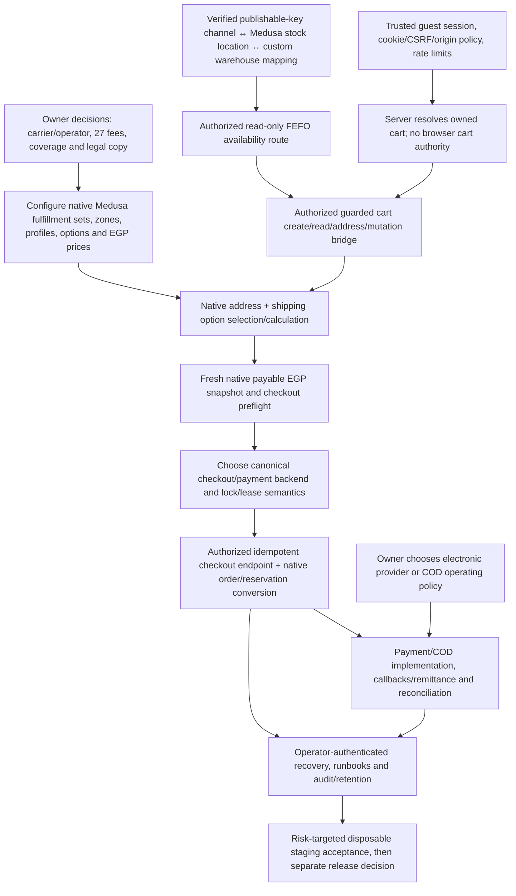

# MVP Completion Gap Audit

**Audit snapshot:** 2026-10-27  
**Repository:** `mo3az-git/zamzam-store`  
**Integration candidate:** Draft PR [#26](https://github.com/mo3az-git/zamzam-store/pull/26), branch `integration/mvp-consolidated-20261027`, verified head `90f858e6998288be4b07a8b0e506f1a586896919`.  
**Baseline verification:** PR metadata reports that exact head, open, not merged, Draft. The PR's recorded parent sources are backend PR #19 and storefront PR #24.  
**Scope:** Repository/source/CI/issue audit only. No feature implementation, TP execution, acceptance-state edits, order, payment, shipping quote, deployment, or live customer action.

## Executive finding

The consolidated candidate is a substantial **read-only and internal-prototype** foundation, not an operable MVP purchase journey. Catalog presentation is integrated; selected backend cart-security and ownership foundations have real disposable-service evidence; FEFO availability and shipping configuration remain deliberately unmounted/unpriced; checkout form and readiness UI are not connected to an authorized server transaction. Internal native order/payment/recovery prototypes exist, but they are not a public authorized checkout path and do not establish production payment settlement or operational fulfillment.

No feature below is classified Production Ready. Design closure and the MVP-first development policy are accepted decisions about process/design; they do not accept runtime behavior or release readiness. The canonical Phase 1 record still reports 0 formally accepted TP cases and TP-01 remains unauthorized.

## Status definitions

- **Implemented:** relevant code or configuration exists on the audited tree.
- **Integrated:** the code is present in PR #26's consolidated tree and its intended adjacent layer is connected. Presence alone does not mean end-to-end storefront wiring.
- **Tested:** named automated/runtime evidence exercised the stated boundary. Synthetic browser, unit, disposable database and Medusa HTTP evidence are identified separately.
- **Accepted:** explicit owner acceptance of the feature behavior or the canonical TP's independent review exists. Design/policy approval is not runtime acceptance.
- **Production Ready:** authorized, security-reviewed, operationally configured and supported end-to-end release behavior. None is inferred from a build, prototype, synthetic preview or disposable test.

## Completion matrix

| Journey capability | Implemented | Integrated in PR #26 | Tested evidence | Accepted | Production Ready |
|---|---|---|---|---|---|
| Catalog, localization, collection/product pages | **Yes** — PR #24 storefront reads Medusa catalog and resolves EGP region context; Arabic/English and SEO work is present. | **Yes, read-only UI** — storefront source overlaid into #26. | Storefront unit tests, workspace build, and Chromium ARG-B01–05 pass on a localhost synthetic Medusa fixture. No claim of live catalog data or independent Argon review. | **Partial** — MVP-first catalog development allowed; no explicit live catalog/customer acceptance found. Formal TPs remain separate. | **No** — live catalog configuration/content, licensed media and preview/production operational gates remain. |
| Variant selection and price display | **Yes** — selected variant/SKU and native EGP-context price presentation. | **Yes, presentation only.** No purchase authorization follows selection. | Unit + synthetic Chromium; real Medusa catalog data/pricing not proven by browser run. | **No feature acceptance evidence found.** | **No** — tied to live catalog, batch eligibility and server-authoritative purchase boundary. |
| Cart creation, read and mutation | **Partial** — native mutation guards and internal guest ownership foundation exist; storefront cart UI and server adapters exist but cart creation/mutation remains feature gated and no trusted public guest session bridge is mounted. | **Partial** — guard/ownership code is in integrated backend; storefront does not call a complete authorized cart lifecycle. | PR #19 records real Medusa HTTP + disposable PostgreSQL/Redis cart mutation and ownership checks. Consolidated CI reruns cart-boundary regression and guest ownership integration. Cart UI/browser path uses synthetic/read-only state. | **No formal TP acceptance.** Related TPs have boundary-specific results and review requirements; do not infer full cart acceptance. | **No** — public session issuance, authorization/CSRF/origin policy, route composition, lifecycle/recovery and customer journey remain. |
| FEFO/batch stock availability | **Partial** — internal batch projection and product visibility scopes exist; location scope must be trusted; no public Store availability route. | **No customer endpoint integration.** | Consolidated CI reports real PostgreSQL FEFO availability and Medusa Query visibility checks; unit tests cover projection/visibility. Location mapping to Medusa stock locations and a public HTTP context are explicitly unverified. | **No.** No customer availability contract/TP accepted. | **No** — route/auth and verified channel-to-warehouse mapping absent; projection is not a reservation. |
| Guest delivery address | **Partial** — bilingual form/validation and canonical governorate-to-`province_code` mapping; internal preflight consumes trusted native cart data. | **UI is not wired to an authorized cart/address mutation or preflight endpoint.** | Validation tests; #28 documents native Egypt address persistence and disposable Medusa geographic fixture. This is not storefront end-to-end address submission. | **No.** | **No** — guest session ownership, route authorization and address mutation flow are not public/integrated. |
| Shipping coverage, method and quote | **Partial foundation** — 27 governorate mappings and unconfigured provider-neutral rate states; native GeoZones/ServiceZones verified. | **Mapping contract integrated**, but no active shipping options, prices, provider or quote. | Disposable Medusa 2.22.1/PostgreSQL verified 27 service zones/GeoZones and no options when no options are configured; quote remains blocked. CI validates 27-entry cross-layer code contract. | Owner approved all-27-governorate requirement and varying-fee pricing model only. Fees/provider/actual coverage are not accepted. | **No** — no approved carrier/fulfillment operator, fee values, native shipping options/prices or truthful operational delivery promise. |
| Payable totals | **Partial** — internal read-only native payable quote/snapshot and EGP guards; Medusa remains source of truth. | **Internal only**, not part of authorized storefront flow. | Consolidated quote validator tests/build; earlier disposable shipping test confirmed empty cart's native EGP 0 does not satisfy payable readiness and returns blockers. No positive native priced shipping cart/quote was proven. | **No.** | **No** — positive native shipping configuration and end-to-end authorized recomputation missing. |
| Payment choice and persistence | **Prototype only** — internal same-order coordinator and COD/simulated-electronic branch persistence; local Medusa system provider/simulated branch, no gateway. | Source code exists in backend tree; no public checkout/payment route or storefront authorization path. | PR #19 documents 51/51 disposable same-order checks in its source history. Current #26 consolidated run explicitly runs read-only quote tests, not that same-order suite. No provider settlement/webhook test. | **No payment method/settlement acceptance found.** | **No** — provider, credentials, capture/refund/webhook/signature/operations and policy are not selected or verified. |
| Native order creation | **Internal prototype** — native Medusa completion and reservation conversion coordinator exist. | Not exposed or invoked by the storefront. | Same-order disposable backend evidence exists on #19 source line; current consolidated CI does not claim a customer checkout/order execution. Synthetic browser does not place orders. | **No.** TP-01 is unauthorized; broader checkout/order TP acceptance remains incomplete. | **No** — no authorized public entry, owner release, complete real-service failure/recovery acceptance or live customer order permission. |
| Reconciliation/recovery | **Internal operations prototype** — inspect/recover services and same-order reconciliation boundaries exist; no public route. | Internal only; no operator-authenticated composition confirmed. | Source docs specify cases and guards; no evidence in current consolidated workflow establishes full production operator-authenticated recovery across unknown native outcomes. | **No.** | **No** — operator authorization, runbook, alerting, retention, tested recovery/restore and on-call ownership remain. |
| Full journey catalog → reconciliation | **No.** Components/prototypes exist at different trust boundaries. | **No end-to-end connection.** | Component-scoped checks only; no single real Medusa/PG/Redis/browser flow crosses authenticated guest → availability → address/shipping → payable → payment → order → reconciliation. | **No.** | **No.** |

## Repository evidence and limits

### Current integration and CI

- [PR #26](https://github.com/mo3az-git/zamzam-store/pull/26) is open, Draft, not merged. Verified head: `90f858e6998288be4b07a8b0e506f1a586896919`.
- [Consolidated MVP CI run 40566386267](https://github.com/mo3az-git/zamzam-store/actions/runs/40566386267): **completed success**. Its successful job includes pinned dependency install; storefront tests; read-only payable quote, cart mutation, guest preflight, governorate contract, shipping policy, batch availability and visibility checks; both workspace lint; disposable Medusa DB migration; real guest cart ownership PostgreSQL integration; real PostgreSQL FEFO integration; Medusa Query visibility integration; both builds; proposed JSON schema validation. These are scoped checks, explicitly not the formal TP suite or full customer journey.
- [Chromium QA run 40566386348](https://github.com/mo3az-git/zamzam-store/actions/runs/40566386348): **completed success**, ARG-B01–B05. It builds Next and uses a local mock Medusa/Next preview; it proves rendered read-only catalog/locale/accessibility smoke behaviors on synthetic data, not live Medusa, stock, shipping or checkout.
- PR #26's changed files and source establish that `AddToCartPreview` is hidden unless explicitly enabled and then simulates only; the checkout/cart components state that they are read-only; preview query strings cannot enable QA fixtures without a server-verified mode.
- The consolidated CI does not run the full formal 59 TP register. CI success is not acceptance or production readiness.

### Planning and canonical test records

Inspected `docs/implementation-plan.md`, `docs/architecture.md`, `docs/phase1-tp-case-matrix.md`, `docs/phase1-tp-execution-register.md`, Phase 2 Slice 02, Phase 3 availability slices, native payable checkout, same-order payment, reconciliation, consolidation candidate, integration handoff and Phase 4.8 shipping foundation.

- Phase 0 checkboxes record **design acceptance only**; their text expressly says they do not prove runtime compatibility or behavior.
- The Phase 1 matrix's latest formal summary reports **7 runner-boundary passes, 52 blocked/unexecuted, 0 formally accepted** and says independent review is still needed for those boundary runs. Newer PR #19/#26 targeted integration evidence should not be silently rewritten into canonical TP acceptance.
- TP-01 is explicitly not authorized. No registry row/status was changed for this audit.
- Phase 2 source documents catalog UI verification but explicitly defer live Medusa catalog capture, batch availability and purchase action.
- Phase 3 docs say availability projection/visibility remain unmounted and do not represent reservation authority; location mapping and public Store request scope remain prerequisites.
- Phase 4.8 docs/issues show actual native geography persistence and zero-option behavior, not a successful shipping quote.

### Source-branch divergence and unfinished functionality

- **PR #19 backend source** includes internal guest ownership, guarded native cart mutation, preflight, FEFO reservation/checkout, payable and same-order payment/recovery prototypes. These are privileged internal components, not proof of a customer-facing route. It also carries unresolved provider, lease recovery, route/auth, cart writer, retention and operational prerequisites.
- **PR #24 storefront source** includes bilingual catalog plus cart/checkout presentation, BFF/session/CSRF policy modules and server-side adapters. The UI remains read-only/preview-only; its session/BFF policy is intentionally unmounted and explicitly says valid cookie/CSRF does not prove cart ownership. No end-to-end trusted identity-to-cart API wiring is present.
- **PR #26** is a consolidation candidate that preserves both source trees and adds scoped CI. Its own description restricts scope: no public cart creation, stock endpoint, guest auth/claim, production checkout, gateway charges or real COD.
- **Issue #22** records the older payable/payment branches as divergent and warns against assuming PR #13 payment models contain all PR #16 payable/recovery changes. PR #23's later payment-quote foundation is read-only and deliberately excludes payment writes; it does not resolve this source-of-truth question. Before any payment integration, select one backend baseline and reconcile migrations, models, workflow signatures, lock authority and recovery behavior explicitly.
- **Issue #28** is still open. Owner-approved: all 27 governorates are required and pricing varies by governorate. Not approved/selected: each amount, fulfillment provider/operator, local restrictions, escalation/failure copy, delivery timing/legal copy and any tax/free-shipping/provider quote policy. The fixture's `manual_manual` provider is not approval.

## Critical dependency graph

**Ordering constraint:** cart/checkout wiring cannot safely jump from UI forms to order completion. Ownership and request authorization precede cart access; stock visibility must be location-scoped and is only advisory; reserve/checkout must revalidate inventory and current native EGP/shipping totals under the selected lock/lease protocol; payment/recovery follow one reconciled backend authority. All public activation remains separately gated.

## Ordered MVP completion backlog

P0 means blocks any safe purchase journey or an honest availability/shipping/payable result. P1 is required for operationally complete MVP and safe failure/recovery. P2 is valuable follow-up that does not establish purchase safety. Tasks have deliberately separate outputs to permit parallel implementation after interface/owner dependencies are fixed.

| Order / ID | Priority | Non-overlapping task and output | Dependencies | Acceptance criteria |
|---|---|---|---|---|
| 0 — DEC-01 | P0 | **Owner: choose delivery operating policy** — record carrier/store-operated method, per-governorate EGP fee schedule/effective date, any local restrictions, tax/free-shipping policy, customer-facing failure/timing/returns copy. | Owner decision; issue #28. | Explicit signed/recorded choices; no guessed amount; all 27 governorates either operationally covered or explicit owner-approved exception; still no activation until technical checks pass. |
| 1 — INT-01 | P0 | **Integration owner: canonical backend source selection** — compare PR #19, #16, #13 and #23 checkout/payment deltas; publish a single migration/module/workflow/lock/recovery map, without transplanting unrelated code. | Read-only review; owner clarification if behavior conflicts. | Every required module/migration has one source; duplicate/conflicting migrations and state models resolved; exact baseline and compatibility checks recorded; no branch merges as part of audit. |
| 2 — AUTH-01 | P0 | **Backend + security owner: guest identity and cart authority** — compose the existing ownership resolver behind a server-issued session, cookie policy, CSRF/origin checks, abuse controls and authenticated server-only storefront BFF. | INT-01; cookie domain/same-site/CORS/origin/TTL decisions; deployment secrets and Redis/persistence choice. | Browser cannot choose cart identity or assert ownership; session rotation/expiry/invalidation and cross-session denial work; unsafe origins/CSRF rejected; DB/Redis failures fail closed; real HTTP integration against disposable services. |
| 3 — INV-01 | P0 | **Backend inventory owner: safe availability contract** — prove map from trusted publishable-key sales channel to Medusa stock locations and custom `inventory_location`; expose only scoped `available/unavailable/unknown` read contract through authorized server boundary. | Trusted Medusa Query context; warehouse/location authority; AUTH-01. | Real Medusa Query/Store HTTP scope and PostgreSQL FEFO fixture agree; unknown/error never means available; no client location IDs; endpoint is read-only and documented as non-reservation. |
| 4 — CART-01 | P0 | **Backend/storefront integration owners: guest cart lifecycle** — compose owned-cart creation and guarded native read/add/update/remove/address routes via BFF; keep cart total native. Separate from inventory endpoint and checkout. | AUTH-01; INV-01 for safe add action; selected canonical backend. | Disposable HTTP flow creates exactly one owned native EGP cart; mutation lock and owner boundaries enforced; no IDOR; quantity/variant validation; native totals returned; client cannot set region/currency/price/ownership. TP-01 remains barred unless separately authorized. |
| 5 — SHIP-01 | P0 | **Backend fulfillment owner: native shipping configuration and quote** — install approved native zones/profile/options/prices/provider/calculation using Medusa; keep rates out of app math. | DEC-01; geography mapping; CART-01. | Disposable 27-governorate positive and negative option lookup; native selected method and amount appear in cart; unsupported/missing quote blocks; no invented price; all authoritative amounts use Medusa semantics. |
| 6 — PAY-01 | P0 | **Backend checkout owner: fresh payable preflight and idempotent native order boundary** — reconcile and expose only after AUTH/CART/INV/SHIP; reserve and revalidate under one agreed cart lock/lease protocol; use native cart completion exactly once. | INT-01, AUTH-01, CART-01, INV-01, SHIP-01; explicit permission for disposable order tests (not TP-01). | Real disposable full-service flow; idempotent replay returns same order; amount/currency/address/shipping revalidated; lock loss/unknown outcomes fenced; stock reservation/conversion atomic; no public route until review. |
| 7 — PAY-02 | P1 | **Owner + payment specialist: select and integrate payment mode(s)** — decide provider or COD policy; implement isolated provider adapter, callback authentication/signature, status transitions/refunds/remittance without conflating order completion and settlement. | PAY-01; credentials/contract/regulatory and COD operations decisions. | Provider sandbox or simulated test never mistaken for settlement; forged/replayed callbacks rejected; exact amount/currency/order binding; COD remittance/reporting policy; disposable failure/retry coverage. No live activation without separate owner release. |
| 8 — REC-01 | P1 | **Operations + backend: recovery/reconciliation and observability** — authenticated operator entry, unknown outcome handling, stale lease resolution, alerts, retention/restore/runbooks, privacy-safe audit trail. | PAY-01 and PAY-02 state contracts. | Fault injection around order conversion/payment callbacks; no duplicate order/reservation/payment; unknown state remains fenced; audited authorized recovery and verified backup/restore procedure. |
| 9 — UX-01 | P1 | **Storefront owner: wire honest states to stable server contracts** — connect existing UI only after API schemas/error codes stabilize; retain bilingual blocked/unavailable/error states and no client authority. | AUTH/CART/INV/SHIP/PAY contracts; DEC-01 copy. | Arabic/English keyboard/mobile end-to-end staging tests; no synthetic mode in production; stale/unknown stock/price/shipping blocks action; user sees only safe public errors. |
| 10 — QA-01 | P1 | **Independent QA/release owner: targeted staging proof and review** — separate tests for end-to-end journeys and high-risk failure paths; retain formal TP registry untouched until its separately authorized gate. | P0 tasks; disposable staging; owner test authorization. | Complete nonproduction browser→BFF→Medusa→PostgreSQL/Redis evidence for success and failure; no real provider/customer data; independent review; then explicit owner release decision. |
| 11 — CONTENT-01 | P2 | **Catalog/content owner: translations, licensed assets and discoverability** — complete verified bilingual content, media rights, sitemap/performance/SEO work. | Catalog owner inputs. | Content provenance and rights recorded; no fabricated product claims; accessibility/SEO/performance review. |

### Suggested parallel-agent split

Parallelize only non-overlapping tasks after shared contracts are agreed:

1. **Backend security agent — AUTH-01:** session/cookie/CSRF/origin/BFF composition; may not change cart/checkout business state.
2. **Inventory agent — INV-01:** Medusa location-link proof and scoped availability API; may not create carts or reserve inventory.
3. **Fulfillment agent — SHIP-01 preparation:** after owner decision DEC-01, configure native fulfillment and test quote semantics; no payment/order code.
4. **Storefront agent — UX-01:** meanwhile can finish read-only catalog/content and prepare UI against proposed schemas; no purchase enablement or backend ownership changes.
5. **Integration lead — INT-01 then CART-01/PAY-01:** own canonical branch/migration/workflow selection and serial composition of auth, cart, stock and checkout; do not delegate competing edits to shared checkout coordinator.
6. **Independent QA — QA-01:** begins only after candidate API contract exists; evidence/review only.
7. **Owner:** DEC-01 plus payment, operational, legal, release and TP authorization decisions.

Do not assign two agents to edit the same checkout coordinator, migration sequence or cart authorization boundary concurrently.

## Exact owner decisions required

### Blocking current shipping/readiness

1. Choose fulfillment method/provider/operator (store-operated or named provider) and who owns provider configuration and service.
2. Approve one EGP delivery fee for each of 27 governorates, with effective date and auditable approval reference. Current model says prices differ; no amounts are approved.
3. Decide whether all addresses within each governorate are serviceable or identify specific restrictions; owner-approved “all governorates” is a geographic requirement, not proof of operational deliverability.
4. Approve the fallback when no quote is available (keep blocked; optional contact/escalation instructions).
5. Approve delivery-time, returns and shipping customer copy; decide applicable tax/free-shipping/discount interactions.

### Required before authorized guest/cart API

6. Approve guest session/cookie policy: first-party host/domain, `HttpOnly`, `Secure`, `SameSite`, allowed storefront origins, CSRF mechanism, session TTL/rotation/revocation, and whether Redis is required for session continuity or only locking.
7. Name the operational owner and retention policy for guest ownership records, personal delivery data, logs and reconciliation records; approve abuse controls/rate limits and recovery escalation.
8. Confirm the trusted mapping of publishable-key sales channels to Medusa stock locations and custom inventory warehouses; identify the canonical location authority.
9. Select which checkout/payment source lineage is canonical after a documented #19/#16/#13/#23 compatibility review. No automatic cherry-pick/branch consolidation is implied.

### Required before payment/release

10. Decide payment mode(s): named electronic provider and sandbox/production policy, or COD operating policy, delivery collection/remittance/reconciliation owner and status semantics. There is no real payment capability demonstrated.
11. Approve callback/webhook, refund/cancellation, customer communication and support ownership; supply secrets only through approved deployment secret management when implementation is separately authorized.
12. Decide whether and when to authorize TP-01 and the separate formal all-59 acceptance gate. This audit does not execute or change either.
13. Name release approver and authorize any customer-facing production activation only after staging evidence and launch/legal/operational gates.

## Remaining unverified conditions

- No full real browser → authenticated BFF → Medusa HTTP → PostgreSQL/Redis → shipping/payment/order/reconciliation journey exists in evidence.
- No live Store HTTP proof of guest session issuance, owner-bound cart resolution, CSRF/origin policy or cross-session denial through the storefront adapter.
- No verified Medusa stock-location ↔ custom warehouse mapping and no customer-facing availability endpoint.
- No positive native priced shipping option or non-empty payable cart was established; shipping methods/provider/rates are intentionally absent.
- No chosen/contracted fulfillment operator or approved fee schedule exists.
- No gateway settlement, signed webhook, real COD collection/remittance, or customer refund is tested.
- No independent Argon browser session/preview acceptance is reported; Chromium CI is synthetic.
- Formal TP acceptance remains separate; TP-01 is unauthorized and the canonical register is unchanged.

## Audit change and verification

This audit is planning documentation only: `docs/mvp-completion-gap-audit.md`. It makes no source/runtime changes and does not modify canonical TP acceptance state.

- Audited code baseline before documentation: `90f858e6998288be4b07a8b0e506f1a586896919`.
- Documentation commit on existing PR #26: `7ff8a9751e54ab2328cfac1c5888af209c009ec1`; this is a docs-only child commit. The PR remains open and Draft.
- Post-commit consolidated CI: [run 40569981874](https://github.com/mo3az-git/zamzam-store/actions/runs/40569981874), completed **success** on the documentation commit. It reran targeted storefront/backend checks, lint, disposable Medusa migration and guest ownership/FEFO/Query integrations, both builds and contract-schema validation. No formal TP suite ran.
- The preceding browser smoke remains [run 40566386348](https://github.com/mo3az-git/zamzam-store/actions/runs/40566386348), completed **success** on code baseline `90f858e`; it was not rerun for a docs-only commit. It used synthetic local Medusa data.
