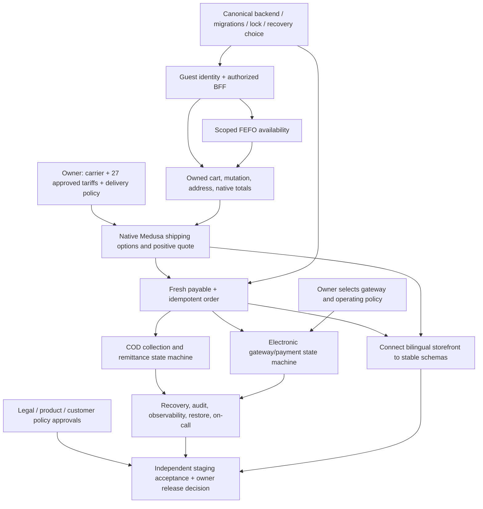

# Zamzam Store MVP completion dashboard and release gate

**Snapshot:** 2026-10-27 (Africa/Cairo); refreshed after PR #26 advanced to `69d6f0b8f4795f347c2aa568c49c0c4841e32a14`.  
**Repository:** `mo3az-git/zamzam-store`  
**Integration PR:** [#26](https://github.com/mo3az-git/zamzam-store/pull/26), Draft/open/not merged, branch `integration/mvp-consolidated-20261027`, current GitHub head `69d6f0b8f4795f347c2aa568c49c0c4841e32a14`; it advanced from `ca6a407` during this coordination turn.  
**Documentation PR:** [#33](https://github.com/mo3az-git/zamzam-store/pull/33), Draft/open/not merged, branch `codex/mvp-release-readiness-dashboard-20261027`, targeting #26; initial docs commit `ab578b1e32a7f7f0a792ae5ef4ec8991bc0b6e74`, with follow-up snapshot update recorded below.  
**Security PR:** [#29](https://github.com/mo3az-git/zamzam-store/pull/29), Draft/open/not merged, branch `integration/mvp-consolidated-security-guard-20261027`, head `61ff9a1e3b521fa1d831e195e06723d150922941`, not yet integrated into #26.  
**Decision boundary:** documentation and coordination only. No merges, deploys, TP-01 execution, canonical TP state changes, or real cart/order/payment/COD/shipping actions are authorized.

This dashboard supersedes older status summaries in the [gap audit](mvp-completion-gap-audit.md) where owner decisions or newer work differ. It complements, and does not overwrite, the canonical TP registry.

## Release decision

**Production launch is blocked.** The candidate provides catalog and localized storefront foundations, selected internal backend prototypes, and targeted component/integration evidence. It does not provide a complete authorized purchase path or verified operational fulfillment. No feature is classified Production Ready, and no release approval is recorded.

The owner has confirmed that MVP must offer **both Cash on Delivery (COD) and electronic payment**, and serve **all 27 Egyptian governorates** with **governorate-varying shipping charges**. Individual fee amounts remain unapproved; the shipping operator/provider and electronic gateway/provider remain undecided. These decisions define requirements; they do not establish operational coverage or working methods.

## Owner decision ledger

| Decision | Recorded state | Release effect |
| --- | --- | --- |
| Geographic requirement | All 27 Egyptian governorates are required. | No governorate may be silently excluded. Actual address-level serviceability still needs evidence. |
| Shipping pricing model | Fees vary by governorate. | Native Medusa rates must be configured only from approved values. |
| Individual tariffs | No amounts approved. | No shipping option, quote, payable checkout or production delivery promise can be enabled. |
| Shipping operator | Undecided. | `manual_manual` in a fixture is not approval; provider and operating model remain blocked. |
| Payment methods | COD and electronic payment both required for MVP. | Implement and verify two independent state machines. Requirement approval does not authorize activation. |
| Electronic gateway | Undecided. | No real charge, callback, refund or settlement path is established. |
| Branch merges / TP-01 | No branch merge authorized; TP-01 execution not authorized. | Keep all PRs unmerged and TP-01 untouched. |

## Workstream dashboard and ownership boundaries

| Workstream | Current evidence and exact identity | Technical state | Remaining gate / non-overlap |
| --- | --- | --- | --- |
| Integration baseline | PR #26, `integration/mvp-consolidated-20261027` @ current `69d6f0b8f4795f347c2aa568c49c0c4841e32a14`, parent `ca6a407629cb09005b53d3203fa6c03618835998`; application-code baseline `90f858e6998288be4b07a8b0e506f1a586896919`. PR metadata says Draft/open/not merged and mergeable. | Consolidated read-only storefront and internal backend foundation; newest commit adds disposable native shipping quote coverage. | Keep #26 as the integration candidate. Do not overlay source branches again; reconcile every later PR against its exact head and changed-file list first. |
| Inventory / FEFO | PR #26 targeted CI run `40569981874` records FEFO PostgreSQL and Medusa Query visibility integrations succeeding. Earlier #26 CI `40566386267` also succeeded. | Scoped internal projection/query evidence exists; no authorized customer availability route or verified channel-to-warehouse mapping is evidenced. Availability is not reservation. | Inventory owner alone owns trusted channel → stock location → custom warehouse mapping and read-only availability contract. Do not include cart creation or checkout in that task. |
| Payment / native order | Source PR #19, branch `phase-1/same-order-native-payment-integration-spike` @ `b4114926b4c59a2c59db383a299881ceb244f522`, Draft/open. Its description reports 51/51 focused disposable checks, including same-order COD and simulated-electronic records; this is source-PR evidence, not production settlement or current #26 end-to-end evidence. PR #23 (`integration/mvp-payment-foundation-20261027` @ `7bf8fecb63ca91a75151de87a6399595e61c7183`) is closed unmerged and explicitly overlapping. | Internal coordinator/prototype evidence; no public authorized order/payment path. | Integration lead selects one compatible canonical checkout/payment source and reconciles migrations, lock/lease semantics, payment/order linkage and recovery before implementation. Do not transplant PR #23 over #19 blindly. |
| Separate COD and electronic state machines | Owner requires both. Existing policy/risk docs specify a COD collection/remittance state machine separate from electronic provider/payment states. PR #19 evidence persists different method branches for a common correlated order; its electronic branch is simulated. | Requirement is clear; production operational transitions are unverified. | Preserve separate allowed transitions, idempotency keys, event/reconciliation records and terminal outcomes. COD collection/remittance must never be treated as gateway authorization/settlement; electronic provider callbacks/refunds must never be inferred from COD delivery status. Add transition tables and negative cross-method tests to the selected backend evidence plan. |
| Shipping / fulfillment | Issue [#28](https://github.com/mo3az-git/zamzam-store/issues/28) is open. PR #19 `b411492` and PR #24 `89d5727` supplied the technical 27-governorate mapping; PR #26 `90f858e` reconciled province codes. New #26 head `69d6f0b` changes `check-egypt-shipping-configuration.mjs`, `test-egypt-governorate-shipping-integration.mjs`, and `phase4-8-egypt-shipping-foundation.md`; its updated note describes a temporary 27-option positive synthetic EGP fixture, but the CI run failed before that path completed. | Run `40572659803` failed during the real guest ownership/disposable shipping job. Earlier shipping setup assertions passed; the new governorate integration exited with sanitized `Error` / `code:null` after `missing_shipping_configuration_yields_no_free_or_fallback_option`. Exact internal operation is not exposed in the log. Vercel Preview for `69d6f0b` succeeded, which is not test success. No owner rate/provider approval. | Fulfillment owner resolves the failed disposable quote fixture, reruns CI, then uses production-intended native options only from approved owner values and proves positive/negative quotes. |
| Security / guest identity | Security PR #29 @ `61ff9a1e3b521fa1d831e195e06723d150922941`, Draft/open; its scope makes native cart completion return fixed 404 until ownership-aware checkout exists. The PR description says BFF is unmounted and guest cart GET/mutation plus checkout-lock ownership remain findings. Combined status lookup showed a Vercel success only; no GitHub Actions run was returned for this head. | A proposed fail-closed guard is separate from #26. BFF transport, guest identity and cart access are not launch-ready. | Security owner owns endpoint authorization map, server-issued session, origin/CSRF, rate limits, no browser cart authority and fail-closed behavior. Integrate #29 once, after security review and CI evidence. Do not duplicate its `/complete` guard in storefront purchase-journey changes. |
| Storefront / checkout UX | PR #24, `phase-2/catalog-storefront-mvp` (current PR head should be refreshed before any future integration); previously integrated bilingual catalog, EGP presentation and safe checkout states into #26. Local working tree on audit branch `8b45e79` has uncommitted edits in `checkout-view.tsx`, `shipping.ts`, `checkout-ui.test.mjs`, browser-QA workflow/spec, and untracked `docs/storefront-purchase-journey-review.md`. Review records subtotal-only readiness and incomplete-quote defects with focused local fixes. | Those local changes are not in PR #26, are uncommitted, and have no CI result; they are not accepted as integrated or tested evidence here. | Storefront owner owns presentation, locale and truthful blocked states only. Do not wire payment selection/order actions or own backend authorization/shipping pricing. Coordinate file overlap with #29 before changing checkout transport. |
| QA / formal acceptance | #26 targeted CI `40569981874` success on the docs-updated integration head; Chromium QA `40566386348` success on `90f858e`, synthetic local Medusa/Next data. New local report [mvp-integration-qa.md](mvp-integration-qa.md) records a storefront run with 58 passing and 4 failing tests, plus 5 blocked suites (3 by missing SWC native binding/cache permissions; 2 by Docker/Playwright absence). | Component and synthetic browser evidence only; local cart-adapter failures are unresolved; no full real browser → authorized BFF → Medusa → payment/order/recovery journey. | QA owner resolves and reruns the four cart adapter failures; after P0 contracts stabilize, independently reviews risk-targeted disposable staging. Keep canonical 59-case register unchanged. TP-01 remains unauthorized. |
| DevOps / migrations / recovery | #26 CI covers disposable DB migration, builds and selected PostgreSQL/Redis integration checks. New [operational-readiness.md](operational-readiness.md) documents missing production topology, secret store, migration identity, restore drill, app telemetry, SLO/RPO/RTO and on-call ownership. | Development CI foundation exists; production operational readiness is unverified. | DevOps owns environment separation, secrets, migration rehearsal/rollback, backup/restore, alerts, incident/runbooks, retention and operator access. Never infer operational readiness from Vercel Preview status. |
| Legal / catalog policy | `docs/risk-and-assumptions.md` marks authenticity/labeling, physical lot/date reconciliation, shipping rates, refund policy, restore drill and qualified legal review as launch gates. | Requirements documented; external evidence/approvals are absent from this repository snapshot. | Owner/legal/accounting/operations provide evidence and approve Arabic customer terms, privacy, delivery, cancellation, returns/refunds, product provenance/labels and claims before publication. |

### Local worktree evidence not yet on a PR

Current branch: `audit/mvp-completion-gap-20261027-final`; HEAD `8b45e79cd019d9c884a625ac33a73232cfecb876`. At inspection, tracked uncommitted files include `.github/workflows/browser-qa.yml`, `.github/workflows/mvp-consolidated.yml`, `apps/backend/scripts/check-egypt-shipping-configuration.mjs`, `apps/backend/scripts/test-egypt-governorate-shipping-integration.mjs`, `apps/storefront/components/checkout-view.tsx`, `apps/storefront/lib/shipping.ts`, `apps/storefront/tests/checkout-ui.test.mjs`, `docs/phase4-8-egypt-shipping-foundation.md`, and `package.json`; untracked files include `compose.qa.yaml`, `docs/mvp-integration-qa.md`, `docs/operational-readiness.md`, `docs/storefront-purchase-journey-review.md`, `scripts/browser-qa/checkout-smoke.spec.mjs`, `scripts/ops-readiness-check.mjs`, and `scripts/run-disposable-integration.ps1`. These are pre-existing local specialist edits and are not part of this docs-only scope. Keep them separate from the documentation commit and do not attribute their code or local QA evidence to PR #26. The two local reports are linked above as evidence with their limits.

## Evidence register

| Evidence | Exact ref | Outcome | What it proves / does not prove |
| --- | --- | --- | --- |
| Consolidated targeted CI | [Run 40569981874](https://github.com/mo3az-git/zamzam-store/actions/runs/40569981874), PR #26 docs-updated commit `ca6a407629cb09005b53d3203fa6c03618835998` per prior audit record. | Completed success. | Scoped storefront/backend checks, lint/build, disposable migration, guest ownership, FEFO/query visibility and schema checks. Not formal TP, customer checkout, real provider settlement or production. |
| Latest #26 shipping integration commit | [`69d6f0b8f4795f347c2aa568c49c0c4841e32a14`](https://github.com/mo3az-git/zamzam-store/commit/69d6f0b8f4795f347c2aa568c49c0c4841e32a14); [CI run 40572659803](https://github.com/mo3az-git/zamzam-store/actions/runs/40572659803), job `122430695297`. | **Failure.** The job passed dependency install, storefront/unit contract tests, lint, DB migration, 20 guest-ownership assertions and 13 native-shipping-readiness assertions. The newly extended governorate integration then exited 1 with `Egypt governorate shipping integration failed: {"name":"Error","code":null}`. The failure occurred after initial 27-zone and no-fallback checks; downstream FEFO, visibility, builds and schema checks were skipped. Vercel Preview for this SHA succeeded. | Failure detail is intentionally sanitized by the test and exact failing internal Medusa operation is not visible in logs. Fix the disposable quote integration before claiming positive quote verification. This run is targeted CI, not formal TP or production evidence. |
| Consolidated CI before final 27-code reconciliation | [Run 40566386267](https://github.com/mo3az-git/zamzam-store/actions/runs/40566386267), `90f858e6998288be4b07a8b0e506f1a586896919`. | Completed success. | Exact 27-code contract and disposable geographic fixture; fixture contained no active options, prices or provider. |
| Browser smoke | [Run 40566386348](https://github.com/mo3az-git/zamzam-store/actions/runs/40566386348), `90f858e6998288be4b07a8b0e506f1a586896919`. | Completed success, ARG-B01–B05. | Synthetic local mock catalog/locale/accessibility smoke only. Does not prove live data, checkout, payment or shipping. |
| Native shipping readiness | [Run 40558250851](https://github.com/mo3az-git/zamzam-store/actions/runs/40558250851), source PR #19 `7099569afe78ff47b49e2730660f50dd23cee192`. | Completed success; 13 disposable checks recorded in issue #28. | Native address persistence and blocked missing shipping/payment readiness; zero options/positive quotes. |
| Payment/order focused source evidence | PR #19 source head `b4114926b4c59a2c59db383a299881ceb244f522`. | PR description reports 51/51 focused disposable checks. | Simulated electronic and COD method branch records on same respective native orders, replay and failure scenarios. Not real gateway, remittance or current integrated flow. |
| Local integration QA record | [mvp-integration-qa.md](mvp-integration-qa.md), shared Windows checkout, Node 24.22.1/npm 11.19.1. | Storefront suite 58 passed / 4 failed; 3 runner suites blocked before assertions; 2 disposable/browser suites not run because Docker/Playwright unavailable. | This is diagnostic local evidence on the dirty worktree, not a green result or a PR check. Four cart adapter failures need investigation before treating cart adapter tests as healthy. |
| Local operational readiness review | [operational-readiness.md](operational-readiness.md). | Documents production gaps and proposes future staging controls; no production drill executed. | Planning evidence only; it does not prove monitoring, recovery, migration rollback or restore readiness. |
| Security PR status | PR #29 `61ff9a1e3b521fa1d831e195e06723d150922941`. | Draft/open; Vercel status success. No GitHub Actions run surfaced in the queried workflow/status endpoints. | Preview build only; security code remains outside #26 and unreviewed for release. |
| Documentation PR status before this update | PR #30 `8b45e79cd019d9c884a625ac33a73232cfecb876`. | Draft/open; Vercel protected Preview success. GitHub Actions query returned no workflow runs for this docs-only SHA. | Confirms preview deployment only. Do not label it documentation CI or functional acceptance. Refresh PR checks after pushing this documentation update and record actual result. |

No CI was triggered by this coordinator while preparing this document. Do not claim checks for this new documentation commit until the PR check page reports them. If branch/path filters skip GitHub Actions, record that transparently; do not make up a run or broaden application CI as part of the docs-only change.

## Dependency-ordered backlog

Priority is based on safe purchase journey and launch gating. Tasks have distinct outputs and should be assigned to one owner each.

| Order | Priority / ID | Owner and single output | Dependencies | Exit evidence |
| --- | --- | --- | --- | --- |
| 0 | P0 DEC-SHIP | Merchant owner: choose operator/model, approve a non-zero EGP tariff for each of all 27 governorates, serviceability restrictions, effective date, failure escalation and delivery/customer copy. | Owner decision; issue #28. | Auditable approval reference and complete tariff/coverage matrix. No guessed or sample prices. |
| 1 | P0 INT-CANON | Integration lead: publish canonical backend source/migration/workflow/lock/payment/recovery map across #19, #23 and related payment lineage. | Read-only compatibility comparison; no merge. | One selected baseline, conflicting schemas/states resolved, exact commit provenance and changed-file ownership map. |
| 2 | P0 AUTH | Backend + security owner: compose server-owned guest session, cookie, origin/CSRF, abuse controls and authorized storefront BFF/cart boundary; resolve PR #29 findings once. | INT-CANON; owner-approved origin/cookie/TTL policy; secrets and persistence model. | Real disposable HTTP authorization, cross-session denial, CSRF/origin rejection, rotation/expiry and dependency-failure fail-closed evidence. |
| 3 | P0 INV | Inventory owner: trusted sales channel → Medusa stock location → batch warehouse map and scoped read-only availability endpoint. | AUTH and location authority. | Real Medusa Query + PostgreSQL agreement; unknown/error never maps to available; endpoint is explicitly advisory, not reservation. |
| 4 | P0 CART | Backend/storefront integration owner: owned cart lifecycle, mutation, address binding and native totals via authorized BFF. | AUTH, selected backend; INV for purchase affordance. | Disposable HTTP create/read/add/update/remove/address; IDOR denial; client cannot set price, owner, region or currency. TP-01 remains unauthorized. |
| 5 | P0 SHIP | Fulfillment owner: native Medusa 27 governorate fulfillment and shipping options/rates, with exact owner-approved amounts and serviceability. | DEC-SHIP, CART. | Positive and negative option lookup and selected method/amount in native cart; missing quote blocks; no app-calculated authoritative fee. |
| 6 | P0 PAY | Checkout owner: fresh payable preflight, idempotent order boundary and two distinct COD/electronic state machines. | AUTH, CART, INV, SHIP, INT-CANON; gateway owner decision for electronic activation. | Concurrency/replay/unknown-outcome evidence; same cart/order linkage and native EGP total; per-method transition tests including cross-method rejection. Provider settlement remains separately gated. |
| 7 | P0 PROVIDER | Payment owner + merchant: choose electronic gateway and define sandbox/production mode, credentials custody, signed callbacks, capture/void/refund and reconciliation; define COD collection/remittance owner. | PAY contract. | Approved provider and operations policy; sandbox callback and failure evidence; COD collection/remittance procedure and state transitions. No real transactions until separately authorized. |
| 8 | P1 UX | Storefront owner: connect bilingual UI only to stable authorized schemas and truthful shipping/payable/payment blockers. | AUTH/CART/INV/SHIP/PAY contracts, approved copy. | Arabic/English responsive/accessibility browser evidence against authorized staging; no synthetic QA mode or client authority in production. |
| 9 | P1 OPS | DevOps/operations owner: migrations/rollback, observability, alerting, backup/restore, operator-authenticated reconciliation, retention and on-call. | Stable selected backend and data flows. | Staging migration/rollback and restore drill; invariant queries; dashboard/alert checks; runbook walkthrough with named operators. |
| 10 | P1 LEGAL | Owner, qualified counsel and accounting: approve authenticity/label evidence, consumer terms/privacy, cancellation/returns/refunds/tax basis, shipping claims and customer support copy. | Product and operating policies. | Written legal/accounting and business approvals; no unsupported provenance/health claims. |
| 11 | P1 QA / RELEASE | Independent QA + named release approver: risk-based end-to-end staging evidence and release decision. | P0 tasks and relevant P1 gates; separate test authorization. | Browser→BFF→Medusa→PostgreSQL/Redis plus both payment branches in sandbox, critical failure/recovery proofs, reviewed report and explicit owner release authorization. Formal TP gate separately resolved. |
| 12 | P2 CONTENT | Catalog/content owner: verified Arabic/English product content, licensed media, discoverability and performance review. | Product owner inputs and rights evidence. | Content provenance, media rights and quality review. |

### Dependency map

## Final MVP acceptance criteria

Production release remains **NO-GO** until each applicable criterion has recorded evidence, independent review where stated, and owner approval:

1. **Scope and provenance:** one selected integration baseline, reproducible lockfile/build, reviewed migrations, and exact source/PR/commit provenance; no unresolved duplicate checkout/payment authority.
2. **Guest security:** server-issued guest identity and owner-bound cart operations; browser cart IDs are locators only; session lifecycle, CSRF/origin, abuse limits and fail-closed service outages proven by disposable HTTP integration.
3. **Inventory:** trusted channel/location mapping is documented; FEFO availability is scoped and truthful; purchase revalidates/reserves under the selected concurrency authority; unknown never means available.
4. **Shipping:** owner-approved operational coverage for all 27 governorates; exact approved varying EGP rates; native Medusa quote bound to the chosen address and cart; unserviceable or missing quote blocks order creation.
5. **Payable/order:** native Medusa totals are authoritative; fresh positive EGP payable snapshot is checked immediately before the idempotent order boundary; retries and uncertain outcomes cannot create duplicate orders or release inventory prematurely.
6. **COD:** separate COD status model covers eligibility, order acceptance, dispatch/delivery, collection, remittance, failure/refusal, cancellation, and reconciliation with named operator, audit and idempotency. No card settlement state is inferred from COD.
7. **Electronic payment:** separately approved gateway; sandbox proof for session/authorization/capture as applicable, signatures, duplicate/out-of-order webhooks, timeout/unknown state, void/refund and reconciliation; no COD collection state is reused.
8. **Storefront:** Arabic and English journey exposes only supported capability and server-authoritative blockers/totals, passes accessibility/mobile review, and contains no QA bypass or synthetic purchase path in production.
9. **Security and operations:** endpoint authorization map, secret custody, least privilege, data retention/privacy, monitoring/alerts, operator-authenticated recovery, migration rollback, backup restore and inventory/financial invariant checks have passed review.
10. **Legal and customer policy:** product provenance/labels and lot/date controls, legally reviewed Arabic Terms/Privacy/returns/refunds, shipping timing and serviceability statements, tax/refund accounting, support/escalation ownership and accurate product claims are approved.
11. **Independent acceptance:** targeted nonproduction end-to-end success and failure evidence is reviewed by someone other than implementers. Canonical TP requirements are handled only through their own authorized process; TP-01 remains prohibited until explicit owner authorization.
12. **Release decision:** named business owner signs the final checklist after all evidence is attached. Draft PR status, a green component CI, or a protected Vercel Preview never constitutes production approval.

## Canonical TP evidence still needed (no execution authorized)

- Preserve `docs/phase1-tp-case-matrix.md` and `docs/phase1-tp-execution-register.md` exactly as canonical records; this dashboard does not alter their rows or state.
- Current audited summary: **0 formally accepted**; prior register summary reports 7 runner-boundary passes and 52 blocked/unexecuted, with independent review still outstanding for those boundary runs. Re-read the canonical files before any later TP status report.
- TP-01 is explicitly unauthorized. Do not execute it, relabel it, infer it passed from PR #19's focused disposable tests, or change its registry state.
- Evidence still required before a separate formal acceptance decision includes exact environment/commit, isolated disposable target identity, command/runner output and artifacts, expected/actual result, failure cleanup, reviewer identity, and registry update authorization.
- Owner must separately decide the unresolved formal all-59 acceptance gate and TP-01 conflict. The MVP-first policy allows development to proceed; it does not silently waive pre-release evidence or authorize TP execution.

## Owner approval checklist

- [ ] Select fulfillment operator and operating model; confirm all 27 governorates' real address-level serviceability.
- [ ] Approve 27 distinct EGP fee values, currency/rounding, effective date, discount/tax/free-shipping interaction and audit reference.
- [ ] Approve unquoted/unserviceable delivery fallback, delivery estimates, returns/refund/shipping text and support escalation.
- [ ] Select electronic gateway and authorize sandbox/production provider policy, callbacks, refunds, settlement/reconciliation owner and credentials custody.
- [ ] Define COD eligibility, collection on delivery, cash/card-at-door policy if any, remittance schedule, failed collection/refusal and reconciliation owner.
- [ ] Approve guest cookie/session/origin/CSRF/TTL policy and data retention/privacy owner.
- [ ] Approve product origin, import, packaging, labeling, batch/date evidence and all public product claims.
- [ ] Obtain qualified legal review of Arabic customer terms, privacy, cancellation, returns, refunds and consumer information; obtain accounting approval of tax/refund treatment.
- [ ] Name security reviewer, independent QA reviewer, DevOps/on-call owner and final release approver.
- [ ] Separately authorize any formal TP execution; TP-01 remains unauthorized unless explicitly changed by the owner.
- [ ] Sign production release only after every required evidence row is complete. No approval is implied by this checklist's presence.

## Formal release-gate report

**Gate result: BLOCKED / NO-GO.** The exact launch blockers are:

1. **Shipping cannot be priced or operated:** provider/operator and all 27 individual tariffs are undecided/unapproved; the disposable fixture has no shipping options or positive quote. This blocks a truthful total and all-governorate fulfillment.
2. **No authorized purchase path:** public guest session/BFF/cart/address/checkout composition is absent or unmounted. Security PR #29 is separate from #26, Draft, and its own scope still names guest cart GET/mutation and checkout-lock ownership gaps.
3. **Inventory availability is not customer-authoritative:** no evidenced public, trusted location-scoped FEFO endpoint or full purchase-time reservation/revalidation flow.
4. **Payment is not operational:** both methods are required, but there is no selected electronic gateway or proven settlement/refund/webhook flow, and no approved COD collection/remittance operations. Existing electronic simulation and COD branch persistence are not live payment evidence.
5. **Order/recovery path is not accepted:** internal same-order prototypes do not provide an authorized customer route or reviewed unknown-outcome recovery across real staging services.
6. **Current integration CI is red and no end-to-end QA/release approval exists:** #26 head `69d6f0b` failed run `40572659803` in the extended governorate shipping integration; green CI on `ca6a407` does not supersede it. Synthetic browser preview does not cover the authorized purchase journey. No independent staging acceptance or owner release signature is recorded.
7. **Launch controls remain open:** restore/recovery/observability/on-call, legal/customer policy, product authenticity/label/lot evidence, retention/privacy and tax/refund approvals lack completion evidence.
8. **Formal test boundary remains unresolved:** canonical registry reports no formal acceptance, TP-01 is not authorized, and the pre-release formal TP gate requires a separate owner decision.

**Shortest safe path:** first resolve the failing `69d6f0b` disposable shipping integration and get current-head CI green; obtain tariff/provider/policy decisions and canonical backend selection; then implement the guest authorization and scoped inventory/cart contracts; configure and prove native shipping; wire one idempotent checkout authority with independent COD/electronic state machines; complete recovery/DevOps/legal gates; run independently reviewed nonproduction end-to-end acceptance; then obtain a separate written release decision. Until then, keep real order placement, shipping activation, COD and electronic transactions disabled.

## Documentation Draft PR and check reporting

This dashboard is a separate docs-only Draft PR #33 against integration PR #26. Existing audit PR #30 has since advanced to commit `9fc07be2c8b0367c732c6d7538a9b6c00e4e9a7d`, whose changed files include an operational-readiness implementation and workflow/package updates; this dashboard is kept on a clean documentation-only branch. The previous #30 head `8b45e79` had a successful Vercel protected Preview status, while queried GitHub Actions endpoints returned no workflow run for that docs-only SHA. #26 run `40569981874` succeeded at `ca6a407`, but newer commit `69d6f0b` run `40572659803` failed in its shipping fixture. Do not carry the earlier success forward as current green CI.

| Documentation revision | Draft PR | GitHub Actions / checks | Vercel Preview | Notes |
| --- | --- | --- | --- | --- |
| Dashboard snapshot refresh | PR #33, commit `481665e4eaf35ee51df411ef88e37269f51bdf9c`. | GitHub Actions API returned zero workflow runs for this docs-only commit. Vercel Preview Comments check `122432384107` succeeded; this reports feedback status, not application CI. | Protected Vercel Preview deployment remained **Building/Pending** at `2026-10-27T19:53:27Z`: [deployment](https://vercel.com/wytshr7-8716/zamzam-store-preview/gv54HmzPqjvQ86Y6S2njd7XMV5hS). | Docs-only; no application tests run locally. The preview result is not release approval. |

