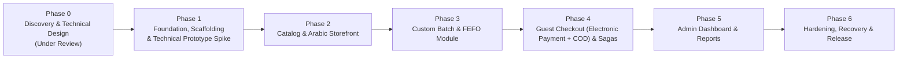

# Implementation Plan & Phase Breakdown
## Project: Arabic-First E-Commerce Store for Imported Food Products (Egypt)
**Document Status:** Revision 19 — Electronic Payments and Phase 0 Design Closure (Design Revision; Runtime Unverified)  
**Date:** 2026-10-25  
**Target Release:** MVP  
**Review Decision:** `Phase 0 design closure is defined; cross-document review/sign-off is pending. Runtime evidence is deferred to the Phase 1 Technical Compatibility Spike.`  
*(Phase 0 closes on design/documentation and recorded owner decisions only; a restricted Phase 1 Technical Compatibility Spike may run before Phase 0 sign-off, but store feature development remains blocked until the spike evidence and launch gates are reviewed)*

---

## 1. Overview and Phased Delivery Roadmap

The project adheres to an incremental delivery model. Progression to any subsequent phase is strictly blocked until the preceding phase satisfies its formal **Acceptance Gate**.



---

## 2. Phase 0 — Discovery and Technical Design (Current Milestone)

### Objective
Deliver a comprehensive, unified technical architecture, data model, state workflow, security policy, and risk assessment that resolves all Medusa v2 cross-module boundaries, inventory sources of truth, cart locking coordination, and failure recovery mechanisms.

### Phase 0 Acceptance Gate (Design Closure; No Runtime Evidence Required)
Phase 0 closes when the architecture and supporting documents are complete and mutually consistent, and all required owner decisions are recorded. Phase 0 does **not** claim package compatibility, successful migrations, concurrency safety, or restore readiness. All checkboxes below intentionally remain unchecked until a reviewer records the corresponding design-review result; do not use this list to imply runtime verification.

- [ ] **1. Architecture & Compatibility (design only):** Candidate versions and module boundaries are explicitly documented, including Medusa Module Links rather than unsupported cross-module foreign keys. Actual dependency resolution, install, build, and migration evidence belongs to the Phase 1 Spike list below.
- [ ] **2. Authoritative Inventory Strategy:** `batch_inventory` is documented as the sole authority for batch-managed food stock, with tri-state balances (`on_hand`, `reserved`, `quarantined`), two-phase cart reservations, canonical `checkout_attempt_id` and server-generated `checkout_line_key`, epoch fencing (`cart_checkout_session`), immutable attempt history, and atomic ledger-mutation contracts.
- [ ] **3. Unified Workflows & State Machines:** Operational, fulfillment, electronic-payment, COD, and return states and their transitions are documented, including partial returns/refunds and separation of delivery failures from customer returns.
- [ ] **4. Sagas & Crash Recovery:** Checkout/payment orchestration, compensation, order correlation, uncertain outcomes, and recovery boundaries are documented without claiming execution.
- [ ] **5. Security & Deployment Specification:** Idempotency, trusted-proxy handling, guest claim/OTP controls, hosted/redirect electronic payment, webhook signature verification, webhook-secret storage, and sanitized audit logging are specified.
- [ ] **6. Risk & Taxonomy Register:** Technical claims are correctly classified as `[VERIFIED-DOCS]`, `[SOURCE-VERIFIED]`, `[PROPOSED]`, `[OWNER-DECISION]`, or `[VALIDATED-TEST]`; Phase 0 must not claim any unexecuted behavior as `[VALIDATED-TEST]`.
- [ ] **7. Acceptance Test Plan:** Design acceptance criteria for Checks A-I and a TP registry covering inventory, checkout, electronic payment, COD, webhook handling, refunds, recovery, and restore evidence are documented. Every runtime test remains unchecked until actually executed.
- [ ] **8. Owner Decisions & Launch Gates:** Gate 4's shipping, opened-item/goods-condition, discounted item-price basis, and full items-plus-shipping refund routing for undelivered electronic orders are recorded as decided. Tax treatment, possible shipping withholding for refused/unreachable undelivered electronic orders, and legal review/approval of Arabic policy text remain `Owner input required`; Gate 6 gateway selection also remains open. Electronic payment and COD are offered side by side; Gates 1, 2, 3, and 5 block launch only.

### Evidence Required in the Phase 1 Technical Compatibility Spike (Not Phase 0 Design Closure)
The following evidence cannot be supplied by documentation review. Each row remains unexecuted until reproducible logs, exit codes, database assertions, and the tested package/environment metadata are attached.

| Evidence item | What must be run/proved | Existing or new TP rows / checks |
|---|---|---|
| Exact dependency compatibility | Candidate package metadata and peer requirements, lockfile reproducibility, clean install, dependency tree, backend/storefront builds, baseline migrations. | Check H; Spike setup tasks 1–4. |
| Native checkout/order correlation | Actual `completeCartWorkflow` behavior, stable cart-to-order correlation, no duplicate order, unknown outcome fencing. | Check C; TP-08a/08b, TP-13c. |
| Inventory atomicity and concurrency | Reservation/ledger atomicity, replay/conflict behavior, cleanup, conversion, trigger and lock interleavings. | Check B; TP-06/07/09/10/11/23e/24c and related subcases. |
| Checkout crash recovery | Recovery at all seven documented checkpoints, with safe no-release behavior for uncertain order/payment outcomes. | Check D; TP-12/13/14/15 plus new payment rows TP-25a–TP-25d. |
| Refund lifecycle and capacity | Computed/approved amount freeze, override audit, partial refunds, idempotency, gateway failure/unknown outcome, reconciliation. | Check F; TP-21/22/23 plus TP-25c/TP-25d. |
| Guest access and payment security | Guest claim/OTP, hosted redirect flow, webhook signature rejection, duplicate/out-of-order webhook handling, secret non-disclosure. | Check G; TP-20a/20b plus TP-25a/TP-25b. |
| Database restore and invariant audit | Restore a staging snapshot and execute schema-consistency/ledger queries. | TP-24a/24b; Gate 5 is a launch gate, not a Phase 0 design gate. |

### Phase 0 Review Checks A-I (Design Review Only)
Checks A-I assess document completeness and consistency only. Any evidence requiring installs, builds, migrations, concurrency, webhook simulation, or restore is tracked in the Spike table above and must not be treated as complete from reading documents alone.

| Check | Design-review scope | Status |
|---|---|:---:|
| **A — Architecture and module boundaries** | Ownership, module links, service boundaries, candidate-version assumptions clearly labeled. | `[ ]` |
| **B — Inventory and ledger contract** | Balances, movement types, lock protocol, snapshots, replay/conflict, cleanup and reconciliation specified consistently. | `[ ]` |
| **C — Checkout/order/payment correlation** | Durable attempt states, order correlation, electronic-payment/COD branches and unknown-outcome behavior documented. | `[ ]` |
| **D — Crash recovery and idempotency** | Seven checkpoints, fencing, retries, safe stored response, and payment compensation documented. | `[ ]` |
| **E — Returns and order versioning** | Version-matched allocations, return quantity, immutability and transition guards specified. | `[ ]` |
| **F — Refund lifecycle** | Formula ownership, computed amount, override audit, frozen approval, partial refunds and payout reconciliation documented. | `[ ]` |
| **G — Guest access and payment security** | Claim redemption, OTP, hosted payment redirect, webhook authentication and data minimization specified. | `[ ]` |
| **H — Compatibility evidence boundary** | Exact candidate pins and the list of required runtime evidence are documented; compatibility itself is not claimed. | `[ ]` |
| **I — Owner decisions and launch gates** | Final owner decisions are recorded and unresolved parameters are explicitly assigned to owner input; launch-only gates are separated. | `[ ]` |

---

### Revision 19 — Design Closure and Runtime Evidence Boundary

Phase 0 acceptance is a **design/documentation decision**, not a statement that the application is built or runtime-safe. The restricted Phase 1 Technical Compatibility Spike may begin before formal Phase 0 sign-off solely to validate package compatibility, scaffold the isolated prototype, apply migrations to a disposable test database, and execute the listed TP cases. It may implement only the minimal adapters/harness needed to exercise those cases. It may **not** build the storefront, catalog, production checkout, production payment integration, admin features, or other store features; it may not deploy to production or enable sales. No install, build, migration, restore, or test result is asserted by this document.


## 3. Phase 1 — Foundation, Scaffolding & Technical Compatibility Spike

### Objective
Establish the repository structure, initialize Next.js 15.5.28 and the Medusa v2.21.2 candidate cohort, connect to PostgreSQL 16.15, configure environment variables, and execute a **Technical Compatibility Spike** covering dependency compatibility, cart/order correlation, inventory reservations, electronic-payment/COD branches, webhook handling, refund idempotency, and recovery before broader feature development.

> **Phase Transition & Scaffolding Policy:**  
> Authorization is granted **EXCLUSIVELY** for initial monorepo scaffolding and executing the 59 listed Technical Prototype test rows (TP-01 through TP-25d, including lettered subcases). Store feature development remains **STRICTLY BLOCKED** until Phase 0 design sign-off and all 59 enumerated prototype test rows (including explicitly listed lettered subcases) pass with logged terminal evidence. Gates 1, 2, 3, and 5 block production launch only, not feature development. The provider-specific electronic-payment integration and final refund-formula activation remain blocked until the open Gate 6/Gate 4 parameters are supplied. The Spike may use a provider simulator; it must not select a gateway on the owner’s behalf.

### Concrete Tasks
1. Initialize monorepo directory layout:
   ```text
   website/
     apps/
       storefront/        # Next.js 15.5.28 App Router (React/react-dom 19.3.1 candidate)
       backend/           # Medusa framework/server/CLI 2.21.2 candidate cohort (Node.js 24.22.1 LTS)
     docs/                # Approved architecture and specs
     package.json
     .env.example
   ```
2. Scaffold **Next.js 15.5.28** with React/react-dom 19.3.1 candidate, TypeScript 5.5.4, Tailwind CSS 3.4.17, and RTL plugins.
3. Scaffold **Medusa framework/server/CLI v2.21.2 candidate cohort**; use exact versions defined in `architecture.md` and verify peer dependencies before acceptance.
4. Establish the PostgreSQL 16.15 target database connection pool (or an explicitly owner-approved patched 16.x minor), pin the immutable service/image digest, and run baseline Medusa core migrations via MikroORM. The migration and connection path remains unverified until executed against the selected candidate dependency set.
5. Set up `.env.example` with sanitized placeholders.
6. Configure ESLint, Prettier, and TypeScript strict mode across both apps.
7. Implement admin seed script for initial super-administrator user with neutral non-production placeholders.
8. **Execute Technical Prototype Gate (Canonical TP ID Registry):**
   Execute the 59 listed prototype test rows (TP-01 through TP-25d, including subcases) in the local staging environment and capture logged terminal evidence:

### Canonical Technical Prototype (TP) Registry (TP-01 through TP-25d)

**Registry count:** 59 test rows are currently enumerated in this table. IDs with letter suffixes are individual test cases/subcases; TP-24c includes enforcement subcases A and B, and TP-25a–TP-25d cover electronic-payment failure modes. The registry has not been executed. All status markers remain `[ ]`.

| Test ID | Scenario Name & Scope | Setup & Inputs | Concurrent Interleaving / Injection | Expected Observable Result & DB State | Status |
|---|---|---|---|---|:---:|
| **TP-01** | **Cart Creation with Batch Variant** | Variant with `manage_inventory: false`. | Standard `POST /store/carts` with line items. | Cart created; native Medusa inventory checks skipped; line has `checkout_line_key` in metadata. | `[ ]` |
| **TP-02a**| **Distributed Cart Lock Acquisition** | Active cart ID `$CART_ID`. | Call `acquireLockStep({ key: "cart:" + cart.id, ttl: 120, timeout: 5, ownerId: workerId })`. | Lock acquired in Redis (`SET cart:... worker:... NX EX 120`); verifies nested workflow lock skip behavior. | `[ ]` |
| **TP-02b**| **Redis Lock Renewal & Heartbeat Coordination** | Active worker running checkout. | Heartbeat timer fires every 30s. Worker calls `extendLock`. Inject Redis delay/failure. | If Redis extends (1), PostgreSQL `idempotency_key.last_heartbeat_at` updates. If Redis fails (0), worker aborts immediately and refuses to update PostgreSQL. | `[ ]` |
| **TP-02c**| **Lock Timeout CAS Lease Abort** | Idempotency lease acquired; Redis lock acquisition times out (>5s). | Concurrent process holds Redis lock. | Worker executes CAS deletion `DELETE FROM idempotency_key WHERE key = :k AND lease_owner_id = :id AND status = 'pending'`; returns 409 Conflict without orphaned lease. | `[ ]` |
| **TP-03** | **Concurrent Cart Lock Rejection** | Lock key `cart:$CART_ID` held by Worker A. | Worker B initiates checkout on same cart with timeout 5s. | Worker B times out after 5s; throws `LockTimeoutError` mapped to 409 Conflict without reserving stock or altering epoch. | `[ ]` |
| **TP-04a**| **Cart Mutation Blocked During Checkout** | Checkout workflow holds lock on `cart:$CART_ID` and `cart_checkout_session.status = 'in_progress'`. | Client calls `POST /store/carts/:id/line-items`. | Request immediately rejected with 409 Conflict ("Cart checkout currently in progress; mutations locked"). | `[ ]` |
| **TP-04b**| **Cart Mutation After 120s Without Abort Action** | Session remains `in_progress` but `last_heartbeat_at` is older than 120s. | Client calls `POST /store/carts/:id/line-items`. | Request is REJECTED with 409 Conflict. Timestamp aging does NOT authorize mutation. Mutation permitted only after explicit recovery aborts session. | `[ ]` |
| **TP-05** | **Payment-Method Branch Selection** | Checkout explicitly selects electronic payment or COD; no gateway has been selected yet. | Execute each method branch in the prototype harness. | Electronic payment creates a provider-neutral `electronic_payment_attempt`; COD creates `cod_collection_record`; neither branch is inferred from the other. No payment-provider compatibility is claimed until the gateway is selected. | `[ ]` |
| **TP-06a**| **Multi-Line Reservation on Same Batch** | Two cart lines reserving the same batch in one attempt. | FEFO reservation assigns Batch A to Line 1 (qty 2) and Line 2 (qty 3). | Creates 2 distinct `cart_batch_reservation` rows with unique `checkout_line_key` values; updates `inventory_batch.quantity_reserved = quantity_reserved + 5`; logs 2 distinct `inventory_movement` rows (`quantity_reserved_delta = +2` and `+3`, other deltas 0) with canonical `inv:v1:reservation:{sha256hex}` keys whose digest inputs include each distinct reservation ID, and accurate locked balance snapshots. | `[ ]` |
| **TP-06b**| **Movement/Reservation Replay vs Conflicting Intent & Rollback** | Existing or new `(checkout_attempt_id, checkout_line_key, batch_id)` reservation identity; exact replay with the persisted reservation ID and matching movement; reuse with changed quantity, delta, batch, or reference; failure injected after balance update and before movement insert. | Sequential and concurrent requests testing the idempotency protocol after batch-first locking. | First execution creates one reservation, increments reserved stock once, and inserts one movement. Exact replay reuses the same reservation ID and movement and makes zero additional balance change or rows. Changed semantic intent returns 409; contradictory reservation/movement state raises a specific divergence error; injected ledger insert failure rolls back the balance and reservation mutation. | `[ ]` |
| **TP-07a**| **Expired Cart Reservation Cleanup & State/Movement Consistency** | Active reservation with `expires_at < transaction_timestamp`; run once, retry after commit, race two cleanup workers, inject an active reservation with a pre-existing matching movement, and inject a conflicting movement key. | `cleanupExpiredReservationsWorkflow` runs using one DB transaction, batch rows locked by ascending ID before reservation rows, then checks the canonical hashed key before mutation. | Successful new cleanup decrements reserved by `quantity` once and atomically inserts the `reservation_release` movement and sets `expired`; retry with `expired` + exact movement is a zero-write replay; `active` + matching movement is an integrity error; key mismatch is 409; `expired` without movement is an integrity error. | `[ ]` |
| **TP-07b**| **Concurrent Cleanup and Checkout Conversion Overlap** | Two transactions target overlapping batches/reservations; include a converted reservation and a stale candidate. | Force explicit interleavings against the Revision 18 hierarchy: for an attempt associated with an existing order, acquire the order-scoped advisory lock first, then session/attempt authority; for a proven pre-order attempt, use session/attempt authority without an order lock. Both paths lock all affected batches by ascending ID before reservation/allocation child rows. Assert no workflow acquires an order advisory lock after session/attempt locks. Cleanup must stop when order creation/correlation is uncertain. | Expected result: neither path releases converted stock; conversion uses exactly the validated reservation ID set; all balance/status/movement/allocation changes are atomic. Deadlock freedom is an expected design outcome, not a proven result until executed. | `[ ]` |
| **TP-08a**| **Native Cart Completion Workflow & Durable Attempt State** | Valid cart with active batch reservation and the attempt currently authoritative. | Persist/commit `attempt_status='order_creation_started'` and `order_correlation_status='pending_correlation'`; invoke `completeCartWorkflow.runAsStep({ input: { id: cart_id } })` using the selected candidate version. | If the workflow returns a usable order ID, guarded CAS binds the order to the same current attempt/epoch. The workflow input is not assumed to accept `metadata`. | `[ ]` |
| **TP-08b**| **Crash/Unknown Outcome Between Order Creation and Binding** | Crash or timeout after the durable `order_creation_started` marker; the call may have created an order without returning a usable ID. | Query orders by `cart_id`; inject both 0-order/in-flight and exactly-1-order cases, plus multi-order ambiguity. Do not require order metadata. | Exactly one order plus one compatible unresolved attempt is bound by CAS. Zero orders with uncertain workflow outcome leaves the attempt fenced in `pending_correlation`/`needs_reconciliation`; no new order, epoch increment, reservation release, or cancellation. Multiple candidates stop for manual reconciliation. | `[ ]` |
| **TP-09** | **Deterministic Line Item Allocation & Negative Set Guard** | Cart with duplicate variants with distinct metadata; injected released/expired reservation row. | Conversion step maps reservations to order lines using `checkout_line_key`. | `order_batch_allocation` records map deterministically via `checkout_line_key`. Conversion exclusively allocates validated active reservations; released/expired reservations are rejected and produce zero allocations or movements. If key is missing, aborts safely with 409 Conflict. | `[ ]` |
| **TP-10** | **Split-Batch Multi-Lot Allocation with Validated Set** | 5 units requested: 3 from Lot A, 2 from Lot B on one line item. | Conversion transaction executes over validated reservation set. | Creates 2 `order_batch_allocation` records referencing the same `order_line_item.id`; $\sum \text{quantity\_allocated} = 5$; logs 2 `allocation_conversion` movements (0 deltas) linking each batch with locked snapshots; verifies integral quantity invariant. | `[ ]` |
| **TP-11** | **Saga Compensation Rollback & Reservation Release** | Simulated failure injected during allocation step after order creation; failure injection at ledger-write boundary; include unknown cancellation outcome. | Step failure invokes compensation only when the order is authoritatively correlated to the current attempt and cancellation is permitted. Inject cancellation success and ambiguous cancellation outcome. | If cancellation is definitively confirmed, release reserved units with the canonical hashed `reservation_release`/`saga_cancel` key and commit the guarded balance decrement, movement, and reservation state atomically at most once. Release the cart lock and mark the attempt aborted only after compensation is confirmed. If cancellation/binding is uncertain, mark `needs_reconciliation`, retain the inventory/epoch fence, and do not release stock or create another order. Ledger failure rolls back the inventory compensation transaction. | `[ ]` |
| **TP-12a**| **Atomic Idempotency Lease Acquisition & Safe Replay** | New idempotency key; the initial successful response contains a transient claim code; then the same request is replayed. | First call issues the one-time claim code to the client but persists only a sanitized `response_body`; replay reads that row without reacquiring cart lock or changing epoch. | Replay returns the same order identity and stored status semantics but a sanitized body with no claim code; byte-for-byte equality with the first response is intentionally not required. No inventory/order mutations occur. | `[ ]` |
| **TP-12b**| **Stale Lease Takeover at 120 Seconds** | Inactive pending lease older than 120s with stopped heartbeat. | New worker arrives with same key. | New worker claims lease via atomic compare-and-set; enters canonical crash recovery protocol. | `[ ]` |
| **TP-12c**| **Cross-Key Cart Collision Guard** | Cart undergoing checkout under Key A; new request arrives with Key B. | Client submits Key B on same cart while Key A is active. | Checked against `cart_checkout_session`: rejects immediately with 409 Conflict ("Cart checkout currently in progress by another request"). | `[ ]` |
| **TP-13a**| **Crash Recovery Checkpoint 1 (Pre-Reservation)** | Crash before or during CBR creation. | Lease expires (>120s); retry occurs. | Advance session epoch to `E+1`, create Attempt B, execute fresh FEFO reservation. Succeeded with new order. | `[ ]` |
| **TP-13b**| **Crash Recovery Checkpoint 2 (Post-Reservation, Pre-Order)** | Crash after CBR committed, before native order creation. | Lease expires; retry occurs. | Old reservations released via canonical hashed `reservation_release`/`cleanup` keys; fresh reservations committed under Attempt B (`epoch = E+1`). | `[ ]` |
| **TP-13c**| **Crash Recovery Checkpoint 3 (Unresolved Order Correlation & Fresh-Key Fence)** | Durable `order_creation_started` marker exists; association is absent and native workflow result may be uncertain. A second request also presents a different idempotency key for the same cart. | Query native orders by cart ID and authoritative attempt state; simulate zero orders with unresolved workflow, exactly one order, and multiple candidates; submit a fresh-key request while correlation is unresolved. | Correlates only a uniquely compatible order/attempt pair supported by the verified native cart/order invariant. An unresolved zero-order result is not proof of failure; wait/reconcile without new order or release. A different key is rejected/deferred while the prior attempt is `pending_correlation`/`needs_reconciliation`. Ambiguity stops for manual review. | `[ ]` |
| **TP-13d**| **Crash Recovery Checkpoint 4 (Post-Association, Pre-Conversion)** | Crash after order is authoritatively bound, before conversion transaction commits. | Recovery worker inspects reservation status/expiry and injects definitive versus unknown cancellation result. | If reservations remain valid, resume guarded conversion over the exact validated set. If expired/superseded, cancel only the authoritatively correlated order under the recovery policy and release stock only after cancellation/compensation is definitively confirmed. If cancellation or correlation outcome is unknown, mark `needs_reconciliation`, retain the inventory/epoch fence, and perform no new order creation or reservation release. | `[ ]` |
| **TP-13e**| **Crash Recovery Checkpoint 5 (Post-Conversion, Pre-Downstream)** | Crash after conversion transaction commits, before operational/payment-method record initialization. | Recovery worker inspects session and persisted payment method. | Observes `cart_checkout_session.status = 'completed'`; initializes missing `order_operational_state` and exactly the matching payment record (`cod_collection_record` for COD, or electronic-payment correlation record for electronic payment); zero inventory balance changes. | `[ ]` |
| **TP-13f**| **Crash Recovery Checkpoint 6 (Post-Downstream, Pre-Idempotency)** | Crash after downstream initialized, before idempotency finalized. | Recovery worker inspects state. | Observes all commerce, operational, and financial records consistent; updates `idempotency_key` to `status = 'completed'` with safe response payload. | `[ ]` |
| **TP-13g**| **Crash Recovery Checkpoint 7 (Post-Completion Replay)** | Idempotency finalized; client retries request. | Client replays request with same key. | Returns cached response immediately. Zero database mutations. | `[ ]` |
| **TP-14a**| **Idempotency Hash Mismatch Rejection** | Same idempotency key with modified cart payload. | Client submits modified items or totals. | Workflow throws 409 Conflict immediately without executing reservation, lock, or saga steps. | `[ ]` |
| **TP-14b**| **Post-14-Day Retention Rejection** | Replay submitted after 14-day retention has purged idempotency row. | Client retries completed cart after 14 days. | Cart session check sees `cart_checkout_session.status = 'completed'`; rejects checkout with 409 Conflict. | `[ ]` |
| **TP-15a**| **Guarded Allocation Epoch Fencing** | Simulated worker stall past 120s; Worker 2 increments epoch in `cart_checkout_session`. | Worker 1 attempts conversion transaction. | Worker 1 guarded update matches 0 rows; rollback occurs. The stale worker must not cancel an order unless authoritative binding proves ownership and cancellation is safe; unknown correlation is marked for reconciliation. | `[ ]` |
| **TP-15b**| **Stale Worker Order Safety** | Stale worker compensation verifies `cart_checkout_attempt.order_id === :order_id`. | Worker 1 checks authoritative binding, current epoch, and cancellation eligibility before any cancellation. If ownership or outcome is unknown, it marks `needs_reconciliation` and does not cancel. | `[ ]` |
| **TP-15c**| **Stale Worker Takeover Rejection** | Worker 1 attempts to update session or idempotency after Worker 2 took over. | Worker 1 executes finalization query. | CAS update matches 0 rows (lease owner / epoch mismatch); Worker 1 aborts cleanly. | `[ ]` |
| **TP-16** | **Major-Unit Shipping Price Calculation** | Cart with `shipping_address.province = 'EG-C'` (50.00 EGP). | Fulfillment provider `calculatePrice` called. | Custom provider `egypt-zone-fulfillment` calculates fee from `shipping_delivery_zone`; native cart and order reflect **exactly 50.00 EGP** (not 5,000 EGP). | `[ ]` |
| **TP-17** | **Shipping Address Change Recalculation** | Governorate changed from Cairo (`EG-C`) to Giza (`EG-GZ`). | Update cart shipping address. | Shipping method invalidated and re-evaluated with updated governorate rate; native cart totals update. | `[ ]` |
| **TP-18** | **Unsupported Governorate Rejection** | Inactive or invalid governorate code (e.g. `EG-UNKNOWN`). | Attempt to select shipping option. | Provider throws `UNSUPPORTED_SHIPPING_ZONE`; client cannot proceed with checkout. | `[ ]` |
| **TP-19** | **Client-Tampered Shipping Fee Resistance** | Client attempts to submit custom shipping price. | Client injects tampered shipping amount in payload. | Backend rejects client-provided amount; enforces authoritative rate from `shipping_delivery_zone`. | `[ ]` |
| **TP-20a**| **Atomic Single-Use Claim Code Redemption via GETDEL** | One-time claim code exchanged for opaque session cookie (`Path=/`). | Client visits `/order/confirm?claim=...`. | First attempt succeeds (`GETDEL`); second attempt returns `nil` and is rejected (401/404); plaintext claim code never persists in database cache. | `[ ]` |
| **TP-20b**| **Cookie Scope and Order Isolation Guard** | Cookie with Order A session attempts to access Order B route. | Client calls `GET /api/guest/orders/:orderB_id`. | Route asserts `session.order_id === request.order_id`; rejects with 403 Forbidden. | `[ ]` |
| **TP-21a**| **Refund Replay with Stored Hash** | Replay of existing refund key with matching payload hash. | Admin submits duplicate refund request. | Returns existing status immediately without locking COD or initiating payout. | `[ ]` |
| **TP-21b**| **Refund Replay Tampering Rejection** | Replay of existing refund key with modified amount. | Admin submits modified refund amount with existing key. | Throws 409 Conflict immediately. | `[ ]` |
| **TP-21c**| **Recipient Hash Stability Under Fresh Nonces** | Identical recipient banking info encrypted with fresh IVs. | Compute `recipient_fingerprint` via keyed HMAC before AES-256-GCM. | Fingerprints and `request_hash` match exactly despite differing ciphertexts; replay recognized safely. | `[ ]` |
| **TP-21d**| **4-Stage Preventive Dual-Control Lifecycle & Completion Guard** | CS creates intent -> Supervisor approves -> Finance operator disburses -> independent reconciler verifies statement. Also attempt direct completion with no submitted child attempt, mismatched parent/child reference, missing child reconciliation evidence, or reused actor. | Exercise the full lifecycle, provider success followed by lost response, unknown outcome, evidence-based resolution, and direct database status mutation through an authorized test role. | The lifecycle reaches `completed` only with a submitted child attempt, matching nonempty external references, recorded independent child reconciliation, and four distinct parent actors. Missing/mismatched child state or actor reuse is rejected. Unknown payout outcome retains capacity and cannot be resent automatically. | `[ ]` |
| **TP-21e**| **Separation of Duties Enforcement** | Requestor attempts to approve own refund (`requested_by === approved_by`), or disburser reconciles own payout. | Use four distinct user identities for requester, approver, disburser, and reconciler; attempt every pairwise role reuse. | Application role authorization plus the strengthened database actor check reject any reuse; completed refunds require all four actor IDs. A DB CHECK is not an authorization system by itself. | `[ ]` |
| **TP-21f**| **Mandatory Transfer Reference on Disbursement** | Attempt to change an attempt to `submitted` / refund to `disbursement_submitted` without a verified nonempty external reference. | Submit status update with null or empty reference. | Rejected; the initial `disbursement_initiated` state may exist before external action, but it is never represented as a confirmed submission without a reference. | `[ ]` |
| **TP-22a**| **Repeated Partial Refunds & Dynamic Capacity Guard** | Multiple partial refunds competing for remaining capacity. | Two partial refund intents submitted concurrently. | Sums all reserved refund amounts including `pending_approval`, `approved`, `disbursement_initiated`, `disbursement_unknown`, `disbursement_submitted`, and `completed`; unknown transfers continue to reserve capacity. COD becomes `fully_refunded` only after completed/refund-reconciled amounts reach collected cash. | `[ ]` |
| **TP-22b**| **Refund Exceeding Collected Cash Capacity Rejection** | Refund amount exceeds unreserved collected cash. | Attempt to refund 600 EGP on 500 EGP collected. | Transaction rolls back; returns 422 Unprocessable Entity. | `[ ]` |
| **TP-23a**| **Return Quantity Trigger Limit Enforcement** | Return item exceeding batch allocation or line ordered quantity. | Client submits return item with quantity > allocated. | Trigger `trg_check_return_quantity` row-locks `order_item` and rejects transaction. | `[ ]` |
| **TP-23b**| **Parent Return Request Row Lock FOR SHARE** | Concurrent return item insertion racing with return request completion. | Item inserted while parent request transitions to completed. | Parent row lock FOR SHARE blocks status modification until item insert commits or fails; completed status rejects item insert. | `[ ]` |
| **TP-23c**| **Illegal Direct Completion Rejection & Exact Refund Settlement** | Attempt insert-direct-to-`completed`; transition before inspections are final; omit or alter frozen `approved_refund_amount`; complete with completed-refund total below or above the approved amount; include the undelivered depot-return/COD precondition. | Exercise direct SQL through the test role and the supported service workflow, with refund records in each boundary state. | Trigger rejects direct completion, incomplete inspection, missing/frozen-amount mismatch, and refund-total mismatch. Customer-return completion succeeds only when all inspections are final, at least one item is approved, the frozen owner-policy-derived amount exists, and the sum of independently reconciled completed refunds equals it exactly. Undelivered COD depot return requires `collection_failed` and creates no cash refund when none was collected. An electronically paid undelivered depot return computes a full items-plus-shipping refund routed through admin approval/override; electronic refund reconciliation is covered by TP-25d. | `[ ]` |
| **TP-23d**| **Multi-Row Insert and Reactivation Aggregation** | (A) Initial multi-row insert contains two 2-unit rows for the same line/batch on a 3-unit allocation. (B) A rejected/cancelled request is reactivated with two 2-unit rows on the same 3-unit allocation. | Test both a single multi-row INSERT using the statement transition table and the request-reactivation update path. Include a line split across multiple valid batches. | Both A and B aggregate all rows by `(line_item_id, batch_id)` and line/order version; the 4-unit request is rejected against a 3-unit allocation, and a request is rejected if aggregate line quantity exceeds ordered quantity. Valid split-batch requests within both limits may proceed. | `[ ]` |
| **TP-23e**| **Return Concurrency, Order-Version, and Cross-Domain Locking** | Concurrent request/validation, physical receipt/restock, and refund transactions for the same order. | Every supported custom workflow acquires the order-scoped transaction advisory lock before row mutations. Return-request changes/item inserts use a validation transaction with no batch mutation. Physical return-stock transactions lock batches ascending and update only pre-existing return-item rows; they do not insert return_item or update return_request status after batch locks. Refund transactions do not lock inventory batches. Inject opposite-order privileged direct SQL only as a negative test; deadlock rollback is acceptable and zero-deadlock behavior remains unproven. | No over-return commits; no physical stock transaction invokes an INSERT/request-state trigger that locks native order/order_item after batch locks. The saved order_version matches both order lines and allocations. All results remain unexecuted until evidence is captured. | `[ ]` |
| **TP-23f**| **Terminal Completed Return Immutability** | Attempt to change any field of a `completed` return request, including notes/status/order_version, as well as attempts to edit return-item identity/quantity. | Trigger rejects all changes to a completed request and all identity/quantity rewrites on return_item with defined error codes. | `[ ]` |
| **TP-24a**| **Disaster Recovery Schema Consistency Queries & Ledger Invariant Audit** | Restored database from staging snapshot. | Runs consistency queries against `"order"`, `order_item` (with version check), `order_line_item`, `order_batch_allocation`, `inventory_batch`, and `inventory_movement`. | Returns 0 mismatched rows; confirms line allocations match active ordered quantities, and confirms $\text{quantity\_on\_hand} = \sum \text{quantity\_on\_hand\_delta}$, $\text{quantity\_reserved} = \sum \text{quantity\_reserved\_delta}$, and $\text{quantity\_quarantined} = \sum \text{quantity\_quarantined\_delta}$ per batch. | `[ ]` |
| **TP-24b**| **Payment-Method and Operational State Synchronization Check** | Restored database verification. | Runs cross-table join verifying every active order has operational state and exactly the required method-specific payment record. | Returns 0 missing/orphaned operational records; COD orders have COD records, and electronic-payment orders have correlated payment attempts. | `[ ]` |
| **TP-24c**| **Append-Only Movement Ledger Enforcement (Subcases A/B)** | Existing movement rows; actual `medusa_app` role plus a separate non-owner test role that has UPDATE/DELETE privileges but remains subject to the trigger. | **A:** Application-role attempts UPDATE, DELETE, TRUNCATE. **B:** Trigger-test role attempts UPDATE/DELETE. | **A:** Privilege layer rejects UPDATE/DELETE/TRUNCATE and rows remain unchanged. **B:** Trigger rejects UPDATE/DELETE with SQLSTATE `P0001` and message `INVENTORY_MOVEMENT_IMMUTABLE`; rows remain unchanged. These are distinct mechanisms; neither subcase is marked executed. | `[ ]` |
| **TP-25a** | **Electronic Payment Failure/Abandonment and Reservation Release** | Electronic-payment attempt initiated; customer fails, declines, or abandons hosted payment. | Deliver definitive failed/expired status and separately simulate an unknown timeout. | Definitive failure permits order cancellation and reservation release only after cancellation is authoritative; unknown outcome retains reservation/fence pending reconciliation. No false `paid` state. | `[ ]` |
| **TP-25b** | **Duplicate, Invalid-Signature, and Out-of-Order Payment Webhooks** | Valid payment event plus duplicate, invalid-signature, and earlier/later event deliveries using a provider simulator. | Deliver same provider event ID twice, tampered signature, and stale event after a newer state. | Signature failure is rejected; duplicate event causes no duplicate transition; out-of-order event is recorded/idempotently ignored or reconciled without state regression. | `[ ]` |
| **TP-25c** | **Payment Succeeded but Order Creation Failed / Timed Out** | Provider reports successful payment while order creation fails or its outcome is uncertain. | Inject failure before order persistence and an ambiguous timeout after order creation starts. | Do not release inventory or retry order creation while correlation is unknown. Once failure is definitive, void/refund the payment using provider-supported semantics and release reservations only after compensation/cancellation is confirmed. | `[ ]` |
| **TP-25d** | **Partial Electronic Refund and Gateway Refund Failure/Timeout** | Paid electronic order with approved frozen refund amount and a partial return. | Gateway refund succeeds with lost response, definitively fails, or times out; reconcile provider transactions against local records. | System-computed amount is bounded by frozen approval; override reason/approver are audited; partial refunds reserve capacity; unknown result is not blindly retried; reconciliation prevents double refund and identifies mismatches. | `[ ]` |

### Verification & Acceptance Gate
- [ ] Technical Prototype passes all 59 enumerated test rows, including the defined subcases, with logged terminal execution evidence.
- [ ] Exact package metadata/peer requirements are captured with `npm view` for all pinned packages.
- [ ] A lockfile is committed and `npm ci` succeeds without peer conflicts.
- [ ] `npm ls --all` contains no incompatible duplicate Medusa core versions or missing peer dependencies.
- [ ] `npm run lint` exits with code 0 across apps.
- [ ] The supported Medusa build command and storefront production build both succeed with reproducible logs.
- [ ] PostgreSQL migrations, database trigger checks, and TP concurrency tests are executed against the pinned service versions; no result is inferred from documentation alone.