# Order and Inventory Workflows Specification
## Project: Arabic-First E-Commerce Store for Imported Food Products (Egypt)
**Document Status:** Revision 19 — Electronic Payments and Phase 0 Design Closure (Design Revision; Runtime Unverified)  
**Date:** 2026-10-25  
**Current Review Decision:** `Phase 0 design closure is defined; cross-document review/sign-off is pending. Runtime evidence is deferred to the Phase 1 Technical Compatibility Spike.`  
*(Phase 0 closes on design/documentation and recorded owner decisions only; a restricted Phase 1 Technical Compatibility Spike may run before Phase 0 sign-off, but store feature development remains blocked until the spike evidence and launch gates are reviewed)*

---

## 1. Unified State Machines & Database Mapping

Operational fulfillment, customer returns, COD cash settlement, and electronic payment are separate state machines. Electronic payment state is held in `electronic_payment_attempt`; provider events are recorded in `payment_webhook_event`. Payment method is explicit per checkout/order and payment state must not be inferred from fulfillment or COD state.

```mermaid
flowchart TD
    subgraph OperationalFlow["1. Operational Order Lifecycle (order_operational_state.operational_status)"]
        O_New["new"] --> O_Confirmed["confirmed"]
        O_New --> O_Cancelled["cancelled"]
        O_Confirmed --> O_Prep["in_preparation"]
        O_Confirmed --> O_Cancelled
        O_Prep --> O_Shipped["shipped"]
        O_Prep --> O_Cancelled
        O_Shipped --> O_Delivered["delivered"]
        O_Shipped --> O_UndeliveredRet["undelivered_returned\n(Physical Delivery Failed & Returned to Depot)"]
        O_Delivered --> O_Completed["completed\n(Delivered + selected payment settlement condition met)"]
        O_Delivered --> O_ReturnProg["return_in_progress\n(Customer Post-Delivery Return Claim)"]
        O_Completed --> O_ReturnProg
        O_ReturnProg --> O_FullyRet["fully_returned\n(Inspection Approved + Full Refund Completed)"]
        O_ReturnProg --> O_PartReturned["partially_returned\n(Inspection Approved + Partial Refund Completed)"]
        O_ReturnProg --> O_PriorState["Revert to Prior State\n(completed / partially_returned / delivered)"]
        O_PartReturned --> O_ReturnProg
    end

    subgraph ElectronicPaymentFlow["2. Electronic Payment (electronic_payment_attempt.status)"]
        P_Initiated["initiated"] --> P_Authorized["authorized"]
        P_Authorized --> P_Paid["paid"]
        P_Initiated --> P_Failed["failed"]
        P_Initiated --> P_Abandoned["abandoned"]
        P_Initiated --> P_Unknown["outcome_unknown"]
        P_Unknown --> P_Paid
        P_Unknown --> P_Failed
        P_Paid --> P_PartialRefund["partially_refunded"]
        P_PartialRefund --> P_PartialRefund
        P_PartialRefund --> P_Refunded["refunded"]
        P_Paid --> P_Refunded
    end

    subgraph FulfillmentFlow["2. Physical Fulfillment (order_operational_state.fulfillment_status)"]
        F_Unf["unfulfilled"] --> F_Prep["preparing"]
        F_Prep --> F_Shipped["shipped"]
        F_Shipped --> F_Delivered["delivered"]
        F_Shipped --> F_Attempt["failed_attempt\n(Max 2 courier retries)"]
        F_Attempt --> F_Shipped
        F_Attempt --> F_Returned["returned_to_warehouse\n(Terminal: Depot Arrival)"]
    end

    subgraph CODFlow["3. COD Cash Settlement (cod_collection_record.collection_status)"]
        C_Unpaid["unpaid"] --> C_Collected["collected_by_carrier"]
        C_Unpaid --> C_Failed["collection_failed\n(Terminal: COD parcel returned undelivered; no cash refund)"]
        C_Unpaid --> C_Cancelled["cancelled"]
        C_Collected --> C_Remitted["remitted_to_bank"]
        C_Remitted --> C_PartRefund["partially_refunded\n(Non-terminal; supports multiple partial refunds)"]
        C_PartRefund --> C_PartRefund
        C_PartRefund --> C_FullRefund["fully_refunded\n(Terminal: cumulative completed refunds == collected_amount)"]
        C_Remitted --> C_FullRefund
    end
```



### 1.1 Permitted Transitions, Transition Guards & Invariants

| State Machine | Column Name | Current State | Allowed Next States | Transition Guards & Preconditions |
|---|---|---|---|---|
| **Operational Status** | `order_operational_state.operational_status` | `new` | `confirmed`, `cancelled` | `cart_batch_reservation` converted to `order_batch_allocation`. |
| | | `confirmed` | `in_preparation`, `cancelled` | Picking list generated; staff starts packing. |
| | | `in_preparation` | `shipped`, `cancelled` | Pre-dispatch canonical expiration check passed; carrier tracking attached. |
| | | `shipped` | `delivered`, `undelivered_returned` | Handed to customer, or courier returned parcel after exhausted delivery attempts. |
| | | `undelivered_returned` | *Terminal* | Delivery failed. Goods physically in depot quarantine. `cod_collection_record.collection_status = 'collection_failed'`. **For COD only, zero cash refund is issued when no cash was collected.** For an electronically paid order returned undelivered by the courier, compute a full refund of items plus shipping and route it through the normal admin approval/override flow with an audited reason. Whether shipping may be withheld when the customer refused delivery or was unreachable remains `Owner input required`. Rescheduling requires a new order. |
| | | `delivered` | `completed`, `return_in_progress` | Transition to `completed` requires the settlement condition for the selected payment method: COD requires `cod_collection_record.collection_status = 'remitted_to_bank'`; electronic payment requires authoritative payment status `paid`. A completed electronic refund is tracked separately and does not rewrite the original payment as unpaid. |
| | | `completed` | `return_in_progress` | Customer files a return within the approved commercial return window. |
| | | `return_in_progress`| `partially_returned`, `fully_returned`, *prior_state* | If return inspection is completely rejected, reverts to recorded `prior_operational_status` (`completed`, `partially_returned`, or `delivered`). Transitions to `partially_returned` or `fully_returned` **only after inspection is approved AND the associated refund record is `completed`**. |
| | | `partially_returned`| `return_in_progress` | **Non-terminal:** Customer may file additional returns for remaining unreturned items until all items are returned. |
| | | `fully_returned` | *Terminal* | 100% of order items returned, inspected, and refunded. |
| | | `cancelled` | *Terminal* | Unreserved stock released. Cannot be cancelled after dispatch. |
| **Fulfillment Status** | `order_operational_state.fulfillment_status` | `unfulfilled` | `preparing` | Warehouse picking commences. |
| | | `preparing` | `shipped` | Parcel dispatched with courier. |
| | | `shipped` | `delivered`, `failed_attempt` | Delivery attempt logged by courier driver in `delivery_attempt`. |
| | | `failed_attempt` | `shipped` (retry), `returned_to_warehouse` | Max 2 re-attempts allowed (3 total attempts). If 3rd fails, parcel returns to warehouse. |
| | | `returned_to_warehouse`| *Terminal* | Arrives at depot; triggers `return_request` with `return_type = 'undelivered_depot_return'`. |
| **COD Status** | `cod_collection_record.collection_status` | `unpaid` | `collected_by_carrier`, `collection_failed`, `cancelled` | Initial state upon checkout. |
| | | `collected_by_carrier`| `remitted_to_bank` | Cash deposited into merchant bank account; verified against courier settlement statement. |
| | | `remitted_to_bank` | `partially_refunded`, `fully_refunded` | Payout created in `refund_record` following approved inspection and dual-control approval. |
| | | `partially_refunded`| `partially_refunded`, `fully_refunded` | **Non-terminal:** Cumulative refund guard enforces $\sum \text{refunds} \le \text{collected\_amount}$. |
| | | `fully_refunded` | *Terminal* | Cumulative completed refunds equal total collected funds. |
| | | `collection_failed` | *Terminal* | Final status if parcel returned to depot undelivered. Strictly terminal; no transition to cancelled or unpaid. |
| | | `cancelled` | *Terminal* | Cancelled prior to collection. |

---

## 2. Electronic Payment, COD Selection, and Provider-Neutral Webhook Contract

### 2.1 Payment method and state interaction

The MVP supports **electronic payment and COD side by side**. The selected method is persisted in `cart_checkout_attempt.payment_method` before external payment/order creation begins and copied to `order_operational_state.payment_method`; it cannot be inferred from the operational order state. The hosted payment session and native order creation may resolve in either order according to the eventual provider contract, so the Saga reconciles both independently.

- Electronic payment internal states: `initiated`, `authorized`, `paid`, `failed`, `abandoned`, `partially_refunded`, `refunded`, `outcome_unknown`, `void_pending`, `voided`.
- COD remains a separate state machine in `cod_collection_record`: `unpaid`, `collected_by_carrier`, `remitted_to_bank`, `partially_refunded`, `fully_refunded`, `collection_failed`, `cancelled`.
- Fulfillment may begin only after authoritative `paid` for electronic payment, or after the COD branch is selected and its order/collection record is initialized under the documented operational policy. COD collection/remittance is never represented as an electronic payment status.
- `authorized` is not equivalent to `paid`; only the selected provider's authoritative captured/paid semantic may transition an electronic attempt to `paid`. Exact provider status mapping is pending gateway selection.

### 2.2 Webhook inbox and idempotency

1. Verify the provider signature using the provider's documented signing algorithm and the exact raw request bytes before accepting the event. Invalid signatures cannot mutate any payment/order state.
2. Deduplicate by the unique pair `(provider_key, provider_event_id)` and compare a canonical `payload_hash`. An exact duplicate is acknowledged idempotently; the same event ID with a different hash is quarantined and reconciled.
3. Persist the verified event to `payment_webhook_event` before applying state changes. Process the event and payment-state transition atomically where supported; if processing fails, retain a retryable inbox status.
4. Do not rely only on webhook arrival order or event timestamps. Apply guarded monotonic transitions; if an event is stale or conflicts with current state, query the provider's authoritative payment record (when supported) and reconcile. Never regress `paid` to `initiated`/`failed` based solely on a delayed event.
5. Provider event ID and the internal `electronic_payment_attempt.idempotency_key` are separate identities. Send the internal key to the gateway only if its documented API supports idempotency semantics.

### 2.3 Saga and compensation rules

- **Payment succeeds but order creation fails definitively:** keep the checkout attempt and provider reference durable; request void/reversal if the payment is only authorized, otherwise request a refund using the provider-supported flow. Release inventory reservations only after the order is definitively absent/cancelled and the payment compensation outcome is authoritatively confirmed. Record the compensation and reconcile provider records.
- **Order creation starts but correlation is unknown:** do not create another order, do not automatically refund/void, and do not release reservations. Keep the epoch fence and inventory reservation while the recovery process resolves the order/payment outcome.
- **Order exists but payment definitively fails or is abandoned:** do not mark the order paid or dispatch it. Cancel the order through the documented cancellation workflow; release reservations only after cancellation is authoritative and any payment session is confirmed failed/expired/voided. A timeout is `outcome_unknown`, not a definitive failure.
- **COD selected:** no electronic payment attempt is created as a substitute for the COD record. The COD state machine tracks carrier collection and remittance independently.
- Compensation steps are idempotent and resumable. If provider compensation outcome is unknown, mark `needs_reconciliation`, retain the stock/payment fence, and prohibit blind retry.

### 2.4 Refund formula, partial refunds, and reconciliation

For each inspected return, the system computes a proposed refund from the per-unit amount actually paid after discounts, returned quantity, the structured `return_cause` and `goods_condition`, and the applicable shipping rule in the decision table below. Merchant-caused returns receive shipping refund; change-of-mind returns do not, and opened items are not accepted for change of mind. For electronically paid orders returned undelivered by the courier, compute a full refund of items plus shipping, freeze it through the same `approved_refund_amount`/approver/timestamp and override-audit mechanism, create a refund intent, and require exact completed/reconciled settlement before completing the return; only a never-captured `voided`/`failed` payment with no `refund_record` may complete without payout. Tax treatment and whether shipping may be withheld for refused/unreachable undelivered electronic orders remain `Owner input required`; the Arabic policy text also requires legal review/approval before launch. An authorized admin may approve the computed amount or override it; every override records reason and approver. On approval, `approved_refund_amount` plus approver/time and override audit become immutable.

**Ordered refund decision table**

| Order / `return_cause` | `goods_condition` | Item refund | Shipping included? | Decision / route |
|---|---|---|---|---|
| Customer return / `merchant_fault` | `sealed` | Full paid-after-discount item amount for returned quantity | Yes | Refundable; compute and route for admin approval/override with audited reason. |
| Customer return / `merchant_fault` | `opened` | Full paid-after-discount item amount for returned quantity | Yes | Refundable; merchant-caused defect/issue is not rejected solely because packaging was opened. |
| Customer return / `merchant_fault` | `damaged_on_receipt` | Full paid-after-discount item amount for returned quantity | Yes | Refundable. |
| Customer return / `merchant_fault` | `expired` | Full paid-after-discount item amount for returned quantity | Yes | Refundable. |
| Customer return / `customer_change_of_mind` | `sealed` | Paid-after-discount item amount for returned quantity | No | Refundable for item price only; shipping is not refunded. |
| Customer return / `customer_change_of_mind` | `opened` | None | No | Not accepted; no refund for change of mind. |
| Customer return / `customer_change_of_mind` | `damaged_on_receipt` or `expired` | Not a valid combination | Not applicable | Record as `merchant_fault` when the actual reason is damage/expiry; do not classify it as change of mind. |
| `undelivered_depot_return` / `courier_undelivered`, electronic payment | NULL (not applicable) | Full refund of all items | Yes, full shipping included by default | `return_item.return_cause` uses `courier_undelivered`; `goods_condition` must be NULL. Freeze the full items-plus-shipping amount via `approved_refund_amount` with approver/timestamp and any required override audit, create a refund intent, and require exact completed/reconciled refund settlement before completion. Only payment status `voided` or `failed` before capture with no `refund_record` permits completion without a refund. Shipping withholding for refused/unreachable customers remains `Owner input required`. |
| `undelivered_depot_return` / `courier_undelivered`, COD | Not applicable | No cash refund when no cash was collected | No cash refund | `return_item.return_cause` uses `courier_undelivered`; COD collection failure remains governed by `collection_failed`; do not apply the electronic refund rule. |

**Existing TP coverage mapping (no new rows; registry remains 59):**
- Merchant-fault returns across `sealed`, `opened`, `damaged_on_receipt`, and `expired`, plus change-of-mind handling for `sealed` versus rejected `opened`: TP-23c should cover the formula-derived amount and exact refund settlement; TP-21d covers approval/override audit; TP-23f covers immutability after completion.
- Structured `return_cause` and `goods_condition` CHECK values, inspection-time assignment, and cause editability only before approval: include the constraints and lifecycle boundaries in the existing TP-23c and TP-23f coverage; no new TP row is introduced.
- Formula breakdown (`computed_items_total`, `shipping_refund_amount`, `shipping_refund_reason`, `computed_refund_amount`) and freeze after approval: TP-21d and TP-23c; replay stability/tampering of the frozen refund request: TP-21a and TP-21b.
- Repeated/partial refunds must stay within remaining payment capacity: TP-22a covers repeated partial refunds and reserved capacity; TP-22b covers the COD collected-cash ceiling; TP-25d covers electronic refund partials, unknown outcomes, and reconciliation.
- Undelivered electronic order full items-plus-shipping refund, approval/frozen-amount and override audit, refund-intent creation, exact completed/reconciled settlement, and the never-captured `voided`/`failed` no-`refund_record` exception: TP-23c and TP-25d; TP-21d covers approval/override audit and TP-25d covers provider timeout/reconciliation. The COD undelivered path remains covered by the unchanged COD-specific `collection_failed`/no-cash-refund guard in TP-23c.

**Decision-table note:** CONFIRMED by the owner: a sealed (unopened) item returned for change of mind is accepted for item price only, without shipping. This is a business decision, not a legal conclusion, and remains subject to lawyer review.

**Remaining `Owner input required`:** (1) tax treatment of tax included in the paid amount (accountant input); (2) whether shipping may be withheld for an undelivered electronic order when the customer refused delivery or was unreachable; and (3) legal review/approval of the Arabic Terms of Service, Privacy Policy, and return/refund policy before launch.

Partial refunds are permitted. Each refund amount is constrained by both the frozen approved amount for that return and remaining order-level paid/collected capacity. For electronic payments, gateway refund requests use a stable internal operation key and provider idempotency only where supported. Definitive failure is recorded; timeout/lost response becomes `outcome_unknown`, capacity remains reserved, and automatic resend is prohibited until reconciliation establishes whether the refund occurred. Reconcile gateway payment/refund records against local order, payment-attempt, refund, and external-reference records; mismatches are surfaced for manual investigation, not silently overwritten.

## 3. Order Checkout Workflow (`completeCartWorkflow` with method-specific payment branch)

### 3.1 Complete Saga Sequence with Attempt History & Guarded Conversion

```mermaid
sequenceDiagram
    autonumber
    actor Customer as Guest Customer
    participant API as Store API Route
    participant Saga as completeCartWorkflow
    participant IdempDB as idempotency_key
    participant LockMod as Redis Locking Module
    participant SessionDB as cart_checkout_session & attempt
    participant BatchMod as Batch Inventory Module
    participant CoreCart as Medusa Core Cart & Order
    participant CodMod as Order Operations & Payment State Module
    participant Gateway as Hosted Payment Gateway

    Customer->>API: POST /store/carts/:id/complete (Header: Idempotency-Key; payment method explicit)
    API->>Saga: Run Workflow (cart_id, idempotency_key, payload_hash, path)

    rect rgb(240, 248, 255)
        Note over Saga,IdempDB: Stage 1: Idempotency Verification & Lease Protocol (BEFORE Lock or Epoch Mutation)
        Saga->>IdempDB: Query / Insert lease for :key (lease TTL: 120s)
        alt Completed Replay
            IdempDB-->>Saga: status == 'completed' & hash matches
            Saga-->>API: 200/201 (Return stored response immediately; ZERO lock or epoch changes)
        else Payload or Path Mismatch (Tampering)
            IdempDB-->>Saga: Hash or path mismatch
            Saga-->>API: 409 Conflict ("Idempotency key reused with different payload")
        else Active In-Flight Conflict
            IdempDB-->>Saga: status == 'pending' & last_heartbeat_at > NOW() - 120s
            Saga-->>API: 409 Conflict ("Checkout request currently in progress")
        else Stale Lease Takeover
            IdempDB-->>Saga: status == 'pending' & last_heartbeat_at <= NOW() - 120s
            Note over Saga: Claim stale lease & enter Canonical Crash Recovery
        else Genuinely New Request
            IdempDB-->>Saga: New lease acquired (status='pending', lease_owner_id=executionId)
        end
    end

    rect rgb(255, 245, 245)
        Note over Saga,SessionDB: Stage 2: Redis Cart Lock & Attempt Record Initialization
        Saga->>LockMod: acquireLockStep(key="cart:" + cart.id, timeout=5, ttl=120, ownerId=executionId)
        alt Lock Timeout (>5s)
            LockMod-->>Saga: LockTimeoutError
            Saga->>IdempDB: CAS delete pending lease (WHERE lease_owner_id = executionId)
            Saga-->>API: 409 Conflict ("Cart checkout lock timeout")
        end
        Saga->>SessionDB: Atomically advance session epoch and create cart_checkout_attempt:
        Note over SessionDB: UPDATE cart_checkout_session SET epoch = epoch + 1, current_attempt_id = :attempt_id<br/>INSERT INTO cart_checkout_attempt (checkout_attempt_id, cart_id, epoch, idempotency_key, payment_method, lease_owner_id, attempt_status)<br/>VALUES (:attempt_id, :cart_id, :epoch, :key, :payment_method, :executionId, 'initiated')
    end

    rect rgb(245, 255, 245)
        Note over Saga,BatchMod: Stage 3: FEFO Batch Stock Reservation
        Saga->>BatchMod: reserveCartBatchesStep(cart_id, attempt_id, epoch=N)
        BatchMod->>BatchMod: Managed reservation transaction:<br/>1. Lock session/attempt authority and assert epoch N + in_progress.<br/>2. Determine candidate batch IDs without locking reservation rows.<br/>3. Lock all affected inventory_batch rows by id ASC FOR UPDATE.<br/>4. Lock/recheck existing CBR identity rows by id ASC; validate status, expiry, and exact semantic replay.<br/>5. If new: insert CBR, guarded reserved-balance increment, and reservation movement atomically.<br/>6. Use `movementDedupKey({ movementType: 'reservation', batchId, referenceType: 'cart_reservation', referenceId: cbr.id, operationSubkey: '' })`; deltas are (0, +qty, 0). Exact replay creates no new rows or balance changes.
        BatchMod->>SessionDB: UPDATE cart_checkout_attempt SET attempt_status = 'reserved'
    end

    rect rgb(255, 250, 240)
        Note over Saga,Gateway: Stage 4: Method-Specific Payment Session and Native Order Correlation
        alt Electronic payment selected
            Saga->>CodMod: Create electronic_payment_attempt (status=initiated, stable idempotency key)
            Saga->>Gateway: Create hosted checkout session / redirect URL (no card data reaches store servers)
            Gateway-->>Customer: Hosted payment page; provider events may arrive asynchronously
        else COD selected
            Note over Saga,CodMod: Persist payment_method=cod; no electronic payment attempt
        end
        Note over Saga,CoreCart: Native order correlation is guarded independently of payment event arrival order
        Saga->>SessionDB: Commit attempt_status='order_creation_started', order_correlation_status='pending_correlation' before invoking native workflow
        Saga->>CoreCart: completeCartWorkflow.runAsStep({ input: { id: cart.id } })
        alt Native workflow returns a usable order ID
            CoreCart-->>Saga: Order Created (order.id)
            Saga->>SessionDB: CAS bind order_id after verifying current attempt and epoch
        else Definitive native workflow failure/compensation
            CoreCart-->>Saga: Authoritative failure
            Saga->>BatchMod: release reservations only after proving no order exists and payment void/refund outcome is resolved
            Saga->>SessionDB: Mark attempt failed and session aborted under epoch/owner CAS
            Saga->>LockMod: releaseLockStep(key="cart:" + cart.id, ownerId=executionId)
            Saga-->>API: 4xx/5xx with retryable outcome
        else Unknown outcome or no usable return value
            CoreCart-->>Saga: Timeout / uncertain result
            Saga->>SessionDB: Mark needs_reconciliation; keep reservation and epoch fenced
            Saga-->>API: 503/202 checkout outcome pending; no second order is created
        end
    end

    rect rgb(250, 240, 255)
        Note over Saga,BatchMod: Stage 5: Guarded Allocation Conversion & Fencing Check
        Saga->>BatchMod: convertCartReservationsToAllocationsStep(order.id, cart.id, attempt_id, epoch=N)
        Note over BatchMod: Managed conversion transaction; same transaction handle throughout:<br/>1. Resolve the correlated order ID with a non-locking lookup and acquire its transaction-scoped order advisory lock; then lock session and attempt authority and assert epoch N/current attempt.<br/>2. Determine batch IDs without locking reservation rows.<br/>3. Lock all affected batches in ascending id order FOR UPDATE.<br/>4. Lock all attempt reservations in ascending id order; validate active status, expiry, line keys and quantities; capture exact `validated_cbr_ids`.<br/>5. Insert allocations and `allocation_conversion` movements only for `validated_cbr_ids`, using the canonical `movementDedupKey` helper (never legacy `alloc:` keys).<br/>6. Assert allocation/movement counts and grouped quantities match the validated set exactly.<br/>7. Transition exactly those reservations to converted; finalize attempt/session.<br/>8. Commit atomically or roll back every change.
        alt Fencing Violation or Expired (0 rows or mismatch)
            BatchMod-->>Saga: Error (STALE_CHECKOUT_ATTEMPT / RESERVATIONS_EXPIRED)
            alt Authoritatively correlated order and cancellation permitted
                Saga->>SessionDB: Verify bound order_id, attempt, epoch, and recovery-controller ownership
                Saga->>CoreCart: cancelOrderStep(order.id)
                alt Cancellation/compensation definitively confirmed
                    Saga->>BatchMod: Release reservations idempotently in the inventory transaction
                    Saga->>LockMod: releaseLockStep(key="cart:" + cart.id, ownerId=executionId)
                    Saga-->>API: 409 Conflict; safe retry requires a new authorized attempt
                else Cancellation outcome unknown
                    Saga->>SessionDB: Mark needs_reconciliation; retain reservation/epoch fence
                    Saga-->>API: 503/202 pending; no stock release or new order
                end
            else Order binding/cancellation authority unknown
                Saga->>SessionDB: Mark needs_reconciliation; do not cancel or release inventory
                Saga-->>API: 503/202 pending reconciliation
            end
        else Conversion Successful
            BatchMod-->>Saga: Allocations Confirmed
        end
    end

    rect rgb(240, 255, 250)
        Note over Saga,CodMod: Stage 6: Settlement Initialization & Idempotency Finalization
        Saga->>CodMod: initOperationalStateStep(order.id, claim_code_hash, 'new')
        alt COD selected
            Saga->>CodMod: initCodRecordStep(order.id, expected_amount, 'unpaid')
        else Electronic payment selected
            Saga->>CodMod: Bind electronic_payment_attempt to correlated order
            Note over Saga,Gateway: Fulfillment remains blocked until authoritative paid; failure/abandonment cancels order, unknown outcome retains reservation/fence
        end
        Saga->>IdempDB: UPDATE idempotency_key SET status = 'completed', order_id = :order_id, response_code = 201, response_body = :safe_body, completed_at = NOW() WHERE key = :key AND lease_owner_id = :executionId
        Saga->>SessionDB: UPDATE cart_checkout_attempt SET attempt_status = 'completed', completed_at = NOW()
        Saga->>LockMod: releaseLockStep(key="cart:" + cart.id, ownerId=executionId)
    end

    Saga-->>API: Success (Order Ref + Transient Claim Code)
    API-->>Customer: 201 Created
```

**Reservation creation and replay contract (documentation only):** Reservation creation must use the canonical identity `(checkout_attempt_id, checkout_line_key, batch_id)`, protected by `uq_cbr_attempt_line_batch`. After the session/attempt authority is locked and the affected batch rows have been locked in ascending ID order, re-read/lock any reservation matching that identity before creating a new one. If an existing active reservation is found, derive its movement key from its persisted `cbr.id`, compare the complete semantic movement fields and quantity, and allow exact replay only when the reservation and movement are both present and consistent; the replay performs zero additional reserved-balance updates and creates no duplicate rows. A changed quantity or other semantic attribute under the same operation is a conflict. A reservation without its expected movement, or a movement that contradicts the reservation state, is `INVENTORY_LEDGER_RESERVATION_STATE_DIVERGENCE`. If no reservation exists, create the reservation row, guarded reserved-balance increment, and `reservation` movement in one transaction. If the uniqueness constraint indicates a concurrent request won, roll back and re-read the canonical row under the same lock ordering; never increment balance before resolving the conflict. A converted/expired/released reservation is handled by attempt recovery, not reactivated by reservation creation. This contract is not runtime-tested.

---

## 4. Idempotency Lease Protocol & Authoritative 7-Checkpoint Crash Recovery

### 4.1 Lease Protocol & Heartbeat Timing
1. **Timing Alignment:**
   - Redis distributed cart lock TTL: **120 seconds**.
   - Idempotency lease stale threshold: **120 seconds** (`last_heartbeat_at + INTERVAL '120 seconds'`).
   - Active workers execute a synchronized background heartbeat every **30 seconds**:
     - The worker first calls Redis `extendLock("cart:" + cart_id, worker_owner_id, 120)`.
     - If Redis returns `0` (lock lost) or fails, the worker aborts (`AbortController.abort()`) and refuses to update PostgreSQL.
     - Only if Redis returns `1` does the worker update PostgreSQL:
       `UPDATE idempotency_key SET locked_at = NOW(), last_heartbeat_at = NOW() WHERE key = :key AND lease_owner_id = :worker_owner_id AND status = 'pending'`.
   - Cart batch reservation TTL: **15 minutes (900 seconds)**.
2. **Atomic Lease Acquisition Query:**
   ```sql
   INSERT INTO idempotency_key (
       key, request_path, request_hash, status, lease_owner_id, locked_at, last_heartbeat_at, expires_at
   ) VALUES (
       :key, :request_path, :request_hash, 'pending', :worker_owner_id, NOW(), NOW(), NOW() + INTERVAL '14 days'
   )
   ON CONFLICT (key) DO UPDATE
   SET lease_owner_id = EXCLUDED.lease_owner_id,
       locked_at = NOW(),
       last_heartbeat_at = NOW()
   WHERE idempotency_key.status = 'pending'
     AND idempotency_key.request_hash = EXCLUDED.request_hash
     AND idempotency_key.request_path = EXCLUDED.request_path
     AND idempotency_key.last_heartbeat_at < NOW() - INTERVAL '120 seconds'
   RETURNING *;
   ```
3. **Outcome Branches:**
   - **Branch 1: Completed Replay:** `status = 'completed'` AND `request_hash = :request_hash`: Return stored `response_code` and `response_body` (200/201) immediately. **NEVER** acquire Redis cart lock, advance epoch, or alter inventory!
   - **Branch 2: Payload or Path Tampering:** `request_hash != :request_hash` OR `request_path != :request_path`: Throw `409 Conflict ("Idempotency key reused with different request payload or endpoint")`.
   - **Branch 3: Active In-Flight Request:** `status = 'pending'` AND `last_heartbeat_at >= NOW() - INTERVAL '120 seconds'`: Throw `409 Conflict ("Checkout request currently in progress. Please wait and retry.")`.
   - **Branch 4: Stale Lease Takeover:** `status = 'pending'` AND `last_heartbeat_at < NOW() - INTERVAL '120 seconds'`: Claim stale lease atomically via CAS update. Worker evaluates the **Authoritative Seven-Checkpoint Recovery Matrix**.
   - **Branch 5: Previous Definite Failure:** `status = 'failed'`: Reject with `422 Unprocessable Entity ("Previous attempt failed; submit a fresh request")`.
   - **Branch 6: Stale Worker Finalization Fencing:** Finalizing updates require `WHERE key = :key AND lease_owner_id = :worker_owner_id`. If 0 rows: worker was superseded; abort with 409 Conflict.

---

### 4.2 Authoritative Seven-Checkpoint Crash Recovery Matrix

| Checkpoint | Last Known Operation | Durable Database State | Native Medusa Order | Attempt-Order Association | Authoritative Attempt & Epoch | Operational & COD Records | Recovery Action | Permitted Mutations | Prohibited Operations | Outcome | Test ID |
|---|---|---|:---:|:---:|---|:---:|---|---|---|:---:|:---:|
| **CP-1: Pre-Reservation** | Crash during or before CBR creation. | `idempotency_key` (`status='pending'`); `cart_checkout_session` (`epoch=E`, `status='in_progress'`); 0 CBR rows. | **No** | None | Attempt A uncommitted. If lease expired (>120s), new Attempt B claims lease. | None | **Compensate Old Attempt:** Advance session epoch to `E+1`, create Attempt B, execute fresh FEFO reservation. | Insert CBR rows for Attempt B. Increment epoch to `E+1`. | Do not complete cart under old attempt A. | Succeeded with new order, or 409 if out of stock. | `TP-13a` |
| **CP-2: Post-Reservation, Pre-Order** | CBR committed; crashed before native order creation. | `idempotency_key` (`status='pending'`); `cart_batch_reservation` (`status='active'`, `attempt=A`); no native order. | **No** | None | Attempt A valid until CBR expiry (15m). If lease expired, Attempt B claims lease. | None | **Fence Old & Re-reserve:** Attempt B advances session epoch to `E+1`. Releases Attempt A reservations via canonical hashed `reservation_release`/`cleanup` keys. Reserves fresh stock. | Release old CBR; insert new CBR; advance epoch to `E+1`. | Do not execute native order creation under old attempt A. | 201 Created under Attempt B. | `TP-13b` |
| **CP-3: Order Creation Started, Outcome/Association Unresolved** | Crash after `order_creation_started` persisted and before an authoritative order binding is committed. | Attempt remains `order_creation_started`/`pending_correlation`; order may exist even if the caller received no usable return value. | **Unknown until queried** | Pending | Recovery queries native orders by `cart_id` and matches exactly one unresolved attempt in the same cart/epoch; it does not require attempt metadata. | None until correlation is definitive | If exactly one order and one compatible unresolved attempt exist, bind by CAS. If zero orders but invocation outcome is uncertain, wait/reconcile without recreating order. If multiple orders/attempts, set `needs_reconciliation` and stop. | No second order, no epoch advance, no reservation release, no cancellation while outcome is unknown. | Correlated order resumes conversion; ambiguous result requires manual reconciliation. | `TP-13c` |
| **CP-4: Post-Association, Pre-Conversion** | Order correlated; crashed before reservation conversion transaction commits. | Native `Order` exists; `cart_checkout_attempt.order_id` bound; CBR (`status='active'`); 0 allocations. | **Yes** | Exists (`correlated`) | Attempt A, Epoch E. | None | **Resume Guarded Conversion:** If reservations unexpired (`expires_at > NOW()`), execute guarded conversion. If expired/superseded, the recovery controller may cancel only the definitively correlated order under an authoritative cancellation policy. | Insert allocations & ledger rows only for valid reservations. Release stock only after cancellation/compensation is confirmed and inventory ledger transition commits. | Do not re-create order. Unknown cancellation outcome means `needs_reconciliation`; do not release reservations or start another order. | 201 Created (if resumed); 409/503 depending on definitive cancellation vs uncertainty. | `TP-13d` |
| **CP-5: Post-Conversion, Pre-Downstream** | Conversion committed; crashed before operational/COD record initialization. | Native `Order` exists; CBR (`status='converted'`); `order_batch_allocation` rows exist; `cart_checkout_session` (`status='completed'`); operational/COD absent. | **Yes** | Exists (`correlated`) | Attempt A, Epoch E. | Absent | **Initialize Downstream:** Core stock conversion is complete. Initialize missing `order_operational_state` (`status='new'`) and the selected payment-method record: `cod_collection_record` (`status='unpaid'`) for COD, or the correlated electronic-payment record for electronic payment. | Insert `order_operational_state`, and insert only the selected payment-method record. | **NEVER alter inventory balances or re-convert allocations!** | 201 Created with order summary. | `TP-13e` |
| **CP-6: Post-Downstream, Pre-Idempotency** | Downstream initialized; crashed before `idempotency_key` marked completed. | All commerce, operational, and financial records exist and are consistent; `idempotency_key` (`status='pending'`). | **Yes** | Exists (`correlated`) | Attempt A, Epoch E. | Present (`new`, `unpaid`) | **Finalize Idempotency Key:** Update `idempotency_key` to `status='completed'` with response payload. Mark `cart_checkout_attempt` completed. | Update `idempotency_key` to `status='completed'`. | Zero inventory, order, or operational changes. | 201 Created with stored response. | `TP-13f` |
| **CP-7: Post-Completion Replay** | Idempotency finalized; client retried request or network stalled during response. | All records consistent; `idempotency_key` (`status='completed'`). | **Yes** | Exists (`correlated`) | Attempt A, Epoch E. | Present | **Immediate Safe Replay:** Read stored `response_code` and `response_body`. Return immediately. | Absolutely zero database writes. | Zero state mutations. | 200/201 Immediate Replay. | `TP-13g` |

---

## 5. Reservation Cleanup Concurrency & Deterministic Lock Ordering

The cleanup worker follows the cross-domain protocol introduced in Revision 18 in Section 6.2 and `data-model.md` Section 5.4. This is a transaction contract, not runtime evidence. The worker processes **one `checkout_attempt_id` per transaction** so that order-root locks, checkout authority, batch locks, and child rows cannot be acquired in inconsistent orders across mixed carts/orders.

**Eligibility gate:** cleanup may release reservations only for an attempt that is authoritatively `aborted` or `failed`. If an order ID exists, cleanup additionally requires that order cancellation be authoritatively recorded (`order_correlation_status='cancelled'`). `order_creation_started`, `pending_correlation`, `needs_reconciliation`, a current `in_progress` attempt, an uncertain native workflow result, or a correlated but not confirmed-cancelled order must stop cleanup without releasing stock. Expiration of a timestamp alone is not sufficient authorization to release stock owned by an active checkout.

```typescript
await em.transactional(async (tx) => {
  // 1. A non-locking candidate read chooses ONE attempt only. It does not
  // authorize a mutation, and no child row is locked at this stage.
  const seed = await tx.createQueryBuilder(CartBatchReservation)
    .select(["id", "checkout_attempt_id"])
    .where({ status: "active", expires_at: { $lt: new Date() } })
    .orderBy("checkout_attempt_id", "ASC")
    .addOrderBy("id", "ASC")
    .limit(1)
    .execute();
  if (!seed.length) return;
  const attemptId = seed[0].checkout_attempt_id;

  const attemptSnapshot = await tx.findOne(CartCheckoutAttempt, { checkout_attempt_id: attemptId });
  if (!attemptSnapshot) throw new Error("INTEGRITY_ERROR: missing checkout attempt");
  const unresolved = attemptSnapshot.attempt_status === "order_creation_started" ||
    ["pending_correlation", "needs_reconciliation"].includes(attemptSnapshot.order_correlation_status);
  if (unresolved) {
    throw new Error("CHECKOUT_ORDER_OUTCOME_UNKNOWN: defer cleanup; do not release inventory");
  }

  // 2. Before a pre-order cleanup, perform a supported Medusa query.graph lookup
  // for orders associated with this cart. If any matching order exists, use the
  // order-correlation/recovery path; if query.graph fails or its result is
  // ambiguous, defer cleanup. A missing attempt.order_id alone does not prove
  // that native order creation never committed.
  // Implement this helper using the supported query.graph/order API for the
  // pinned Medusa version; its exact query/result contract is an implementation
  // gate and must be verified in TP-08/TP-13 before coding against an assumed shape.
  const nativeOrderProbe = await lookupNativeOrdersByCartId(attemptSnapshot.cart_id);
  if (nativeOrderProbe.status !== "complete") {
    throw new Error("CHECKOUT_ORDER_OUTCOME_UNKNOWN: native order probe incomplete; defer cleanup");
  }
  if (attemptSnapshot.order_id && !nativeOrderProbe.orderIds.includes(attemptSnapshot.order_id)) {
    throw new Error("ORDER_ASSOCIATION_PROBE_MISMATCH: defer cleanup for reconciliation");
  }
  if (!attemptSnapshot.order_id && nativeOrderProbe.orderIds.length > 0) {
    throw new Error("ORPHAN_NATIVE_ORDER_FOUND: correlate/cancel authoritatively before cleanup");
  }

  // 3. Existing-order attempts acquire the shared order advisory root BEFORE
  // any row-level lock. An associated order is releasable only after confirmed
  // cancellation. Never infer cancellation from a timeout or missing response.
  if (attemptSnapshot.order_id) {
    if (attemptSnapshot.order_correlation_status !== "cancelled" ||
        !["aborted", "failed"].includes(attemptSnapshot.attempt_status)) {
      throw new Error("ORDER_NOT_CONFIRMED_CANCELLED: cleanup must not release reservations");
    }
    await tx.execute(
      `SELECT pg_advisory_xact_lock(hashtextextended('phase0:order:' || ?::text, 0))`,
      [attemptSnapshot.order_id]
    );
  } else if (!["aborted", "failed"].includes(attemptSnapshot.attempt_status) ||
             !["none", "cancelled"].includes(attemptSnapshot.order_correlation_status)) {
    throw new Error("CHECKOUT_ATTEMPT_NOT_ABANDONED: recovery must fence/abort the attempt first");
  }

  // 4. Lock workflow authority rows after the advisory root, if one exists.
  const session = await tx.createQueryBuilder(CartCheckoutSession)
    .where({ cart_id: attemptSnapshot.cart_id })
    .setLockMode("pessimistic_write")
    .getSingleResult();
  if (!session) throw new Error("INTEGRITY_ERROR: missing cart checkout session");
  const attempt = await tx.createQueryBuilder(CartCheckoutAttempt)
    .where({ checkout_attempt_id: attemptId })
    .setLockMode("pessimistic_write")
    .getSingleResult();
  if (!attempt || !["aborted", "failed"].includes(attempt.attempt_status)) {
    throw new Error("CHECKOUT_ATTEMPT_STATE_CHANGED: rollback cleanup transaction");
  }
  if (attempt.order_id && attempt.order_correlation_status !== "cancelled") {
    throw new Error("ORDER_NOT_CONFIRMED_CANCELLED: rollback cleanup transaction");
  }
  if (session.current_attempt_id === attemptId && session.status === "in_progress") {
    throw new Error("CHECKOUT_ATTEMPT_STILL_CURRENT: recovery must abort before cleanup");
  }

  // 5. Re-read eligible reservations for this attempt. This is still a
  // non-locking read; all rows are revalidated under locks below.
  const candidates = await tx.find(CartBatchReservation, {
    checkout_attempt_id: attemptId,
    status: "active",
    expires_at: { $lt: new Date() },
  }, { orderBy: { id: "ASC" } });
  if (!candidates.length) return;

  // 6. Determine all affected batches, then lock them in ascending ID order.
  // Do not lock reservation rows before the batch rows.
  const batchIds = [...new Set(candidates.map(c => c.batch_id))].sort();
  const lockedBatches = await tx.createQueryBuilder(InventoryBatch)
    .select(["id", "variant_id", "quantity_on_hand", "quantity_reserved", "quantity_quarantined"])
    .where({ id: { $in: batchIds } })
    .orderBy("id", "ASC")
    .setLockMode("pessimistic_write")
    .execute();
  const batchMap = new Map(lockedBatches.map(b => [b.id, b]));
  if (batchMap.size !== batchIds.length) throw new Error("INTEGRITY_ERROR: missing locked batch");

  // 7. Lock reservations second, in ascending ID order, and revalidate each row.
  const candidateIds = candidates.map(c => c.id).sort();
  const reservations = await tx.createQueryBuilder(CartBatchReservation)
    .where({ id: { $in: candidateIds }, checkout_attempt_id: attemptId })
    .orderBy("id", "ASC")
    .setLockMode("pessimistic_write")
    .execute();
  const now = new Date();

  for (const reservation of reservations) {
    const batch = batchMap.get(reservation.batch_id);
    if (!batch) throw new Error(`INTEGRITY_ERROR: missing locked batch ${reservation.batch_id}`);
    if (reservation.status !== "active" || reservation.expires_at >= now) continue;

    const dedupKey = movementDedupKey({
      movementType: "reservation_release",
      batchId: reservation.batch_id,
      referenceType: "cleanup",
      referenceId: reservation.id,
      operationSubkey: "",
    });

    // 8. Check the ledger key before any state or balance mutation.
    const existing = await tx.findOne(InventoryMovement, { deduplication_key: dedupKey });
    if (existing) {
      const exact = existing.batch_id === reservation.batch_id &&
        existing.variant_id === reservation.variant_id &&
        existing.movement_type === "reservation_release" &&
        existing.quantity_on_hand_delta === 0 &&
        existing.quantity_reserved_delta === -reservation.quantity &&
        existing.quantity_quarantined_delta === 0 &&
        existing.reference_type === "cleanup" &&
        existing.reference_id === reservation.id &&
        existing.reason === null && existing.actor_id === "SYSTEM";
      if (!exact) throw new Error("DEDUPLICATION_KEY_COLLISION_ATTRIBUTE_MISMATCH: 409 Conflict");
      if (reservation.status === "expired") continue; // exact terminal replay; zero writes
      throw new Error("INVENTORY_LEDGER_RESERVATION_STATE_DIVERGENCE: matching movement exists but reservation is not expired");
    }

    if (reservation.status === "converted" || reservation.status === "released") continue;
    if (reservation.status === "expired") {
      throw new Error("INVENTORY_LEDGER_RESERVATION_STATE_DIVERGENCE: expired reservation has no cleanup movement");
    }
    if (reservation.status !== "active") {
      throw new Error(`INTEGRITY_ERROR: unsupported reservation status ${reservation.status}`);
    }
    if (reservation.expires_at >= now) continue;

    const qty = reservation.quantity;
    const before = {
      onHand: batch.quantity_on_hand,
      reserved: batch.quantity_reserved,
      quarantined: batch.quantity_quarantined,
    };
    if (before.reserved < qty) throw new Error("INVENTORY_INVARIANT_VIOLATION: reserved balance below reservation quantity");

    // 9. Balance, movement, and reservation transition all share this tx.
    const result = await tx.createQueryBuilder(InventoryBatch)
      .update({ quantity_reserved: () => `quantity_reserved - ${qty}`, updated_at: now })
      .where({ id: reservation.batch_id, quantity_reserved: { $gte: qty } })
      .execute();
    if (result.affected !== 1) throw new Error("INVENTORY_INVARIANT_VIOLATION: guarded balance update failed");

    await tx.insert(InventoryMovement, {
      id: "mov_" + crypto.randomUUID(),
      deduplication_key: dedupKey,
      batch_id: reservation.batch_id,
      variant_id: reservation.variant_id,
      movement_type: "reservation_release",
      quantity_on_hand_delta: 0,
      quantity_reserved_delta: -qty,
      quantity_quarantined_delta: 0,
      quantity_on_hand_before: before.onHand,
      quantity_on_hand_after: before.onHand,
      quantity_reserved_before: before.reserved,
      quantity_reserved_after: before.reserved - qty,
      quantity_quarantined_before: before.quarantined,
      quantity_quarantined_after: before.quarantined,
      reference_type: "cleanup",
      reference_id: reservation.id,
      reason: null,
      actor_id: "SYSTEM",
      created_at: now,
    });

    const stateResult = await tx.createQueryBuilder(CartBatchReservation)
      .update({ status: "expired", updated_at: now })
      .where({ id: reservation.id, status: "active", quantity: qty })
      .execute();
    if (stateResult.affected !== 1) throw new Error("RESERVATION_STATE_RACE: rollback cleanup transaction");
    batch.quantity_reserved -= qty; // transaction-local snapshot only
  }
});
```

**Cleanup replay/recovery decision table:**

| Locked reservation state | Matching cleanup movement | Required behavior |
|---|---|---|
| `expired` | Exact semantic match | Safe replay; zero balance/state mutations. |
| `active` | Exact semantic match | Integrity divergence; rollback and alert; do not silently set `expired`. |
| Any state | Same key but semantic mismatch | Rollback with `409 Conflict`. |
| `active` and still expired | No movement | Apply guarded reserved decrement, insert movement, transition to `expired` atomically. |
| `converted` or `released` | No cleanup movement | Another workflow resolved it; skip without release. |
| `expired` | No movement | Integrity divergence; state and ledger should have committed together. |
| `active` but no longer expired | No movement | Skip. |

The worker uses a bounded candidate set but handles one attempt per transaction. Any retry that finds an already-terminal candidate must validate the existing movement/state pair before classifying it as a replay. An expired timestamp alone never authorizes release from an active/in-progress/unknown checkout attempt. The operation does not claim to repair inconsistent historical state automatically.

## 6. Refund Intent, Disbursement Attempts, and Four-Actor Separation

The workflow deliberately separates a refund intent from a real-world payout. PostgreSQL cannot atomically commit a bank/Vodafone Cash transfer. Therefore, a timeout or process crash after an external transfer begins is an **unknown outcome**, not proof that the transfer failed. The system must not automatically resend an ambiguous manual payout.

### 6.1 Actors and status contract

Four distinct human users are required for a successful cash refund:

1. `requested_by`: Customer Service/request creator.
2. `approved_by`: authorized approver, not the requester.
3. `disbursed_by` / `refund_disbursement_attempt.started_by`: finance operator who performs the external transfer, distinct from requester and approver.
4. `reconciled_by`: independent reconciler, distinct from the other three, who verifies evidence and closes the refund.

`refund_record.status` follows:

`pending_approval -> approved -> disbursement_initiated -> disbursement_submitted -> completed`

If the provider result is uncertain:

`disbursement_initiated -> disbursement_unknown`

No automatic retry is permitted from `disbursement_unknown`. Only a reconciliation action with evidence can resolve it to `disbursement_submitted` (transfer proven to exist) or a state allowing a new attempt after `confirmed_not_sent` (transfer proven not to have happened). `failed` is allowed only when the external payout is affirmatively proven not to have happened; it must not mean merely that the API timed out.

### 6.2 Intent creation and idempotency race

```sql
BEGIN;
-- Resolve order_id with a non-locking supported query before beginning this
-- mutation transaction. Acquire the shared order-scoped advisory lock before
-- row-level locks; do not query/lock the Medusa-owned Order table directly here.
SELECT pg_advisory_xact_lock(
  hashtextextended('phase0:order:' || :order_id::text, 0)
);

-- First read the idempotency key. If present, compare the canonical request hash;
-- exact replay returns the persisted intent, mismatch returns 409 without payout.
SELECT * FROM refund_record WHERE idempotency_key = :key;

-- Lock the return/refund domain roots after the order advisory lock.
SELECT order_id, order_version, return_type, return_status, approved_refund_amount,
       refund_amount_approved_by, refund_amount_approved_at
FROM return_request WHERE id = :return_request_id FOR UPDATE;
-- Re-check the order_id returned by the locked row is still :order_id.
-- Lock the selected method-specific settlement row in this existing lock-order slot:
-- COD: SELECT * FROM cod_collection_record WHERE order_id = :order_id FOR UPDATE;
-- Electronic: SELECT * FROM electronic_payment_attempt WHERE order_id = :order_id FOR UPDATE;
-- For undelivered electronic returns, lock the applicable latest payment-attempt row
-- even when status is failed/voided so the pre-capture/no-refund exception is serialized.
-- Re-read the idempotency key after the locks to handle a concurrent insert.
SELECT * FROM refund_record WHERE idempotency_key = :key;
```

A new intent is permitted only for the matching `order_id`, either (a) a `customer_return` in `pending_inspection`, or (b) an `undelivered_depot_return` in `pending_inspection` whose `order_operational_state.payment_method = 'electronic'`; both require a positive frozen `approved_refund_amount` with approver/timestamp evidence before intent creation. The undelivered-electronic proposal uses `courier_undelivered` and NULL `goods_condition`, while customer returns use the recorded inspection condition; both use the snapshotted per-unit amount actually paid after discounts and the shipping decision table in §2.4. The breakdown is stored in `return_request.computed_items_total`, `return_request.shipping_refund_amount`, `return_request.shipping_refund_reason`, and `return_request.computed_refund_amount`. Tax treatment, possible shipping withholding for refused/unreachable undelivered electronic orders, and legal review/approval of Arabic policy text remain `Owner input required`. An override requires reason and approver audit; client input is never authoritative. If the key exists, compare `request_hash` against canonical `{order_id, return_request_id, amount, refund_method, recipient_fingerprint}`. A match returns the existing refund status without creating another intent; a mismatch returns `409 Conflict` and makes no payout request.

If absent, check the total reserved refund capacity for the order:

```sql
SELECT COALESCE(SUM(amount), 0)
FROM refund_record
WHERE order_id = :order_id
  AND status IN ('pending_approval','approved','disbursement_initiated',
                 'disbursement_unknown','disbursement_submitted','completed');

SELECT COALESCE(SUM(amount), 0)
FROM refund_record
WHERE return_request_id = :return_request_id
  AND status IN ('pending_approval','approved','disbursement_initiated',
                 'disbursement_unknown','disbursement_submitted','completed');
```

Reject with `422` if adding the requested amount would exceed either the order-level settled-payment capacity (electronic payment amount authoritatively paid, or COD collected/remitted capacity) or `return_request.approved_refund_amount` for this return. Use the applicable locked payment/settlement record as the serialization point for order-level capacity and the locked return-request row for per-return capacity. This uses the existing refund/disbursement transaction and lock order: order-scoped transaction advisory lock, `return_request`, method-specific settlement row (`electronic_payment_attempt` for electronic refunds), `refund_record`, then `refund_disbursement_attempt` rows by ascending attempt number; never acquire inventory batch locks in refund transactions. The lock-order design text itself is unchanged. Insert the intent and commit. A concurrent unique-key collision must not produce a success response when `INSERT ... ON CONFLICT DO NOTHING RETURNING id` returns no row: re-read the key in a new statement, compare the hash, return the existing record only on an exact match, return `409` on mismatch, and otherwise fail closed with a retryable internal error. Never return `201` without a confirmed persisted intent.

### 6.3 External payout attempt protocol

1. **Prepare:** Resolve the `order_id` with a non-locking supported query before the mutation transaction. Acquire the shared order-scoped transaction advisory lock, then lock rows in this order: related `return_request`; the selected method-specific settlement row (`cod_collection_record` for COD, or the applicable `electronic_payment_attempt` for electronic payment); `refund_record`; current `refund_disbursement_attempt` rows in ascending attempt number. Database triggers may also take the native order row lock as defense-in-depth. Re-check the order identity after locking `return_request`. Require `status='approved'`, a frozen approved amount, sufficient remaining order/return capacity, and all assigned actors distinct so far. Insert `refund_disbursement_attempt` with the next attempt number, stable `operation_key`, `status='initiated'`, and `started_by`; set refund status to `disbursement_initiated`; commit before contacting the external service. Every refund mutation must use this same advisory-rooted lock order; no workflow may acquire the advisory lock, return-request root, or method-specific settlement row after locking refund/attempt rows. Refund transactions never acquire inventory batch locks.
2. **Provider idempotency:** If the actual bank/provider explicitly supports an idempotency token, send `operation_key` unchanged and verify provider semantics. For manual wire/Vodafone Cash operations where no such API exists, the key is an internal audit token only and cannot guarantee the external transfer executes once.
3. **Known success:** After receiving reliable success plus a reference, persist the reference and set attempt `submitted`, refund `disbursement_submitted`, and `disbursed_by`/`disbursed_at` in a guarded transaction. The external reference must be nonempty and unique.
4. **Timeout/crash/uncertain result:** Mark or recover the attempt as `outcome_unknown` and refund as `disbursement_unknown`. Retain capacity reservation. Do not start another payout attempt automatically. If the process died before writing the unknown state, a reconciliation worker identifies old `initiated` attempts and conservatively classifies them as unknown unless authoritative provider evidence proves otherwise.
5. **Reconciliation:** An independent actor searches the bank/provider statement using operation details, time, amount, recipient fingerprint, and any available reference. If the transfer exists, record the canonical external reference and mark the attempt/refund submitted; if the transfer is proven absent, mark `confirmed_not_sent` with evidence and return the refund to `approved` for a new numbered attempt. If evidence is inconclusive, leave it `disbursement_unknown` and escalate; never retry blindly.
6. **Final completion:** A fourth distinct actor completes reconciliation only after a submitted attempt and authoritative statement evidence are present. Under the same order-rooted refund lock order, lock the selected submitted attempt and verify that the cumulative completed refund total for the return will not exceed `return_request.approved_refund_amount` or applicable settled-payment amount. In one transaction, set the selected `refund_disbursement_attempt.reconciled_by`/`reconciled_at`, then set `refund_record.status='completed'`, `reconciled_by`, and `reconciled_at` using the same actor; require the parent/child external references to match and require all four parent actors to be distinct. Recalculate completed refund totals and update COD status in the same transaction. If (and only if) all inspections are final, at least one item is approved, the approved amount is frozen, and the cumulative completed refunds exactly equal `return_request.approved_refund_amount`, transition the `return_request` to `completed` in this same transaction; otherwise leave it in its current non-terminal state. A database guard on `refund_record` rejects completion unless the corresponding child attempt is submitted and independently reconciled. The return-request trigger independently rejects completion unless the exact approved amount has been reconciled. Do not let the approver be the reconciler.

This protocol prevents blind automatic resend when the outcome is uncertain. It does not claim mathematically at-most-once external payout for a provider that lacks an idempotent transfer API; evidence-based reconciliation is mandatory.

### 6.4 Request hash and recipient encryption

1. Normalize recipient data to a canonical JSON representation and compute `recipient_fingerprint = HMAC-SHA256(normalized_json, HMAC_KEY)`.
2. Compute `request_hash = SHA256(order_id || ':' || return_request_id || ':' || normalized_amount || ':' || refund_method || ':' || recipient_fingerprint)`.
3. Encrypt details using AES-256-GCM with a fresh nonce. Ciphertext must not be used as the replay hash.
4. Never log recipient plaintext, OTP, claim code, key material, or full encrypted payload.

---

## 7. Authoritative Inventory Movement Vocabulary & Deduplication

Every physical balance mutation appends an immutable row to `inventory_movement` with a unique `deduplication_key VARCHAR(128) UNIQUE NOT NULL`:

| Movement Type | `quantity_on_hand_delta` | `quantity_reserved_delta` | `quantity_quarantined_delta` | `reference_type` | `reference_id` Format | Deduplication Key Pattern | Operational Preconditions & Balance Effect |
|---|:---:|:---:|:---:|---|---|---|---|
| **`receipt`** | **$+N$** | $0$ | $0$ | `receipt` | `inventory_batch.receipt_operation_id` | `inv:v1:receipt:{SHA-256(identity tuple)}` | **Precondition:** Batch starts at 0; intake records $+N$ in same transaction; initial snapshots $0 \to N$. Increases on-hand stock. |
| **`reservation`** | $0$ | **$+N$** | $0$ | `cart_reservation` | `cbr.id` | `inv:v1:reservation:{SHA-256(identity tuple)}` | **Precondition:** Batch has sellable stock ($\text{quantity\_available} \ge N$). Increments reserved balance without changing on-hand. |
| **`reservation_release`** | $0$ | **$-N$** | $0$ | `cleanup` / `saga_cancel` | `cbr.id` | `inv:v1:reservation_release:{SHA-256(identity tuple)}` (cleanup/saga context encoded in identity) | **Precondition:** Reservation row currently active. Decrements reserved stock by canonical `cbr.quantity` at most once back to available pool. |
| **`allocation_conversion`**| $0$ | $0$ | $0$ | `order_allocation` | `order_id` | `inv:v1:allocation_conversion:{SHA-256(identity tuple)}` | **Precondition:** Active unexpired reservations validated under locked batch rows. Informational audit event; 0 balance delta. |
| **`fulfillment`** | **$-N$** | **$-N$** | $0$ | `fulfillment` | `ful.id` | `inv:v1:fulfillment:{SHA-256(identity tuple)}` | **Precondition:** Order allocated; batch has on-hand and reserved $\ge N$. Courier dispatch decrements physical on-hand and reserved simultaneously. |
| **`return_quarantine`** | **$+N$** | $0$ | **$+N$** | `return_quarantine` | `return_id` | `inv:v1:return_quarantine:{SHA-256(identity tuple)}` | **Precondition:** Returned parcel physically received at depot. Increments on-hand and quarantine by $+N$; sellable available change is 0. |
| **`return_restock`** | $0$ | $0$ | **$-N$** | `return_restock` | `return_id` | `inv:v1:return_restock:{SHA-256(identity tuple)}` | **Precondition:** Food safety supervisor inspects and approves parcel; batch has quarantined $\ge N$. Decrements quarantine, restoring sellable stock. |
| **`damage_writeoff`** | **$-N$** | $0$ | **$-N$** | `damage_writeoff` | `writeoff_id` | `inv:v1:damage_writeoff:{SHA-256(identity tuple)}` | **Precondition:** Damaged food currently in quarantine (`quantity_quarantined \ge N`). Decrements physical on-hand and quarantine simultaneously. Nonempty reason required. |
| **`expiry_quarantine`** | $0$ | $0$ | **$+N$** | `expiry_quarantine` | `quarantine_id` | `inv:v1:expiry_quarantine:{SHA-256(identity tuple)}` | **Precondition:** Reclassifies unreserved sellable stock only ($\text{quantity\_available} \ge N$). Increments quarantine; available decrements. Active orders never quarantined. |
| **`manual_correction`** | **$\pm N$** | **$\pm M$** | **$\pm K$** | `manual_correction` | `adjustment_id` | `inv:v1:manual_correction:{SHA-256(identity tuple)}` | **Precondition:** Authorized supervisor adjustment; resulting balances satisfy $on\_hand \ge reserved + quarantined \ge 0$. Mandatory nonempty reason. |

### 7.1 Ledger Invariants & Balance Semantics
1. **Physical On-Hand Invariant (Per Batch):**
   $$\text{quantity\_on\_hand} = \sum_{\text{all movements}} \text{quantity\_on\_hand\_delta}$$
2. **Reserved Stock Invariant (Per Batch):**
   $$\text{quantity\_reserved} = \sum_{\text{all movements}} \text{quantity\_reserved\_delta}$$
3. **Quarantined Stock Invariant (Per Batch):**
   $$\text{quantity\_quarantined} = \sum_{\text{all movements}} \text{quantity\_quarantined\_delta}$$
4. **Sellable Available Stock Invariant:**
   $$\text{quantity\_available} = \text{quantity\_on\_hand} - \text{quantity\_reserved} - \text{quantity\_quarantined} \ge 0$$
5. **Physical Balance Boundary:**
   $$\text{quantity\_on\_hand} \ge (\text{quantity\_reserved} + \text{quantity\_quarantined}) \ge 0$$
6. **Batch Inception & Receipt Invariant:** Batches start at 0 balances; initial physical stock is recorded via `receipt` movement within the batch insertion transaction, ensuring Invariant 1 holds strictly from inception.

### 7.2 Cross-Domain Lock Hierarchy (Revision 18)

The former inventory-only rule was incomplete: it covered `inventory_batch` versus reservation/allocation rows, but it did not explain how an existing order's return/fulfillment locks interact with checkout session/attempt locks. The following is the canonical **application-workflow lock protocol** for Revision 18. It is a design contract, not evidence that a deployed implementation follows it.

#### A. Root serialization before row locks

1. **Existing-order workflows:** Before taking any row-level lock or mutating custom order/return/inventory data for an existing order, acquire the same transaction-scoped order advisory lock in every participating custom workflow:
   ```sql
   SELECT pg_advisory_xact_lock(
     hashtextextended('phase0:order:' || :order_id::text, 0)
   );
   ```
   Obtain `order_id` from a non-locking supported query first, acquire the advisory lock, then re-read/revalidate the association and `order_version` before mutation. For transactions involving multiple orders, acquire all order advisory locks in ascending lexical `order_id` order. The hash is a lock key only; a hash collision may cause harmless extra serialization and must not be treated as entity identity.
2. **Existing order plus checkout attempt:** Acquire the order advisory lock **before** locking `cart_checkout_session`, then lock `cart_checkout_attempt`. This includes order correlation/recovery, conversion, and any cleanup of an attempt already associated with an order.
3. **Pre-order cart-only flows:** When no native order exists, acquire/renew the external Redis cart lock as specified, then lock `cart_checkout_session` followed by `cart_checkout_attempt`. Such a transaction must commit before calling native order creation. It must never attempt to acquire an order advisory lock later in the same transaction.
4. **Return/refund roots:** Existing-order workflows acquire the order advisory lock first. Then lock the domain roots required for that operation in this order: `cart_checkout_session` (if used), `cart_checkout_attempt` (if used), `return_request`, the selected settlement row (`cod_collection_record` for COD or `electronic_payment_attempt` for electronic payment), `refund_record`, and `refund_disbursement_attempt` (ascending attempt number), omitting entities not used by that transaction. Refund disbursement/reconciliation must not be combined into a transaction that mutates inventory balances; these are separate transactions.

The advisory lock is a shared application-level serialization mechanism. It does not replace Medusa public module APIs, does not create cross-module foreign keys, and does not itself lock the native Order row. Database triggers may still take native row locks as defense-in-depth. Application workflows must use the shared helper before mutation; ordinary application roles must not be allowed to bypass the workflow boundary. Do not claim protection from unrelated native/framework or privileged SQL writes unless those writers participate in the same protocol or are prevented from mutating the relevant custom state.

#### B. Inventory row locks after domain roots

After acquiring the appropriate root locks above:

5. Determine the complete set of affected `batch_id` values using non-locking reads. Do not lock reservation, allocation, `order_item`, or `return_item` rows before batch locks in a transaction that will also mutate a batch balance.
6. Lock every affected `inventory_batch` row in ascending `id` order (`ORDER BY id ASC FOR UPDATE`) and retain its actual balances for snapshots. Validate that every requested batch was found.
7. Only after all affected batches are locked, lock/revalidate the relevant child rows (reservations, allocations, and any return/order-item child rows that the workflow must mutate or whose trigger will lock). Use ascending primary-key order within each child table and the same documented order in each workflow. Update only the exact validated IDs captured by the transaction.
8. Check the movement `deduplication_key` and compare immutable semantic attributes before any balance mutation. Exact replay is allowed only when the associated domain state also proves that operation already committed. Conflicting attributes or a movement/domain-state mismatch abort with the specified error; they are not silently repaired.
9. Apply guarded balance updates, state transitions, and ledger insertion with the same transaction handle. Commit all or roll back all.

#### C. Required transaction separation for returns

- A **return-request/quantity-validation transaction** may acquire the order advisory key, create/update `return_request`, and insert `return_item` rows while running order/item/quantity guard triggers, but it must not mutate an inventory batch in that same transaction.
- A **physical return receipt/quarantine/restock transaction** must acquire the order advisory key and read/lock the required return root before inventory mutation, determine affected batches without locking child rows, and lock batches in ascending order. It may then update pre-existing `return_item` inspection/receipt fields and allocation state. It MUST NOT insert `return_item` rows or update `return_request` status in this transaction because those trigger paths acquire native order/order-item locks and invert the batch-first stock order. The `return_item` UPDATE trigger must not acquire native order/order-item locks. If a new return item or request-state change is required, commit that validation/state transaction separately before starting physical stock mutation.
- A **refund/disbursement/reconciliation transaction** uses order advisory lock -> `return_request` -> COD -> refund -> disbursement attempt, and never takes inventory batch locks. Do not combine the financial payout transaction with a physical inventory transaction.

This transaction separation is mandatory: do not place an item/return trigger that locks order-item/allocation rows before a later batch lock in the same transaction.

#### D. Checkout, cleanup, and conversion specifics

| Operation | Required lock sequence |
|---|---|
| Pre-order reservation creation | Redis cart lock -> `cart_checkout_session` -> `cart_checkout_attempt` -> determine batch IDs -> `inventory_batch` rows ascending -> reservation rows ascending -> dedup check -> balance/movement write -> commit |
| Order correlation after native workflow | Non-locking supported order lookup -> order advisory lock -> `cart_checkout_session` -> `cart_checkout_attempt` -> revalidate binding -> commit; no inventory mutation |
| Reservation-to-allocation conversion | Non-locking lookup of the correlated order ID -> order advisory lock -> session -> attempt -> determine all batch IDs without child locks -> batch rows ascending -> all attempt reservations ascending -> validate order-line mapping and exact `validated_cbr_ids` -> allocations/movements/status changes -> commit |
| Expired-reservation cleanup for a pre-order/aborted attempt | Establish that no native order exists and the workflow outcome is not unknown -> session -> attempt -> determine batches -> batch rows ascending -> reservation rows ascending -> replay check -> atomic release/movement/status transition |
| Cleanup or recovery for an attempt with an associated order | Non-locking association lookup -> order advisory lock -> session -> attempt -> determine batches -> batch rows ascending -> reservation rows ascending -> revalidate eligibility -> atomic mutation, or stop for reconciliation |
| Fulfillment or stock mutation for an existing order | Non-locking order ID lookup -> order advisory lock -> required operational root rows -> determine batches -> batch rows ascending -> allocation/child rows ascending -> guarded balance and movement writes |
| Return request creation/quantity validation only | Order advisory lock -> return-request root -> trigger-protected order-item/allocation checks -> commit; **no later batch lock in this transaction** |
| Physical return receipt/restock | Order advisory lock -> read/lock required return root -> determine batch IDs -> batch rows ascending -> update pre-existing return-item/allocation child rows -> movement/balance mutation -> commit; **no return-item INSERT or `return_request` UPDATE in this transaction** |
| Refund/disbursement/reconciliation | Order advisory lock -> return request -> selected settlement row (COD or electronic payment) -> refund -> disbursement attempts ascending; **no inventory batch lock** |
| Batch-only receipt, expiry quarantine, or manual correction | Stable operation advisory key where specified -> batch rows ascending (when multiple) -> movement dedup check -> guarded balance/movement write -> commit |

#### E. Trigger limitation and failure handling

PostgreSQL takes a target row's tuple lock for an `UPDATE` before a row-level `BEFORE UPDATE` trigger can execute. Therefore a trigger that later locks the native `order` row cannot reorder a non-compliant caller's earlier tuple lock. The approved application workflow must acquire the order advisory lock before any such statement. Direct writes should be denied to ordinary application roles; privileged/direct-SQL negative tests may deadlock and be aborted by PostgreSQL. A deadlock outcome must roll back the entire transaction and may be retried only through the same idempotent workflow. **No zero-deadlock claim is made until real PostgreSQL concurrency tests pass.**


### 7.3 Semantic Replay Comparison Fields
When an existing movement record matches the requested `deduplication_key`, safe idempotent replay is granted ONLY if all immutable semantic intent attributes match exactly:
- `batch_id`
- `variant_id`
- `movement_type`
- `quantity_on_hand_delta`
- `quantity_reserved_delta`
- `quantity_quarantined_delta`
- `reference_type`
- `reference_id`
- `reason` (normalized; required for manual correction and damage write-off)
- `actor_id` (audit actor is part of semantic replay identity)

Generated `id`, `created_at`, and before/after snapshots are excluded from semantic identity comparison. An exact movement replay is valid only when related workflow state is consistent; a ledger row alone never proves that a multi-row transaction completed. If any semantic attribute differs, the transaction immediately rolls back and aborts with `409 Conflict` (`DEDUPLICATION_KEY_COLLISION_ATTRIBUTE_MISMATCH`). Generated movement IDs, timestamps, and snapshots are excluded from semantic identity comparison.

Persisted-key generation follows the fixed-length `inv:v1:{movement_type}:{lowercase_sha256_hex}` contract and canonical tuple described in `architecture.md` Section 7.1 and `data-model.md` Section 5.6. Legacy readable prefixes are not stored. The helper and its operation-subkey rules must be identical across reservation, cleanup, conversion, fulfillment, receipt, return, quarantine, damage, and manual-correction flows.